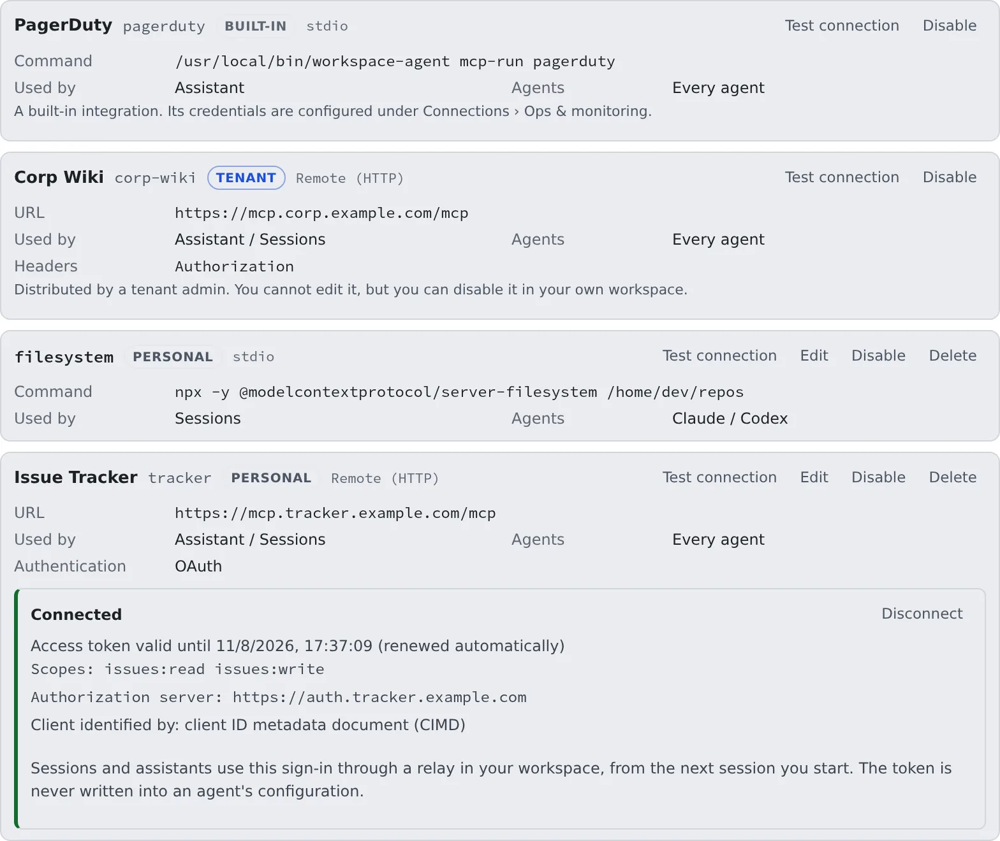

# Add an MCP server to your sessions

English | [日本語](mcp-servers.ja.md)

Register an MCP server and your sessions and assistants can use its tools.
This is where you add tools Agent Fleet does not ship with, such as an internal wiki, an issue tracker or a document search.

## How it works

| What you do | What the agent does |
|---|---|
| Register an MCP server | Uses the server's tools from the next session you start |
| Sign in to an OAuth server | Calls the server through a relay inside your workspace, without ever seeing the token |
| Disable a server you do not need | Does not receive a disabled server |

> [!NOTE]
> These are servers **your sessions use**. To let an outside app drive this Workspace, use
> [MCP tokens & apps](../outside/external-claude.md) under **Outside access**.

## Register a server

Open **⚙ Settings → "MCP servers (used by sessions)"** and press "**Add MCP server**".
The registrations live inside your workspace, so start the workspace first if it is stopped.

| Field | What to enter |
|---|---|
| Display name | The name shown in the list. Optional |
| ID | The server name written into each agent's configuration. Filled in from the display name or the URL host until you edit it yourself |
| Transport | "**Remote (HTTP)**" (the default) or "**stdio**" |
| URL | For a remote server: the MCP endpoint URL |
| Command, Arguments, Environment variables | For stdio: the executable to start inside the workspace, its arguments (one per line) and environment variables |
| Authentication | For a remote server. See [Choose the authentication](#choose-the-authentication) |

- The ID is up to 48 letters, digits, dashes and underscores, starting with a letter or digit. It never changes once registered
- Remote servers are supported over Streamable HTTP only
- Environment-variable and header values are stored encrypted and never shown on screen again. The configuration file handed to the agent that runs the server can still contain them in plain text (a file in your home only you can read, never in a repository)
- A plain `http://` URL to a host other than this machine is accepted, but you get a warning: the token and every request travel unencrypted

> [!WARNING]
> Put credentials such as tokens in **Authentication**, not in the URL. A URL with a user name and password in it is refused.

### Choose the authentication

| Authentication | Use it for |
|---|---|
| None | A server that needs no authentication |
| Bearer token | A server that takes one token. It is sent as `Authorization: Bearer <token>` |
| Custom headers | A server that wants headers with names and values of your choosing |
| OAuth | A server that accepts only an OAuth sign-in. Nothing is typed in the form ([Sign in to an OAuth server](#sign-in-to-an-oauth-server)) |

- A Bearer token pasted with its `Bearer ` prefix is fine
- A saved token is not shown. Leave the field blank to keep it, or type a new one to replace it
- OAuth cannot be combined with fixed headers
- A saved server whose `Authorization` header is not a Bearer token (`Token …`, say) opens as Custom headers

### Advanced

"**Advanced**" starts closed, with the current values on one line beside the title (for example "Assistant, Sessions · Every agent · default timeout"). It opens by itself when you edit a server whose values are not the defaults.

| Field | What it decides |
|---|---|
| Used by | Whether the "**Assistant**", "**Sessions**" or both get the server. Clear both and the entry stays but is handed to nothing |
| Agents | Which kinds of agent get the server. Select none for every agent |
| Timeout (ms) | Between 1000 and 120000. Leave it blank for each agent's default |
| Enabled | Clear it and the definition stays but is handed to nothing |

## Check it with a connection test

"**Test connection**", in the form or on a row, checks that the server answers, even before you save.

- On success you see the server's name, version, tool count and round-trip time, such as "**Connected: example-mcp 1.2.0, 3 tools (214ms)**"
- On failure you see why. Whatever the server itself printed or answered is shown as it is
- When the server asks for an OAuth sign-in, the test says "**OAuth sign-in required**" instead of failing, and lists the
  authorization server, how a client can register and the scopes it found. For a saved server whose authentication is OAuth, you can "**Sign in**" from there

## Sign in to an OAuth server

1. Choose "**OAuth**" under **Authentication** and save the server
2. Press "**Sign in**" on its row. The authorization server opens in a new tab (in this tab, after telling you, if the browser blocks the new one)
3. In that tab, sign in with your own account and approve
4. When the tab says "**You can close this tab**", close it. The row in your Console tab updates by itself

The row reads "**Connected**" when it is done, with when the access token expires (it renews itself), the scopes you
granted and how the client was identified.

| Row state | Meaning |
|---|---|
| Not signed in | You have not signed in yet. No session gets this server yet |
| Connected | Ready to use |
| Sign in again | The saved sign-in can no longer be renewed. Press "**Sign in again**" |
| More permission needed | The server asked for a permission you have not granted. "**Approve the extra permission**" signs in again asking for it on top of what you have |

- The server is handed to sessions and assistants **only while you are signed in**. Like any server, it takes effect from the next session you start
- Sessions use the sign-in through a relay inside your workspace. The token is never written into an agent's configuration
- When the authorization server offers no automatic registration, you see "**A client ID is needed**". Enter the client ID you registered
  there by hand (and the secret, if it has one) and press "**Save and sign in**"
- "**Disconnect**" deletes the saved sign-in, and revokes it at the authorization server when that supports it

## What you can change, by origin

Each row carries a label saying who registered it.

| Label | What it is | What you can do here |
|---|---|---|
| Personal | A server you registered | Test, edit, disable, delete |
| Tenant | A server an administrator distributed to everyone in the tenant | Test, and disable it in your own workspace. You cannot edit or delete it |
| Built-in | Agent Fleet's own server and the ops & monitoring integrations | Test only. You cannot edit, disable or delete it |

- A **tenant** server whose credential each member supplies shows "**Enter values**". The values are stored encrypted in your workspace and never reach the tenant
- A **tenant** server that uses OAuth offers "**Sign in**" like one of your own. The sign-in is yours alone
- The tenant's servers reach your workspace within 5 minutes. To take them in now, press "**Fetch tenant set**"
- A personal registration with the same name as a tenant server is not used. The list then says "**These personal registrations are unused because a tenant-distributed server has the same name**", followed by their names
- The **built-in** Agent Fleet server goes to every session with no setup. Sessions use it to report that they are done or to propose a handoff
- The PagerDuty, Grafana, CloudWatch and AWS integrations appear in the list once you connect them on the **Ops & monitoring** tab

How administrators distribute servers is in [MCP distribution and outside access](../../admin/04-mcp-outside.md).

## Which agents get it

- **Sessions**: a server reaches sessions **from the next session you start**. Running sessions are not affected.
  Agent sessions receive servers; shell and SSM terminals do not. How each kind differs is in the "Receives integration (MCP)
  servers" row of [Agents — what each kind can do](../../ref/agents.md)
- **Assistants**: choose the servers in the assistant's edit form, under "**MCP servers (optional)**"
- A server with **Agents** selected goes only to those kinds of agent

MCP definitions committed in a repository (`.mcp.json` and the like) are not handled on this tab. "**Project settings…**" in the
repository's right-click menu shows how each agent picks them up, with warnings.

## When it goes wrong

### A registered server does not show up in a session

- Running sessions are not affected. Start a new session
- Check whether the row says "**Missing required values, so it is not handed out even while enabled (a header has no value).**" A tenant server whose credential you have not entered says "**No credential entered, so nothing is handed over even while enabled.**" instead: fill it in with "**Enter values**"
- An OAuth server is not handed out until its row reads "**Connected**"
- Check **Used by** and **Agents** under **Advanced**

### The destination is not on the outbound allowlist

Your workspace's outbound traffic is restricted. Press "**Request access**" on the row, give a reason and press "**Send request**".
The server works once an administrator approves it. While egress is log-only it still works, but it stops once enforcement is switched on.

### The sign-in never finishes

The row says a sign-in was started but never finished.

1. Press "**Sign in**" again
2. If "**Retry with dynamic registration**" appears, press it
3. If it still does not get through, ask the server's operator to trust this deployment's host.
   For another Agent Fleet deployment, that is its administrator's trusted client hosts setting

### "This is this deployment's own /mcp endpoint" and the save is refused

This Agent Fleet's own `/mcp` cannot be registered for sessions, because it would hand them your full authority.
Its `/mcp/memory` is refused too: sessions already have memory through the built-in Agent Fleet server. Another Agent Fleet deployment can be registered.

### The timeout has no effect

opencode and Cursor have no equivalent setting, so a timeout is ignored there.

## Related

- [Agents — what each kind can do](../../ref/agents.md): which agents receive MCP servers
- [MCP distribution and outside access](../../admin/04-mcp-outside.md): administrators distribute a server to the whole tenant
- [MCP tokens & apps](../outside/external-claude.md): let an outside app drive this Workspace
