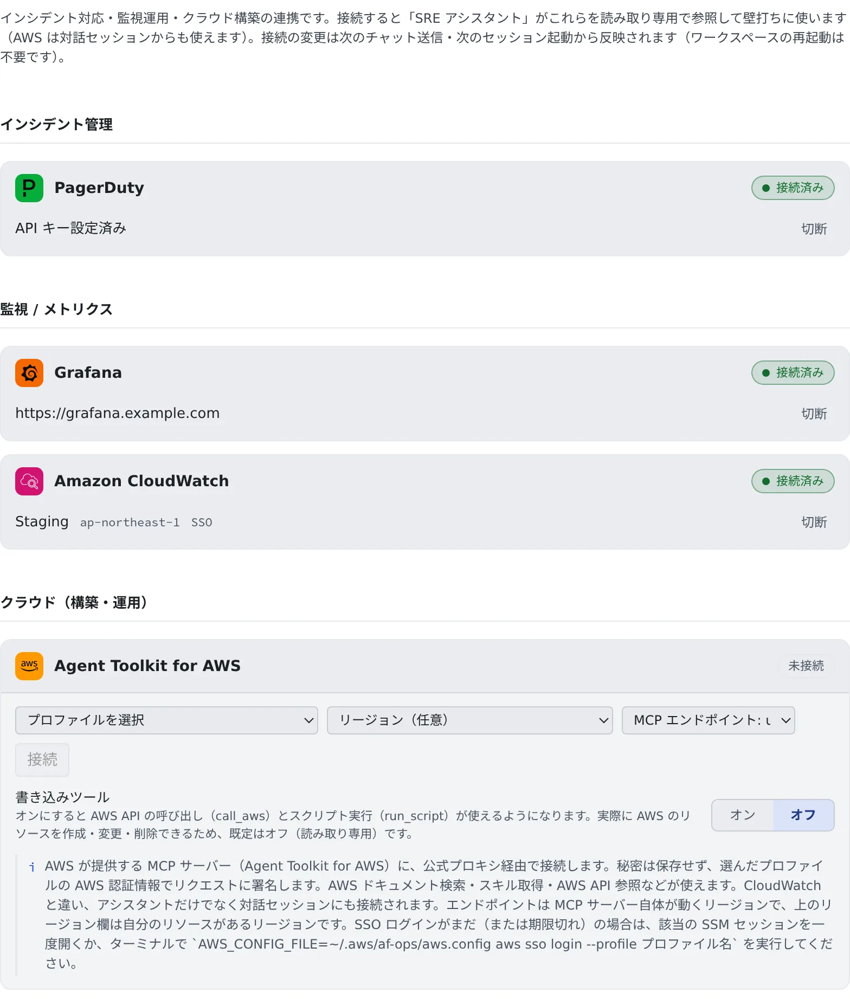

# 監視ツールとつなぐ

[English](ops-monitoring.md) | 日本語

PagerDuty・Grafana・CloudWatch・AWS を接続しておくと、「SRE アシスタント」が実際のインシデントやメトリクス、ログを見ながら、
状況の整理や原因の仮説出しを手伝います。AWS は、コードを書いているセッションのエージェントからも使えます。

## 全体像

| あなたがやること | エージェントがやること |
|---|---|
| ツールを接続する | ツールを MCP サーバーとして起動し、読み取り専用で使う |
| SRE アシスタントにチャットで聞く | インシデントやメトリクスを確かめて、影響・原因の仮説・次の一手をまとめる |
| 復旧の操作は自分でする | 手順を示すだけで、ack や resolve、リソースの変更はしない |

| ツール | 入れるもの | 使えるところ |
|---|---|---|
| PagerDuty | API キー | アシスタント |
| Grafana | URL とサービスアカウントトークン | アシスタント |
| Amazon CloudWatch | AWS プロファイルを選ぶだけ | アシスタント |
| Agent Toolkit for AWS | AWS プロファイルを選ぶだけ | アシスタントと、エージェントのセッション |

## ツールを接続する

**⚙設定 →「運用・監視」** を開き、使うツールのカードに入力して「**接続**」を押します。設定するときは、ワークスペースが起動している必要があります。

### PagerDuty

- **API キー**を貼ります。PagerDuty の Integrations > API Access Keys で「Read-only」を選んで作った、読み取り専用のキーをおすすめします
- PagerDuty に app.eu.pagerduty.com でログインしているときだけ、「**EU リージョン**」をオンにします

### Grafana

- **Grafana の URL** と、**サービスアカウントトークン**を入れます。トークンは Viewer の権限のものをおすすめします
- セルフホストの Grafana、Grafana Cloud、Amazon Managed Grafana のどれでも使えます

**Amazon Managed Grafana のとき**

- URL には、ワークスペースのエンドポイント（`g-xxxx.grafana-workspace.<リージョン>.amazonaws.com`）を入れます
- トークンは、Grafana の管理画面（Administration → Service accounts。管理者の権限が要ります）で作ります。
  IAM の権限があれば、`af-aws-exec` でプロファイルを指定して `aws grafana create-workspace-service-account-token` を実行しても作れます
- IAM や SigV4 の設定は要りません
- トークンの有効期限は最長 30 日です。切れたら、新しいトークンを作ってカードに貼り直します

### CloudWatch

- プルダウンから、**⚙設定 →「AWS プロファイル/SSM」** に登録したプロファイルを選びます。秘密を入れる欄はありません
- リージョンは任意です。空欄ならプロファイルのリージョンを使います
- `~/.aws` を自分で管理しているときは、「**手動入力（自分の ~/.aws のプロファイル）**」を選んでプロファイル名を入れます

### AWS

AWS が提供する MCP サーバー（Agent Toolkit for AWS）につなぎます。AWS のドキュメント検索、スキルの取得、AWS API の参照などが使えます。
プロファイルとリージョンの選び方は CloudWatch と同じで、ほかに 2 つ設定があります。

| 設定 | 内容 |
|---|---|
| MCP エンドポイント | MCP サーバー自体が動くリージョン（`us-east-1` か `eu-central-1`）。自分のリソースがあるリージョンは「リージョン」の欄に入れます |
| 「**書き込みツール**」 | 既定ではオフ（読み取り専用）です。オンにすると AWS API の呼び出し（`call_aws`）とスクリプトの実行（`run_script`）が使えるようになり、**実際に AWS のリソースを作成・変更・削除できます** |

- AWS だけは、アシスタントに加えて、エージェントのセッションにもつながります（シェルと SSM のセッションを除きます）
- 接続したあとで設定を変えるときは、「**切断**」してからつなぎ直します。「書き込みツール」はオフに戻ります

## SRE アシスタントに聞く

アシスタントの「**新規チャット**」から「SRE アシスタント」を選んで、会話を始めます。

> 今開いている PagerDuty のインシデントを一覧して、経緯をまとめて

> このサービスの直近 1 時間のエラーレートを Grafana で見て

> CloudWatch で、このロググループの ERROR を分析して

- アシスタントは事実と推測を分けて、影響範囲 → 原因の仮説 → 次のアクションの順に答えます。対外報告やポストモーテムの下書きも頼めます
- 書き込みの操作（インシデントの ack・resolve、スケジュールの変更、AWS のリソースの変更）はしません。復旧は手順を示すだけです
- SRE アシスタントは組み込みのアシスタントなので、編集はできません

## いつ反映されるか

| 使うところ | 反映されるとき |
|---|---|
| アシスタント | 次にチャットを送ったとき |
| セッション（AWS） | 次にセッションを起動したとき。動いているセッションは変わりません |

どちらも、ワークスペースの再起動は要りません。

## ほかの監視ツールを使う

カードのないツール（Zabbix など）は、[MCP サーバー](mcp-servers.ja.md)として登録します。

1. **⚙設定 →「MCP サーバー（セッションで使う）」** で、そのツールの MCP サーバーを追加します。どのサーバーを使うかは、ツールの案内に従います
2. 「**詳細設定**」の利用先で、チャットで使うなら「**アシスタント**」を、エージェントのセッションで使うなら「**セッション**」を選びます
3. アシスタントで使うときは、自分で作ったアシスタントの編集フォームの「**MCP サーバー（任意）**」で選びます

- 組み込みのアシスタント（SRE アシスタント、フリート・オペレーター、Agent Fleet アシスタント）には足せません。自分のアシスタントを作ってください
- ターミナル（CLI）のセッションで Grafana・PagerDuty・CloudWatch を使いたいときも、同じように MCP サーバーとして登録します
- `claude mcp add` で手作業で足したサーバーは、アシスタントの選択肢に出てきません。登録画面から足してください

## 安全に使う

- **アラートの本文やログは、外部の人が中身を左右できる入力です。** 接続は読み取り専用のまま使ってください
- 書き込みを試すときは、そのためのアシスタントかセッションを分けて、はっきり頼みます
- PagerDuty は読み取り専用のキーを、Grafana は Viewer のトークンをおすすめします。Agent Fleet も、Grafana は書き込み・管理のツールを、
  PagerDuty は書き込みのツールを無効にして起動します
- 接続なしで CloudWatch Logs を読むだけなら、エージェントに [af-aws-exec](../../ref/cli/af-aws-exec.ja.md) でプロファイルを指定して
  `aws logs tail` などを使わせる方法もあります。プロファイルに要るのは、ログの読み取り権限だけです

## 困ったとき

### CloudWatch や AWS のツールが SSO のエラーになる

選んだプロファイルの SSO ログインがまだか、期限が切れています。接続はできても、ツールを使うときにエラーになります。

- **⚙設定 →「AWS プロファイル/SSM」** で、そのプロファイルの「**ログイン**」を押します（[AWS SSO を使う](aws-sso.ja.md#ログインする)）
- または、そのプロファイルの SSM セッションを一度開きます

### Amazon Managed Grafana が急に使えなくなった

トークンの期限（最長 30 日）が切れています。新しいトークンを作り、Grafana のカードを切断してから貼り直してください。

### アシスタントがツールを使わない

- カードが「接続済み」かを確かめます
- 自分で作ったアシスタントでは、編集フォームの「**MCP サーバー（任意）**」で選ばれているかを確かめます

## 関連

- [セッションに MCP サーバーを追加する](mcp-servers.ja.md)：カードのないツールをつなぐ
- [AWS SSO を使う](aws-sso.ja.md)：CloudWatch と AWS が使うプロファイルとログイン
- [Discord・Slack とつなぐ](chat-bridge.ja.md)：セッションの通知をチャットで受ける
