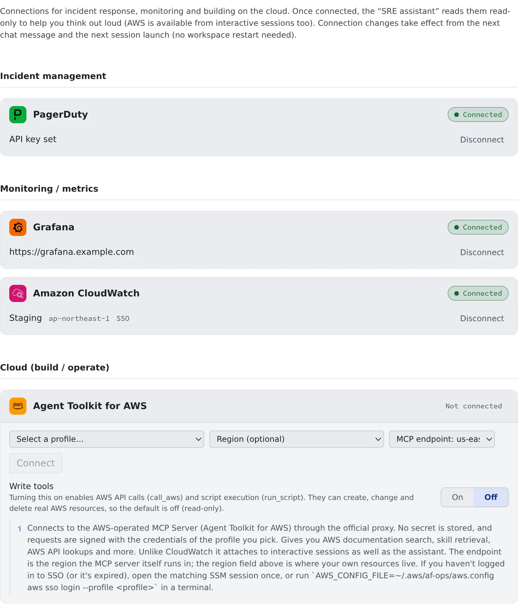

# Connect monitoring tools

English | [日本語](ops-monitoring.ja.md)

Connect PagerDuty, Grafana, CloudWatch and AWS, and the "SRE Assistant" helps you sort out what is happening and form
hypotheses about the cause while it looks at real incidents, metrics and logs. AWS is available to the agents in your
coding sessions as well.

## How it works

| What you do | What the agent does |
|---|---|
| Connect the tools | Starts each tool as an MCP server and uses it read-only |
| Ask the SRE Assistant in a chat | Checks incidents and metrics, then sums up the impact, likely causes and next steps |
| Do the recovery yourself | Gives the steps only; never acks, resolves or changes resources |

| Tool | What you enter | Where it can be used |
|---|---|---|
| PagerDuty | An API key | The assistant |
| Grafana | A URL and a service account token | The assistant |
| Amazon CloudWatch | Just pick an AWS profile | The assistant |
| Agent Toolkit for AWS | Just pick an AWS profile | The assistant and agent sessions |

## Connect the tools

Open **⚙ Settings → "Ops & monitoring"**, fill in the card of the tool you use and press "**Connect**". The workspace
has to be running while you set it up.

### PagerDuty

- Paste an **API key**. A read-only key is recommended: in PagerDuty, choose "Read-only" under Integrations > API Access Keys
- Turn on "**EU region**" only if you log in to PagerDuty at app.eu.pagerduty.com

### Grafana

- Enter the **Grafana URL** and a **service account token**. A token with the Viewer role is recommended
- Self-hosted Grafana, Grafana Cloud and Amazon Managed Grafana all work

**For Amazon Managed Grafana**

- Enter the workspace endpoint as the URL (`g-xxxx.grafana-workspace.<region>.amazonaws.com`)
- Create the token in Grafana's administration screen (Administration → Service accounts; it needs administrator rights).
  With IAM permissions you can also create it with `aws grafana create-workspace-service-account-token`, run through `af-aws-exec` with a profile
- No IAM or SigV4 setup is needed
- The token lasts at most 30 days. When it expires, create a new one and paste it into the card again

### CloudWatch

- Pick a profile you registered in **⚙ Settings → "AWS profiles/SSM"** from the drop-down. There is no secret to enter
- The region is optional. Left empty, the profile's region is used
- If you manage `~/.aws` yourself, choose "**Manual entry (a profile in your own ~/.aws)**" and enter the profile name

### AWS

This connects to the MCP server AWS provides (Agent Toolkit for AWS), for AWS documentation search, skill retrieval,
AWS API lookups and more. You pick the profile and region the same way as for CloudWatch, plus two more settings.

| Setting | What it is |
|---|---|
| MCP endpoint | The region the MCP server itself runs in (`us-east-1` or `eu-central-1`). The region your resources are in goes in the "Region" field |
| "**Write tools**" | Off (read-only) by default. Turning it on enables AWS API calls (`call_aws`) and script execution (`run_script`), which **can create, change and delete real AWS resources** |

- AWS alone is connected to agent sessions as well as the assistant (except shell and SSM sessions)
- To change a setting after connecting, "**Disconnect**" and connect again. "Write tools" goes back to off

## Ask the SRE Assistant

Start a conversation from "**New chat**" in the assistants and pick "SRE Assistant".

> List the PagerDuty incidents that are open now and summarise how they unfolded

> Look at this service's error rate for the last hour in Grafana

> Analyse the ERRORs in this log group in CloudWatch

- The assistant keeps facts apart from guesses and answers in the order impact → likely causes → next actions. It can
  also draft status updates and postmortems
- It does no writes (acking or resolving an incident, changing a schedule, changing AWS resources). For recovery it gives the steps only
- The SRE Assistant is a built-in assistant, so it cannot be edited

## When a change takes effect

| Where it is used | Takes effect |
|---|---|
| The assistant | From your next chat message |
| Sessions (AWS) | From the next session you launch. Sessions already running do not change |

Neither needs a workspace restart.

## Use other monitoring tools

A tool without a card (Zabbix and the like) is added as an [MCP server](mcp-servers.md).

1. In **⚙ Settings → "MCP servers (used by sessions)"**, add the tool's MCP server. Follow the tool's own instructions on which server to use
2. Under "**Advanced**", in Used by, choose "**Assistant**" to use it in chat, or "**Sessions**" to use it in agent sessions
3. To use it in an assistant, pick it under "**MCP servers (optional)**" in the edit form of an assistant you created

- It cannot be added to a built-in assistant (SRE Assistant, Fleet Operator, Agent Fleet Assistant). Create your own assistant
- To use Grafana, PagerDuty or CloudWatch in a Terminal (CLI) session, register their MCP servers the same way
- A server added by hand with `claude mcp add` does not appear among an assistant's choices. Add it from the registration screen

## Use it more safely

- **Alert text and logs are input that outsiders can shape.** Keep these connections read-only
- When you try writes, keep a separate assistant or session for it and ask explicitly
- A read-only key for PagerDuty and a Viewer token for Grafana are recommended. Agent Fleet also starts Grafana with its
  write and admin tools disabled, and PagerDuty with its write tools disabled
- To just read CloudWatch Logs without a connection, have an agent run `aws logs tail` and the like through
  [af-aws-exec](../../ref/cli/af-aws-exec.md) with a profile. The profile needs only permission to read logs

## When it goes wrong

### CloudWatch or AWS tools fail with an SSO error

The chosen profile's SSO login has not happened yet or has expired. Connecting still works, but the tools fail when used.

- Press "**Log in**" on that profile in **⚙ Settings → "AWS profiles/SSM"** ([Use AWS SSO](aws-sso.md#log-in))
- Or open an SSM session of that profile once

### Amazon Managed Grafana suddenly stops working

The token's lifetime (at most 30 days) is over. Create a new token, disconnect the Grafana card and paste it again.

### The assistant does not use the tools

- Check that the card says "Connected"
- For an assistant you created, check that the server is chosen under "**MCP servers (optional)**" in its edit form

## Related

- [Add an MCP server to your sessions](mcp-servers.md): connect a tool that has no card
- [Use AWS SSO](aws-sso.md): the profiles and the login CloudWatch and AWS use
- [Connect Discord and Slack](chat-bridge.md): get session notifications in chat
