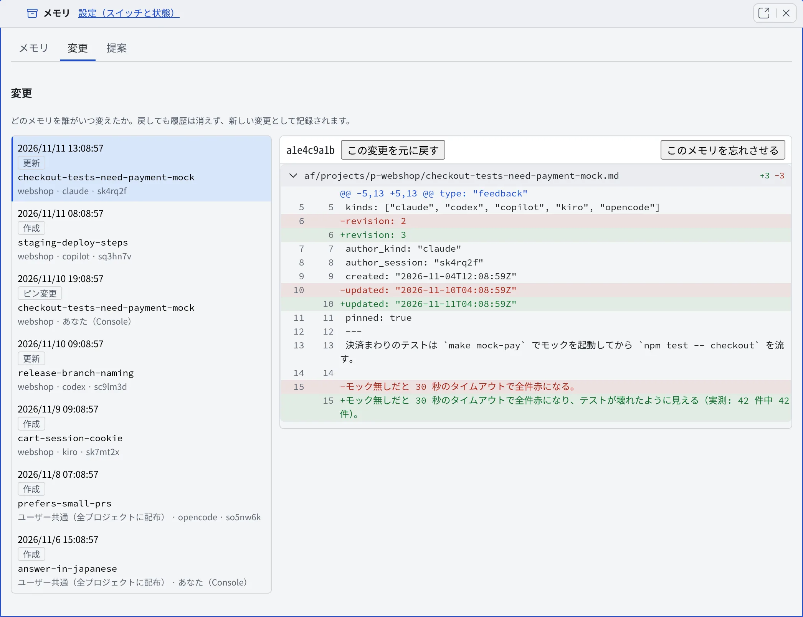

# メモリの変更を確かめる

[English](changes.md) | 日本語

エージェントがメモリに書いた内容は、承認なしですぐにすべてのエージェントに共有されます。
「変更」タブで、どのメモリを誰がいつ変えたかを確かめ、まずい変更を元に戻せます。

## 全体像

| あなたがやること | エージェントがやること |
|---|---|
| 「変更」タブで変更の一覧と差分を読む | メモリを保存するたびに、変更が 1 件記録される |
| まずい変更を元に戻すか、メモリを忘れさせる | 戻した内容・忘れさせた結果を、次に読むときから使う |

戻しても忘れさせても履歴は消えず、その操作も新しい変更として記録されます。そのため、元に戻した操作をさらに元に戻すこともできます。

## 変更の一覧を読む

[メモリビュー](overview.ja.md#メモリビューを開く)の「**変更**」タブを開きます。最新の 100 件が新しい順に並びます。

| 行に出るもの | 内容 |
|---|---|
| 操作 | 「**作成**」「**更新**」「**忘却**」「**元に戻す**」「**取り込み**」「**ピン変更**」「**置き換え**」「**退役**」。リントが書いた変更は `lint`（パスの付け替えは `lint-rename`）と出ます |
| メモリと範囲 | メモリの名前と、プロジェクトか「**ユーザー共通（全プロジェクトに配布）**」か。1 つの変更で複数のメモリが動いたときは「＋ 名前」が続きます |
| 書き手 | エージェントの種類とセッション。あなたの操作は「**あなた（Console）**」です |

- 行を選ぶと、右に差分が出ます。秘密情報らしき記述を含む差分は表示しません
- 「**古い変更を読み込む**」を押すたびに 100 件ずつ、最初の変更まで遡れます
- ターミナルでは `af-memory changes --limit N` で最大 300 件を見られます

## 変更を元に戻す

1. 戻したい変更を選びます
2. 「**この変更を元に戻す**」を押します。メモリをその変更の前の状態に戻します
3. 確認の「**変更を元に戻しますか？**」で「**この変更を元に戻す**」を押します

- 戻せるのは、そのメモリの**最新の**変更だけです。後の変更があると「**このメモリには後の変更があります。元に戻せるのは最新の変更だけです。**」と出ます
- 戻す内容に秘密情報らしき記述があると「**秘密情報らしき記述があります**」が出ます。値は伏せてあります。本物の秘密でないと確かめたときだけ「**確認したので続ける**」を押します

## メモリを忘れさせる

内容を戻すのでなく、メモリそのものをエージェントから見えなくしたいときは、最新の変更を選んで「**このメモリを忘れさせる**」を押します。
忘れさせたメモリは、[メモリビューの「忘れさせた」](overview.ja.md#忘れさせる)から取り消せます。

## 以前のメモリレビューの変更をまとめて戻す

以前のバージョンには、終わったセッションからメモリを提案させるレビューの機能がありました。今はありませんが、そのレビューが公開した変更（作者 `review`）は一覧に残っています。

1. 作者が `review` の変更を選び、「**このレビューの変更を元に戻す**」を押します
2. そのレビューが公開したメモリを、すべて元の状態へ新しい変更として戻します

- レビューのあとで誰かが編集したメモリは、そのまま残して結果に名前を出します
- もう一度実行すると、残りだけを試します

## 困ったとき

### 「この変更には戻せる内容が履歴にありません」と出る

手で置いたファイルを忘れさせた変更など、戻す先の版が履歴にない変更です。元に戻せません。

### 「この変更は元に戻せません」と出る

そのメモリの過去の版を[履歴から消去](overview.ja.md#過去のテキストを履歴から消す)したため、戻す先がありません。メモリを忘れさせることはできます。

## 関連

- [エージェントのメモリを見る・直す](overview.ja.md)：メモリビューでメモリを読む・直す
- [メモリの自動整理を使う](tidy-up.ja.md)：承認した提案も、この一覧に作者「consolidator」の変更として並ぶ
- [古くなったメモリを見つける](lint.ja.md)：リントが書いた変更は作者「lint」で並ぶ
