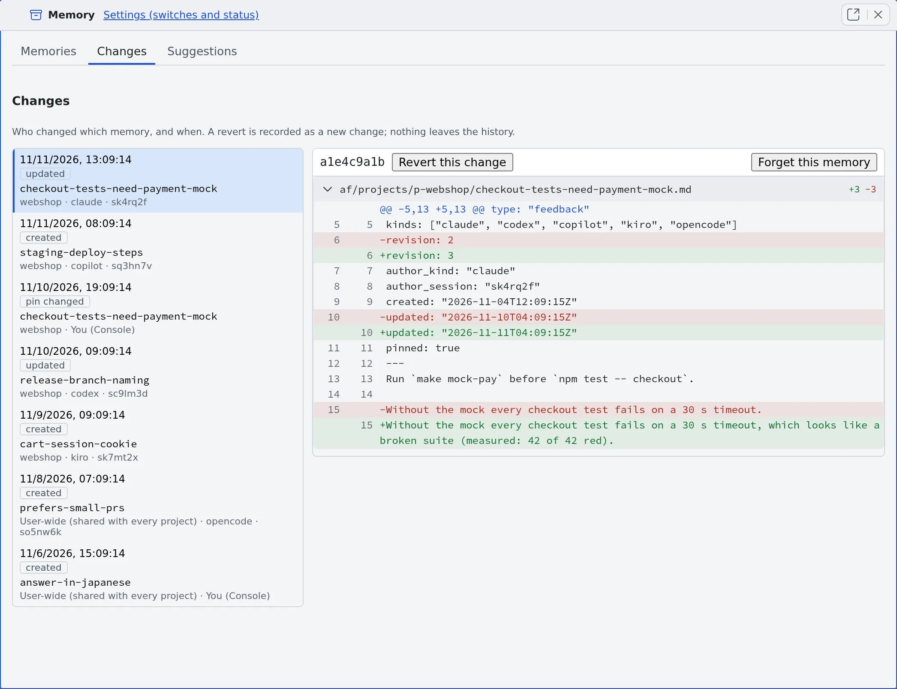

# Check memory changes

English | [日本語](changes.ja.md)

What an agent writes into memory is shared with every agent at once, without your approval.
The Changes tab shows which memory who changed and when, and lets you revert a bad change.

## How it works

| What you do | What the agent does |
|---|---|
| Read the list of changes and their diffs in the Changes tab | Every time it saves a memory, one change is recorded |
| Revert a bad change, or make agents forget the memory | Uses the reverted text, or no longer sees the memory, from its next read |

Reverting and forgetting never erase history: they are recorded as new changes, so the undo can be undone too.

## Read the list of changes

Open the **Changes** tab of the [Memory view](overview.md#open-the-memory-view). The newest 100 changes are listed, newest first.

| What a row shows | Meaning |
|---|---|
| Operation | **created**, **updated**, **forgotten**, **reverted**, **imported**, **pin changed**, **replaced** or **retired**. Changes written by lint show as `lint` (`lint-rename` for a renamed path) |
| Memory and scope | The memory's name, and its project or **User-wide (shared with every project)**. When one change moved several memories, "+ names" follows |
| Author | The agent kind and session. Your own actions show as **You (Console)** |

- Pick a row to see its diff on the right. A diff that holds what looks like a secret is not shown
- **Load older changes** adds 100 more each time, back to the first change
- From a terminal, `af-memory changes --limit N` lists up to 300

## Revert a change

1. Pick the change you want to undo
2. Press **Revert this change**. It brings the memory back to how it was before that change
3. In **Revert this change?**, press **Revert this change**

- Only a memory's **newest** change can be reverted. When it has later changes, "**This memory has later changes. Only the newest change can be reverted.**" appears
- If the text you bring back looks like a secret, **Possible secrets found** appears with the values masked. Press **I checked, continue** only once you are sure it is not a real secret

## Make agents forget a memory

When you want the memory itself out of agents' view rather than its earlier text back, pick its newest change and press **Forget this memory**.
You can undo it from [the Memory view's Forgotten chip](overview.md#forget-a-memory).

## Undo an old memory review's changes at once

Earlier versions had a review that had finished sessions suggest memories. It is gone, but the changes it published (author `review`) remain in the list.

1. Pick a change whose author is `review` and press **Undo this review's changes**
2. Every memory that review published is put back, as new changes

- A memory someone edited after the review is left as it is and named in the result
- Running it again retries only what is left

## When it goes wrong

### "The history holds no text to bring back for this change" appears

The change has no earlier version in the history to go back to, such as the forget of a file put in place by hand. It cannot be reverted.

### "this change cannot be reverted" appears

The memory's past revisions were [purged from the history](overview.md#remove-past-text-from-the-history), so there is nothing to go back to. You can still forget the memory.

## Related

- [Read and correct agent memory](overview.md): read and correct memories in the Memory view
- [Use memory tidy-up](tidy-up.md): approved suggestions show in this list as changes by `consolidator`
- [Find stale memories](lint.md): changes written by lint show with the author `lint`
