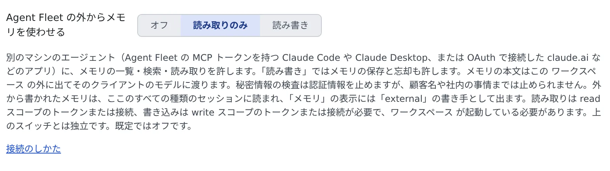

# 外部のエージェントからメモリを使う

[English](external.md) | 日本語

手元のパソコンの Claude Code や Claude Desktop、claude.ai から、Agent Fleet のメモリを探したり、読んだり、保存したりできます。
手元の Claude Code が溜めたメモリを、Agent Fleet のメモリへ持ち込むこともできます。

## 全体像

| あなたがやること | エージェントがやること |
|---|---|
| 外からメモリを使うことを許可する | — |
| 手元のクライアントを `/mcp` か `/mcp/memory` につなぐ | Agent Fleet のメモリのツールを受け取る |
| 「メモリから探して」「メモリに保存して」と頼む | 作業中のリポジトリのプロジェクトで、メモリを検索・保存する |

外から保存したメモリは、ワークスペースのすべての種類のセッションが読みます。メモリの「変更」の表示に並び、そこで元に戻せます。

## 始める前に

1. **⚙設定 →「エージェントメモリ」→「設定」** の「Agent Fleet の外からメモリを使わせる」を選びます。既定は「オフ」です

   

   | 選択 | 外からできること |
   |---|---|
   | オフ | 何もできません |
   | 読み取りのみ | メモリの一覧・検索・読み取り |
   | 読み書き | 読み取りに加えて、保存・部分的な編集・報告・忘却 |

2. ワークスペースを起動しておきます。メモリはワークスペースの中にあるので、止まっている間は使えません

テナント管理者が外からのメモリの利用をブロックしているときは、この設定やトークンにかかわらず、メモリのツールは出てきません
（[管理者向けの説明](../../admin/memory-outside.ja.md)）。

## クライアントをつなぐ

クライアントによって、つなぐ先が違います。

| クライアント | つなぐ先 | つなぎかた |
|---|---|---|
| 手元の Claude Code・Claude Desktop | `/mcp`（セッションのツールも使える）か `/mcp/memory`（メモリだけ） | [トークンを発行する](../outside/external-claude.ja.md#トークンを発行する) |
| claude.ai | **`/mcp/memory`** | [サインインでつなぐ](../outside/oauth-client.ja.md#接続する) |

設定の「接続のしかた」を押すと、「MCP トークン・接続アプリ」が開きます。そのトークンでできることと、この設定へのリンクがあります。

- **トークンのスコープと設定の、狭いほうが効きます。** 読み取りには `read` 以上、保存や忘却には `write` と「読み書き」の両方が要ります
- `/mcp/memory` 向けのトークンや接続は `/mcp` では使えず、その逆も使えません。切り替えるときはつなぎ直します

### claude.ai には /mcp/memory を使う

claude.ai は、そこで追加したコネクタを、アカウントのすべての Claude Code のセッションに渡します。このワークスペースのセッションも含みます。

- `/mcp` のコネクタだと、それらのセッションにあなたのメンバーとしての権限がそのまま渡ります
  （[このデプロイの /mcp をセッションにつながない](../outside/external-claude.ja.md#このデプロイの-mcp-をセッションにつながない)）
- `/mcp/memory` のコネクタが提供するのは、メモリの 8 つのツールだけです。ワークスペースのセッションは同じメモリをもともと使えるので、渡っても増えることはありません
- 確認ページには、アプリが求めているのはメモリだけだと出ます

すでに `/mcp` でつないでいる claude.ai のコネクタは、そのまま動きます。移すときは、claude.ai でそのコネクタを削除し、`/mcp/memory` のアドレスで追加し直します。
`/mcp` は、Claude Desktop やコマンドラインのクライアントのように、自分のパソコンだけで動いてセッションのツールが要るものに使ってください。

## エージェントに頼む

手元のクライアントに、ふだんの言葉で頼むだけです。

> Agent Fleet のメモリから、結合テストの回し方を探して

> このリポジトリは lint の前に `make gen` が要る、と Agent Fleet のメモリに保存して

| ツール | すること | 要るもの |
|---|---|---|
| `memory_projects` | プロジェクトと、そのリポジトリのアドレスを一覧する | 読み取り |
| `memory_index`・`memory_search`・`memory_read` | メモリの索引を見る・探す・読む | 読み取り |
| `memory_save`・`memory_patch` | メモリを保存する・一部を直す | 読み書き |
| `memory_feedback` | 役に立たなかったメモリを報告する | 読み書き |
| `memory_forget` | メモリを忘れさせる | 読み書き |

- **プロジェクトは、作業中のリポジトリで決まります。** エージェントは `git remote get-url origin` の値を渡し、Agent Fleet がそれを各プロジェクトのリポジトリと照合します。
  `https://`・`ssh://`・`git@` のどの書き方でもかまいません
- **保存と忘却には範囲の指定が要ります。** 特定のリポジトリのことは `project`、どのプロジェクトでも成り立つことだけを `user` にします。
  指定がない呼び出しは断られるので、リポジトリだけの事実が全プロジェクトに広がることはありません
- **書くのは事実だけです。** 秘密情報に見える文章は断られます。保存は、ワークスペースの中のエージェントと同じ版の確認・秘密情報の検査・上限を通ります

## 手元の Claude Code のメモリを持ち込む

「取り込み・書き出し」の「Claude Code から取り込む」が読むのは、ワークスペースの中の Claude Code だけです。
手元のパソコンの Claude Code のメモリは、手元の Claude に 1 件ずつ `memory_save` で保存させて持ち込みます。

### 準備する

1. **⚙設定 →「エージェントメモリ」→「設定」** で、「セッションに Agent Fleet のメモリを使わせる」をオンにします。ワークスペースのセッションが、持ち込んだメモリを読むようになります
2. 同じ画面で、「Agent Fleet の外からメモリを使わせる」を「読み書き」にします
3. 手元の Claude Code を、`write` のスコープで `/mcp` につなぎます。サインインでもトークンでもかまいません（[コマンド](../outside/move-work-in.ja.md#始める前に)）
4. そのリポジトリを、ワークスペースの `~/repos` にクローンしておきます。まだメモリがないクローンでも、最初の保存でプロジェクトが始まります

### スキルを保存する

次のスキルを、手元のパソコンに一度だけ保存します。保存先は `~/.claude/skills/af-memory-import/SKILL.md` です。

````markdown
---
name: af-memory-import
description: このプロジェクトの Claude Code のメモリを Agent Fleet のメモリに写す
disable-model-invocation: true
---
このプロジェクトについてあなたが持っているメモリを、Agent Fleet のメモリに写して。自分のメモリのファイルは変更しないこと。

1. `git remote get-url origin` を実行する。以下の呼び出しの `repository` はすべてこの値。agent-fleet の
   `memory_projects` を呼び、このリポジトリが一覧にあるか確かめる（ワークスペースにクローンされたリポジトリは、
   まだメモリがなくても件数 0 で一覧に出る）。なければ、ワークスペースにクローンされていないので、そこで止まって教えて。
2. メモリのディレクトリにあるファイルを、索引の `MEMORY.md` を除いて一覧にする。ファイルごとに名前・type・説明を
   1 つの表で見せ、scope を提案する: このリポジトリについてのことは `project`、どのプロジェクトでも成り立つ事実だけ
   `user`。表について私の OK を待つ。
3. OK したファイルごとに:
   - 名前で `memory_search` を呼ぶ。同じ名前のメモリがあれば `memory_read` で読み、本文が同じなら飛ばす。違えば両方を
     見せて、どちらを残すか聞く。置き換えるときは、読んだ `revision` を渡す。
   - `memory_save` を呼ぶ: `scope`、`repository`、`name`（小文字・数字・`-`・`_`・`.` で 64 文字まで）、
     `description`（1 行）、`type`（`user`・`feedback`・`project`・`reference` のどれか）、`body`（frontmatter を除いた本文）。
   - 秘密情報らしいなどの理由で拒否されたら、言い換えて再送しないこと。理由を控える。
4. 保存したもの・飛ばしたもの・拒否されたものを報告する。
````

### 持ち込む

1. そのリポジトリの手元の Claude Code のセッションで、`/af-memory-import` と入力します
2. Claude が見せる表を確かめて、OK を出します
3. 終わったら、メモリの「変更」の表示を見ます。保存は作成者の種類 `external` で並び、1 件ずつ元に戻せます

- 手元のメモリのファイルは変わりません。その後に手元で覚えたことは手元に残るので、必要になったらもう一度実行します。本文が同じメモリは飛ばされます
- 指示ファイル（`CLAUDE.md`）はメモリではありません。書いてあることは **⚙設定 →「エージェントへの指示」** に移すか、リポジトリのファイルのままにしてください

## 記録に残るもの・外に出るもの

| 何が | どうなるか |
|---|---|
| 外から保存したメモリ | メモリの一覧に、作成者の種類 `external` で並びます。コミットには、クライアントが名乗った名前が参考として残ります |
| 外からの保存・部分的な編集・報告・忘却 | 監査ログに、プロジェクトの ID と一緒に残ります。メモリの名前は残りません |
| メモリの本文 | そのクライアントのモデルに渡り、ワークスペースの通信制御の外に出ます |

秘密情報の検査は認証情報を止めますが、顧客名や社内の事情までは止めません。外に出してよい内容か、考えてから許可してください。

## うまくいかないとき

### メモリのツールが出てこない

次を順に確かめます。

1. 「Agent Fleet の外からメモリを使わせる」が「オフ」になっていないか
2. トークンや接続のスコープが足りているか（保存には `write`）
3. テナント管理者がブロックしていないか。ブロックされていると、設定やスコープにかかわらずツールは出ません。わからなければ管理者に確かめます

### 「ワークスペースを起動してください」と返る

ワークスペースが止まっています。Console で起動してから、もう一度頼んでください。

### リポジトリが見つからないと断られる

| 状況 | すること |
|---|---|
| ワークスペースにクローンしていない | `~/repos` にクローンしてから、もう一度保存します |
| 同じリポジトリのクローンが 2 つ以上ある | `memory_projects` の ID を `project` として渡します |
| 自分で運用している Git サーバーのリポジトリ | 照合できるのは github.com・gitlab.com・bitbucket.org・codeberg.org だけです。`project` を渡します |

### 保存が「scope」の指定を求めて断られる

範囲の指定がない保存・忘却は断られます。エージェントに、リポジトリのことなら `project`、全プロジェクトのことなら `user` で保存し直すよう頼んでください。

## 関連

- [外部の Claude からワークスペースを動かす](../outside/external-claude.ja.md)：トークンの発行と、手元の Claude Code への登録
- [リモートの MCP クライアントをサインインでつなぐ](../outside/oauth-client.ja.md)：claude.ai などをトークンなしでつなぐ
- [メモリを取り込む・書き出す](import-export.ja.md)：ワークスペースの Claude Code や muse のメモリを取り込む
