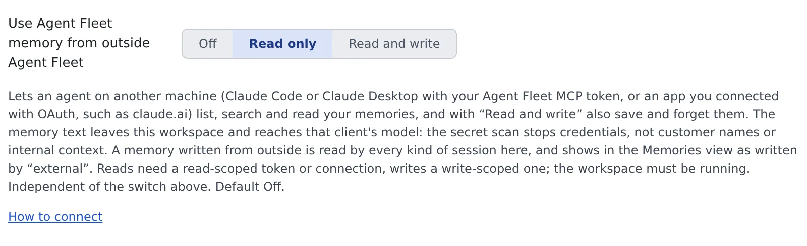

# Use memory from an external agent

English | [日本語](external.ja.md)

Search, read and save Agent Fleet memory from Claude Code or Claude Desktop on your own computer, or from claude.ai.
You can also bring the memory your own Claude Code kept into Agent Fleet memory.

## How it works

| What you do | What the agent does |
|---|---|
| Allow memory to be used from outside | — |
| Connect your client to `/mcp` or `/mcp/memory` | Receives the Agent Fleet memory tools |
| Ask it to "search the memory" or "save this to the memory" | Searches and saves memory in the project of the repository it works in |

A memory saved from outside is read by every kind of session in the workspace. It shows in the memory Changes view, where you can revert it.

## Before you start

1. In **⚙ Settings → Agent memory → Settings**, choose "Use Agent Fleet memory from outside Agent Fleet". It is Off by default

   

   | Choice | What an outside client can do |
   |---|---|
   | Off | Nothing |
   | Read only | List, search and read memories |
   | Read and write | Read, and also save, patch, report and forget |

2. Keep the workspace running. The memory lives inside it, so it cannot be used while the workspace is stopped

If your tenant administrator has blocked memory from outside, the memory tools never appear, whatever this setting and your token say
([for administrators](../../admin/memory-outside.md)).

## Connect a client

Where you connect depends on the client.

| Client | Connect to | How |
|---|---|---|
| Claude Code or Claude Desktop on your computer | `/mcp` (session tools too) or `/mcp/memory` (memory only) | [Issue a token](../outside/external-claude.md#issue-a-token) |
| claude.ai | **`/mcp/memory`** | [Connect by signing in](../outside/oauth-client.md#connect) |

The setting's "How to connect" opens MCP tokens & apps, which lists what a token can do and links back to this setting.

- **The narrower of the token's scope and the setting wins.** Reading needs `read` or higher; saving and forgetting need both `write` and "Read and write"
- A token or connection made for `/mcp/memory` does not work on `/mcp`, and the other way round. To switch, connect again

### Use /mcp/memory for claude.ai

claude.ai hands every connector you add there to all the Claude Code sessions of your account, including the sessions in this workspace.

- A connector to `/mcp` would give those sessions your full member authority
  ([Do not connect this deployment's /mcp to a session](../outside/external-claude.md#do-not-connect-this-deployments-mcp-to-a-session))
- A connector to `/mcp/memory` serves the eight memory tools and nothing else. The workspace's sessions already use the same memory, so it gives them nothing new
- The consent page says the app is asking for your memory only

A claude.ai connector you already have on `/mcp` keeps working. To move it, remove it in claude.ai and add it again with the `/mcp/memory` address.
Keep `/mcp` for a client that runs only on your own computer and needs the session tools, such as Claude Desktop or a command-line client.

## Ask the agent

Just ask your client in plain words.

> Search my Agent Fleet memory for how we run the integration tests

> Save to Agent Fleet memory that this repo's lint step needs `make gen` first

| Tool | What it does | Needs |
|---|---|---|
| `memory_projects` | Lists the projects and their repository addresses | Read |
| `memory_index`, `memory_search`, `memory_read` | Show the index of memories, search, read | Read |
| `memory_save`, `memory_patch` | Save a memory, change part of one | Read and write |
| `memory_feedback` | Report a memory that failed you | Read and write |
| `memory_forget` | Forget a memory | Read and write |

- **The project follows the repository being worked in.** The agent passes the output of `git remote get-url origin`, and Agent Fleet matches it against each project's repository.
  `https://`, `ssh://` and `git@` spellings all work
- **Saving and forgetting need a scope.** Use `project` for something about one repository, and `user` only for something that holds in every project.
  A call without one is refused, so a fact about one repository cannot spread to every project by mistake
- **Write facts only.** Text that looks like a secret is refused. A save goes through the same revision check, secret scan and limits as an agent's save inside the workspace

## Bring your own Claude Code's memory in

Import from Claude Code, under Import & export, reads only the Claude Code inside the workspace.
The memory of Claude Code on your own computer comes across by having that Claude save each memory with `memory_save`.

### Prepare

1. In **⚙ Settings → Agent memory → Settings**, turn on "Let sessions use Agent Fleet memory", so the workspace's sessions read what you bring in
2. On the same screen, set "Use Agent Fleet memory from outside Agent Fleet" to "Read and write"
3. Connect Claude Code on your computer to `/mcp` with the `write` scope, by signing in or with a token ([commands](../outside/move-work-in.md#before-you-start))
4. Clone the repository under `~/repos` in the workspace. A clone that holds no memory yet is started as a project by the first save

### Save the skill

Save this skill once on your computer, at `~/.claude/skills/af-memory-import/SKILL.md`.

````markdown
---
name: af-memory-import
description: Copy this project's Claude Code memory into Agent Fleet memory
disable-model-invocation: true
---
Copy the memory you keep for this project into Agent Fleet memory. Change nothing in your own memory files.

1. Run `git remote get-url origin`; that is `repository` for every call below. Call agent-fleet
   `memory_projects` and check that it lists this repository (a repository cloned in the workspace is listed even before it holds any
   memory, with a count of 0). If it does not, the repository is not cloned in the workspace: stop and tell me.
2. List the files in your memory directory, except the index `MEMORY.md`. For each file, show me its name,
   type and description in one table, and propose a scope: `project` for anything about this repository,
   `user` only for a fact that holds in every project. Wait for my OK on the table.
3. For each file I approved:
   - Call `memory_search` with its name. If a memory of that name exists, `memory_read` it; when the text is
     the same, skip it; when it differs, show me both and ask which to keep. To replace it, pass the
     `revision` you read.
   - Call `memory_save` with `scope`, `repository`, `name` (lower case; letters, digits, `-`, `_`, `.`;
     at most 64 characters), `description` (one line), `type` (`user`, `feedback`, `project` or `reference`)
     and `body` (the file's text without its frontmatter).
   - If a save is refused, for example as a possible secret, do not retry it in other words. Note the reason.
4. Report what was saved, skipped and refused.
````

### Bring it in

1. In a Claude Code session of that repository on your computer, type `/af-memory-import`
2. Check the table Claude shows you and give your OK
3. When it has finished, look at the memory Changes view. The saves are listed with author kind `external`, and each can be reverted

- Your own memory files are not changed. What your own Claude Code learns later stays there, so run the skill again when you need it. A memory with the same text is skipped
- Instruction files (`CLAUDE.md`) are not memory. Put what they say in **⚙ Settings → Agent instructions**, or keep the repository's own file in the repository

## What is recorded and what leaves

| What | What happens |
|---|---|
| A memory saved from outside | Listed in the memories with author kind `external`. The commit carries the name the client gave for itself, for information only |
| Each save, patch, report and forget from outside | Written to the audit log with the project id. The memory's name is not |
| The memory text | Reaches that client's model, outside the workspace's egress controls |

The secret scan stops credentials, not customer names or internal context. Think about whether the content may leave before you allow it.

## When it goes wrong

### The memory tools do not appear

Check these in order.

1. "Use Agent Fleet memory from outside Agent Fleet" is not Off
2. The token's or connection's scope is enough (`write` to save)
3. Your tenant administrator has not blocked it. When they have, no tool appears, whatever the setting and the scope say. Ask them if you are not sure

### The answer says to start the workspace

The workspace is stopped. Start it in the Console and ask again.

### A save is refused because the repository is not found

| Situation | What to do |
|---|---|
| It is not cloned in the workspace | Clone it under `~/repos` and save again |
| The workspace has two or more clones of it | Pass an id from `memory_projects` as `project` |
| It is on a Git server you run yourself | Only github.com, gitlab.com, bitbucket.org and codeberg.org are matched. Pass `project` |

### A save is refused asking for a scope

A save or forget without a scope is refused. Ask the agent to save again with `project` for something about the repository, or `user` for something about every project.

## Related

- [Drive your workspace from an external Claude](../outside/external-claude.md): issue a token and register it in your own Claude Code
- [Connect a remote MCP client by signing in](../outside/oauth-client.md): connect claude.ai and others without a token
- [Import and export memory](import-export.md): import the memory of the workspace's Claude Code or muse
