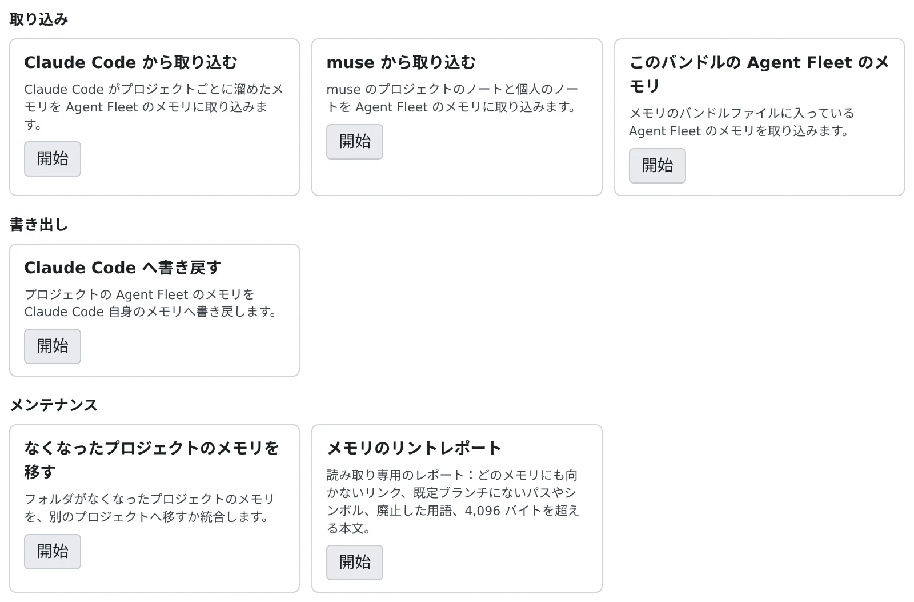

# メモリを取り込む・書き出す

[English](import-export.md) | 日本語

Claude Code や muse が溜めたメモリを、Agent Fleet のメモリへ一度で持ち込めます。
逆に Agent Fleet のメモリを Claude Code へ書き戻したり、フォルダが変わったプロジェクトのメモリを移したりもできます。

## 全体像

| あなたがやること | エージェントがやること |
|---|---|
| 取り込み元とプロジェクトを選び、プレビューを見て確定する | 取り込んだメモリを、次のセッションから Agent Fleet のメモリのツールで読む |
| Claude Code へ書き戻す | Agent Fleet のメモリを使わない Claude Code のセッションが、書き戻したファイルを読む |
| なくなったプロジェクトのメモリを、代わりのプロジェクトへ移す | 移した先のプロジェクトのセッションが、そのメモリを読む |

どの操作も、確定するまで何も書きません。取り込んだメモリや移したメモリは、メモリの「変更」の表示に 1 件ずつ並び、そこで元に戻せます。

## 画面を開く

**⚙設定 →「エージェントメモリ」→「取り込み・書き出し」** を開きます。ワークスペースが止まっているときは使えないので、先に起動してください。



| グループ | カード | できること |
|---|---|---|
| 取り込み | Claude Code から取り込む | [Claude Code が溜めたメモリを取り込む](#claude-code-から取り込む) |
| 取り込み | muse から取り込む | [muse のメモを取り込む](#muse-から取り込む) |
| 取り込み | このバンドルの Agent Fleet のメモリ | [バンドルに入っている Agent Fleet のメモリを取り込む](#バンドルの-agent-fleet-のメモリを取り込む) |
| 書き出し | Claude Code へ書き戻す | [Agent Fleet のメモリを Claude Code へ写す](#claude-code-へ書き戻す) |
| メンテナンス | なくなったプロジェクトのメモリを移す | [フォルダが変わったプロジェクトのメモリを移す](#なくなったプロジェクトのメモリを移す) |
| メンテナンス | メモリのリントレポート | 古くなったメモリを見つける（読み取り専用のレポート） |

カードの「**開始**」を押すと、その場で手順の画面に切り替わります。どの手順も同じ流れです。

1. **元の選択**：取り込み元やプロジェクトを選びます
2. **プレビュー**：何が起きるかが、状態ごとに件数付きで並びます
3. **確認**・**適用**：確定すると書き込みます
4. **結果**：終わったら「**取り込み・書き出しに戻る**」でカードの一覧に戻ります

途中でやめるときは「**キャンセル**」を押します。適用中は押せません。

## Claude Code から取り込む

ワークスペースの Claude Code がプロジェクトごとに溜めたメモリを、Agent Fleet のメモリへ一度だけ取り込みます。

1. 「Claude Code から取り込む」の「**開始**」を押します
2. Claude のプロジェクトを選びます。取り込み先は `~/repos` にある、対応する作業コピーのプロジェクトです
3. プレビューを確かめて、「**{n} 件を取り込む**」を押します

| プレビューの状態 | 取り込むと |
|---|---|
| 新規 | 追加します |
| Claude 側が新しい（上書き） | Agent Fleet 側の写しを上書きします。取り込み後に自分で直していても上書きするので、両方の時刻が出ます |
| 変更なし | 何もしません |
| 忘れ済み（取り込まない） | 忘れたメモリや、取り込みを取り消したメモリは二度と戻しません |
| 秘密情報の疑い（取り込まない） | 伏せた検出結果が出ます。Claude 側のファイルを直して、プレビューし直してください。通す方法はありません |
| 取り込めない | 理由が出ます |

- **取り込むには、Agent Fleet のメモリのスイッチがオンである必要があります。** プレビューはオフでも見られます
- 何も切り詰めずに取り込みます。名前・説明（2,000 文字まで）・本文（200 KiB まで）が上限内の、通常のテキストファイルが対象です
- `~/repos` に対応する作業コピーがない、または 2 つ以上あるプロジェクトは、一覧に出ますが取り込めません
- 取り込んだメモリは書き手が不明として記録され、メモリの一覧に「取り込み」として並びます

スイッチをオンにすると、Claude Code 自身のメモリは自動で取り込まれます。この画面は、それとは別に手で取り込みたいときに使います。

## muse から取り込む

Muse Code が溜めたメモを、Agent Fleet のメモリへ一度だけ取り込みます。流れは Claude Code の取り込みと同じで、muse のフォルダを選び、プレビューを見て確定します。

muse には保存先が 3 つあり、どれも一覧に出ます。

| 保存先 | 取り込み先 |
|---|---|
| プロジェクトのメモ（作業コピーの `.agents/memory`） | その作業コピーのプロジェクト |
| personal project のメモ（muse 自身の作業コピー別のフォルダ） | `~/repos` の対応する作業コピーのプロジェクト |
| personal のメモ | ユーザー全体のメモリ。**すべてのプロジェクトのセッションが読みます** |

- **personal のメモは、チェックを入れるまで見ません。** 「これらをユーザー全体のメモリへ取り込む。すべてのプロジェクトのセッションが読むようになります。」に
  チェックを入れたときだけ、プレビューと取り込みをします。ほかの保存先がユーザー全体のメモリへ入ることはありません
- **「共有」と付いたメモに注意してください。** `.agents/memory` はリポジトリの中にあり、git が追跡しているファイルはチームメンバーも持っています。
  取り込むと、その文章があなたのセッションが読むメモリへ写ります
- **フロントマターは要りません。** 名前はファイル名、説明は最初の空でない行、種別はなしになり、「フロントマターなし」と付きます。
  フォルダの中のメモは `a/b.md` → `a--b` のように名前が付きます
- 取り込みの実行にはスイッチのオンが必要です。プレビューはオフでも見られます

| プレビューの状態 | 取り込むと |
|---|---|
| 新規 | 追加します |
| muse 側が新しい（上書き） | Agent Fleet 側の写しが、この取り込みで書いたままのときだけ更新します |
| Agent Fleet 側に独自の版あり（取り込まない） | 取り込み後に Agent Fleet で保存・編集・ピン留め・取り消しをしたメモリや、muse 由来でない同じ名前のメモリには触りません |
| 変更なし | 何もしません |
| 忘れ済み（取り込まない） | 忘れたメモリは戻しません |
| 秘密情報の疑い（取り込まない） | 取り込まずに一覧に出します |
| 取り込めない | 名前が使えない、同じ名前になるファイルが 2 つある、など |

`MEMORY.md`、`.md` 以外のファイル、シンボリックリンクはメモとして扱いません。Agent Fleet から muse へは書き戻しません。

## バンドルの Agent Fleet のメモリを取り込む

[メモリのスナップショット](snapshots.ja.md#書き出す)で書き出したバンドルには、Agent Fleet のメモリも入っています。
スナップショットとしてバンドルを取り込んでもそれは書き込まれないので、このカードで取り込みます。

1. 「このバンドルの Agent Fleet のメモリ」の「**開始**」を押します
2. メモリのバンドルファイルを選びます。tar.gz には Agent Fleet のメモリが入っていないので、受け付けません
3. プレビューを確かめて、「**{n} 件を取り込む**」を押します

| プレビューの状態 | 取り込むと |
|---|---|
| 新規 | 追加します |
| すでにある | 何もしません |
| ここでは内容が違う（そのまま） | 同じ名前のメモリがここにあれば、置き換えません |
| ここで忘れ済み（戻しません） | 履歴にしか残っていないものも含めて、戻しません |
| 秘密情報らしき記述（スキップ） | ファイル全体を検査します。通す方法はありません |
| 取り込めません | 理由が出ます |

- バンドルの各プロジェクトは、ここのプロジェクトと対応づけます。パスが違うときは、リポジトリのアドレスが同じプロジェクトがここにちょうど 1 つあれば対応づけます。
  対応がない、または 2 つ以上あるプロジェクトは取り込みません。ユーザー全体のメモリはいつも対象です
- 取り込むのは、各メモリの最新の本文とエージェントの制限だけです。バンドルの履歴は取り込みません
- リビジョン（ここでの次の番号から）、作成者（不明）、日時（取り込んだ時刻）、ピン留め、読まれた回数は引き継ぎません。元の出所は記録されます
- スイッチがオンでもオフでも使えます。取り込みは監査ログに残ります

## Claude Code へ書き戻す

プロジェクトの Agent Fleet のメモリを、Claude Code 自身のメモリへ一度だけ写します。対象は Claude Code だけです。

スイッチをオフにすると、全プロジェクトの書き戻しは自動で行われます。この画面は、それが残した競合を片付けるときや、
Claude Code 自身のメモリをオンに戻したあとに使います。

1. 「Claude Code へ書き戻す」の「**開始**」を押します
2. Agent Fleet のプロジェクトを選びます
3. プレビューを確かめ、上書きしたい競合があればチェックを入れて、「**書き戻す（{n} 件の変更）**」を押します

| プレビューの状態 | 書き戻すと |
|---|---|
| Claude にない（新規） | ファイルを作ります |
| Agent Fleet 側が新しい（更新） | 前に書き戻したファイルを更新します |
| Agent Fleet で忘れ済み（削除） | 前に書き戻したファイルを消します |
| 競合（チェックしない限り残す） | Agent Fleet が書いていない、または書いたあとに Claude 側で変わったファイルです。チェックしたものだけ置き換えます |
| 秘密情報の疑い（書かない） | 書きません |
| 変更なし | 何もしません |
| Claude にだけある（残す） | 消しません |

- **書く前に、Claude のメモリをスナップショットに残します**（契機「書き戻し前」）。[メモリのスナップショット](snapshots.ja.md#ある時点に戻す)の履歴から戻せます
- `MEMORY.md` は Claude の読み込み上限（200 行・24 KiB）に収まるように作り直し、古いものと置き換えます
- ユーザー全体のメモリと、ほかの種類のエージェントに限ったメモリは書きません
- Claude がファイルの `metadata` に記録した項目（`originSessionId` など）は、更新しても残します
- スイッチがオンのときは、オンにする前から動いている Claude Code のセッションを先に終了してください。Claude Code 自身のメモリに書き込み続けていることがあります

## なくなったプロジェクトのメモリを移す

プロジェクトはリポジトリのフォルダに結び付いています。リポジトリの名前を変えた、移動した、クローンし直したときは新しい空のプロジェクトになり、
古いプロジェクトのメモリはどのセッションからも読めなくなります。そのメモリを、代わりのプロジェクトへ移します。

1. 「なくなったプロジェクトのメモリを移す」の「**開始**」を押します
2. 「移動元」に、作業コピーがなくなったプロジェクトを選びます（メモリの件数が出ます）
3. 「移動先」に、代わりのプロジェクトを選びます（メモリがあるか、`~/repos` に作業コピーがあるもの）
4. プレビューを確かめて、「**{n} 件のメモリを移す**」を押します

同じリポジトリをクローンし直した作業コピーがちょうど 1 つあれば、移動先の候補として出ます。「**移動を確認する**」を押すと 2 つの欄が埋まり、
プレビューが出ます。確定するまで何も移しません。

| プレビューの状態 | 移すと |
|---|---|
| 移す | 移します |
| 移動先に同じものあり（古い方だけ消す） | 本文が同じなので、古いほうを消すだけです |
| 移動先で名前が使われている | 上書きはしません。「移さずそのまま残す」か「別の名前で移す」を選びます |

- 別の名前は `<名前>-moved`、次は `<名前>-moved-2`、`<名前>-moved-3` … です
- プレビューのあとに変わったメモリや、秘密情報らしき内容を含むファイルは、古いプロジェクトに残ります
- メモリ 1 件ごとに、「変更」の表示に各プロジェクト 1 件ずつ、計 2 件が並びます。どちらも元に戻せます
- 途中で止まっても何も失われません。プレビューからもう一度移すと、止まったところから終わります
- この操作は Console からだけ実行できます

作業コピーがなくなったと分かっているプロジェクトだけが「移動元」に出ます。マウントしていないディスクのフォルダのように判断できないものは出ません。

## ターミナルから使う

Claude Code と muse の取り込みと Claude Code への書き戻しは、ワークスペースのターミナルから `af-memory` でもできます。
スイッチと秘密情報の検査は Console と同じです。

```sh
af-memory import-sources                          # 取り込める Claude のプロジェクト
af-memory import --project <slug> --dry-run       # プレビュー
af-memory import --project <slug>                 # 取り込む
af-memory export --project <ID か名前> --dry-run  # 書き戻しのプレビュー
```

すべてのサブコマンドとオプションは [af-memory](../../ref/cli/af-memory.ja.md) にあります。

## 困ったとき

### 「取り込む」が押せない

Agent Fleet のメモリのスイッチがオフです。**⚙設定 →「エージェントメモリ」→「設定」** の「セッションに Agent Fleet のメモリを使わせる」をオンにしてください。
バンドルの取り込みと書き戻しは、オフでも使えます。

### 「~/repos に対応する作業コピーがありません」と出る

そのリポジトリがワークスペースにクローンされていません。`~/repos` にクローンしてから、プレビューし直してください。
「対応する作業コピーが複数あります」のときは、同じリポジトリのクローンが 2 つ以上あります。

### 「秘密情報の疑い」で取り込めない

検出された箇所を元のファイルで直し、プレビューし直してください。検査を飛ばして取り込む方法はありません。

### 書き戻しのあとに「新しい編集を元の場所に戻せず…」と出る

書き戻しの最中に Claude 側のファイルが変わりました。あなたの新しい編集は、Claude のメモリのディレクトリに表示された名前で残っています。手で元の場所へ戻してください。

### 移動が途中で止まった

何も失われていません。止まったメモリは、両方のプロジェクトにあるか、古いプロジェクトに残っています。プレビューからもう一度移すと、続きを終えられます。

## 関連

- [スナップショットでメモリを戻す](snapshots.ja.md)：Claude Code や Codex 自身のメモリの履歴と、バンドルの書き出し
- [外部のエージェントからメモリを使う](external.ja.md)：手元のパソコンの Claude Code のメモリを持ち込む
- [af-memory](../../ref/cli/af-memory.ja.md)：ターミナルからの取り込み・書き戻し・リント
