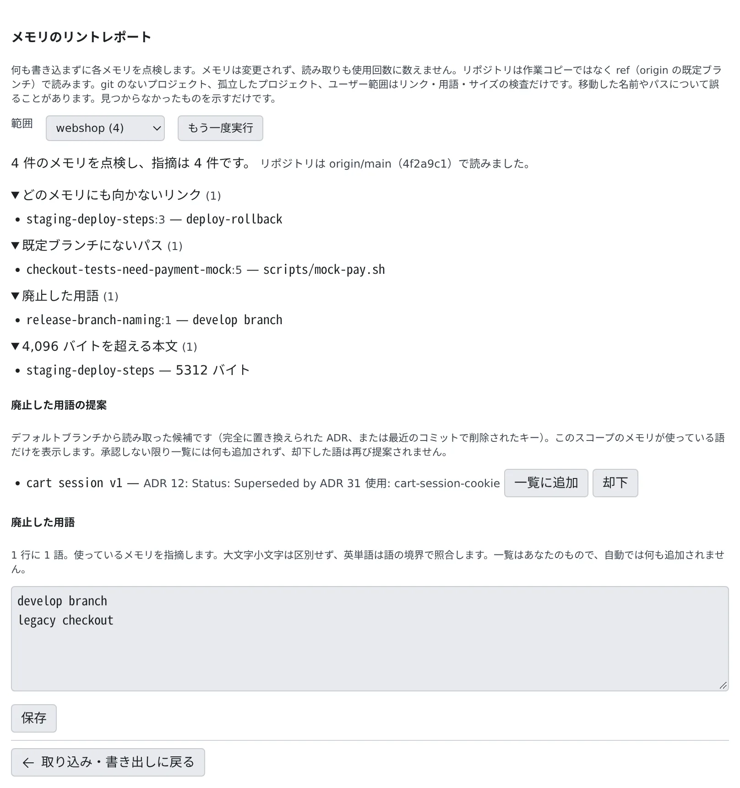

# 古くなったメモリを見つける

[English](lint.md) | 日本語

メモリは、コードが変わると黙って古くなります。リントレポートで、なくなったパスや廃止した用語を使っているメモリを見つけられます。
見つけた指摘をメモリに書き込むと、エージェントはそのメモリを「要確認」として読みます。

## 全体像

| あなたがやること | エージェントがやること |
|---|---|
| リントレポートで、範囲ごとにメモリを点検する | （何もしない。レポートは何も書き込まない） |
| `af-memory lint --apply` か「lint の自動マーク」で、指摘をメモリに書き込む | 指摘のあるメモリを読むとき、理由つきの「要確認」として受け取る |
| 古い・間違っていると報告されたメモリを直す | 裏切られたメモリを `memory_feedback` で報告する |

## リントレポートを見る

1. **⚙設定 →「エージェントメモリ」→「取り込み・書き出し」** を開きます
2. 「メンテナンス」の「**メモリのリントレポート**」で「**開始**」を押します
3. 「**範囲**」で、プロジェクトか「**ユーザーのメモリ**」を選びます

レポートは点検するだけで、何も書き込みません。メモリは変わらず、読んでも使用回数に数えません。ターミナルでは `af-memory lint [--user | --project <ID か名前>] [--json]` で同じレポートが出ます。範囲を指定しないと、すべての範囲を点検します。

| 指摘 | 意味 |
|---|---|
| どのメモリにも向かないリンク | 存在しないメモリへの `[[リンク]]` |
| 既定ブランチにないパス | リポジトリのパスが既定ブランチにない（先頭のフォルダがリポジトリにあるパスだけが対象） |
| 既定ブランチのどこにもないシンボル | バッククォートで囲んだ `Test*` やコードらしい名前が見つからない |
| 記録のない ADR 番号 | `ADR 0123` のような番号の記録がない |
| 廃止した用語 | あなたの「廃止した用語」の一覧にある語を使っている |
| 4,096 バイトを超える本文 | ほかのセッションが想起で見る範囲を超えている |

- リポジトリは作業コピーではなく、`origin` の既定ブランチを読みます。fetch はしないので、クローンが古いと答えも古くなります。読んだ ref とコミットはレポートに出ます
- git のないプロジェクト、作業コピーがなくなったプロジェクト、ユーザーのメモリは、リンク・用語・サイズだけを点検します
- 名前を変えたパスやシンボルも「ない」と出ます。指摘は断定ではなく、確かめるきっかけとして読んでください

### 廃止した用語を登録する

「**廃止した用語**」の欄に、もう使わない語を 1 行に 1 語ずつ書きます。大文字小文字は区別せず、英単語は語の境界で照合します。

- 一覧はあなたのものです。自動で何かが加わることはありません
- 「**廃止した用語の提案**」に、既定ブランチから見つけた候補（完全に置き換えられた ADR の名前、最近のコミットで消えた `AF_*` のキー）が根拠つきで出ます。この範囲のメモリが使っている語だけです
- 提案は「**一覧に追加**」で一覧に入り、「**却下**」すると二度と提案されません

## 指摘をメモリに書き込む

ターミナルで `af-memory lint --apply`（範囲の指定はレポートと同じ）を実行すると、レポートの指摘をメモリに書き込みます。

- リンク・パス・シンボル・ADR・廃止した用語の指摘が、メモリの理由（`reasons`）になります。サイズの指摘は書きません
- 理由のあるメモリは「要確認」になり、エージェントがどこで読んでも理由が添えられます。Claude Code への書き戻しからも外れます
- 変更はメモリ 1 件ごとに作者「lint」の変更として[変更](changes.ja.md)に並び、元に戻せます
- 1 回に書くのは最大 100 件です。もう一度実行すると続きを書きます
- なくなったパスが既定ブランチで git のリネームで移っていたときは、本文のそのパスだけを新しいパスに置き換えます
- リントの理由は、誰かがそのメモリを変更し、そのルールが当てはまらなくなった時点で外れます

## 自動で印を付ける

**⚙設定 →「エージェントメモリ」→「設定」** の「**lint の自動マーク**」をオンにすると、`af-memory lint --apply` と同じことを、ユーザーのメモリとメモリのある全プロジェクトに自動で行います。

- **既定ではオフ**です。「セッションに Agent Fleet のメモリを使わせる」もオンである必要があります
- モデルは使わず、トークンも使いません。「メモリの自動整理（提案）」のスイッチとは別です
- 動くのは、どのセッションも 15 分間ターンを実行していないときだけで、間隔は最短 6 時間です。100 件の上限で書き残したときは 30 分後に続けます
- 実行中にセッションが動き出すと、範囲の切れ目で止まります
- 切り替えられるのは Console のあなただけです。セッションからは変えられません

## エージェントからの報告

エージェントは、読んだメモリが古かった・間違っていたとき、`memory_feedback` で報告します。

- 今の版への報告は、そのメモリの理由になります。本文が変わると消えます
- 古い版への報告は、観察として残るだけです
- 数えるのは、1 セッション・1 版につき 1 件です
- 報告と理由は、[メモリの自動整理](tidy-up.ja.md)の材料になります

## 困ったとき

### `af-memory lint --apply` が「already in progress」で断られる

自動の実行と手動の実行は重なりません。自動の実行が終わってから、もう一度実行してください。
全範囲の実行が途中で断られても、済んだ範囲の変更は残ります。もう一度実行すれば残りが終わります。

### あるはずのパスが「既定ブランチにない」と出る

リントは fetch しません。リポジトリで `git fetch` してから、レポートの「**もう一度実行**」を押してください。

## 関連

- [エージェントのメモリを見る・直す](overview.ja.md)：「要確認」のメモリを読んで直す
- [メモリの変更を確かめる](changes.ja.md)：作者「lint」の変更を元に戻す
- [メモリの自動整理を使う](tidy-up.ja.md)：指摘をもとに、直す提案をモデルに作らせる
