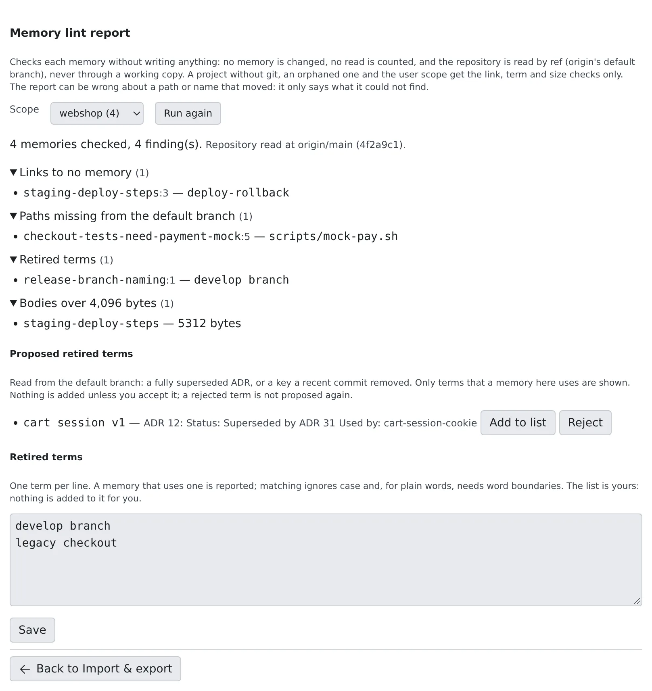

# Find stale memories

English | [日本語](lint.ja.md)

Memories go stale silently when the code changes. The lint report finds memories that use paths that are gone or terms you retired.
Write its findings into the memories and agents read them as suspect.

## How it works

| What you do | What the agent does |
|---|---|
| Check one scope's memories with the lint report | (Nothing. The report writes nothing) |
| Write the findings into memory with `af-memory lint --apply` or Automatic lint marks | Gets a memory with findings as suspect, with its reasons, whenever it reads it |
| Fix memories reported as stale or wrong | Reports a memory that turned out stale or wrong with `memory_feedback` |

## Read the lint report

1. Open **⚙ Settings → Agent memory → Import & export**
2. Under Maintenance, press **Start** on **Memory lint report**
3. In **Scope**, pick a project or **User memory**

The report only checks: it writes nothing, no memory changes, and reading is not counted as a use. From a terminal, `af-memory lint [--user | --project <id or name>] [--json]` prints the same report. With no scope given, it checks every scope.

| Finding | Meaning |
|---|---|
| Links to no memory | A `[[link]]` to a memory that does not exist |
| Paths missing from the default branch | A repository path missing from the default branch (only a path whose first folder exists in the repository) |
| Symbols found nowhere in the default branch | A `Test*` or code-shaped name in backticks that cannot be found |
| ADR numbers with no record | A number such as `ADR 0123` with no record |
| Retired terms | A word from your Retired terms list |
| Bodies over 4,096 bytes | More than other sessions see in recall |
| Bodies a document they anchor already says | Most of the text is already in a document the memory names (a Markdown or text file on the default branch): a candidate to supersede by that document. Advice only, never written as a reason |

- The repository is read from `origin`'s default branch, not from a working copy. It does not fetch, so a stale clone gives a stale answer. The report says which ref and commit it read
- A project without git, a project whose working copy is gone, and user memory get the link, term and size checks only
- A path or symbol that was renamed is reported as missing too. Treat a finding as a prompt to check, not a verdict

### Register retired terms

In the **Retired terms** box, write the words you no longer use, one per line. Matching ignores case, and plain words match whole words.

- The list is yours. Nothing is ever added to it by itself
- **Proposed retired terms** shows candidates found on the default branch (the name of a fully superseded ADR, an `AF_*` key a recent commit removed) with their evidence. Only words this scope's memories use are shown
- **Add to list** puts a proposal on the list; **Reject** means it is never proposed again

## Write the findings into memory

Run `af-memory lint --apply` in a terminal (the scope flags are the same as for the report) to write the report's findings into memory.

- Link, path, symbol, ADR and retired-term findings become the memory's reasons (`reasons`). Size findings are not written
- A memory with reasons is suspect: wherever an agent reads it, the reasons come with it. It is also left out of the write-back to Claude Code
- Each memory changes in one change authored `lint`, listed in [Changes](changes.md), and can be reverted
- At most 100 memories are written per run. Running it again continues
- When a missing path was moved by a git rename on the default branch, only that path in the text is replaced with the new one
- A lint reason is removed once someone changes the memory and the rule no longer fires

## Mark memories automatically

Turn on **Automatic lint marks** in **⚙ Settings → Agent memory → Settings** and the same thing as `af-memory lint --apply` runs by itself over user memory and every project that holds memory.

- It is **off by default**. "Let sessions use Agent Fleet memory" must be on too
- It uses no model and spends no tokens. It is separate from the Memory tidy-up (suggestions) switch
- It runs only when no session has run a turn for 15 minutes, at most once every 6 hours. When the 100-memory cap left some unwritten, it continues after 30 minutes
- If a session starts working during a run, the run stops between scopes
- Only you can switch it, in the Console. A session cannot

## Reports from agents

When a memory it read turned out stale or wrong, an agent reports it with `memory_feedback`.

- A report on the current revision becomes a reason on the memory. A change of the text clears it
- A report on an older revision is only kept as an observation
- One report per session per revision counts
- Reports and reasons are material for [memory tidy-up](tidy-up.md)

## Memories superseded by a document

A memory you promoted into the repository's documents (see below) is superseded by that document: agents no longer see it, and it points at the file, the heading and the merge commit instead. The lint report of the project keeps checking that target, under **Document targets**.

| Shown | Meaning |
|---|---|
| the file moved to … in … | A git rename on the default branch moved the file |
| the file is gone | The file is not on the default branch, and no rename explains it |
| the heading is gone | The file is there, the heading is not |
| the merge was reverted by … | A commit on the default branch reverts the merge (a revert of that revert brings it back) |
| its merge commit is not on the default branch | The history was rewritten, or the commit was never fetched |
| names another repository than this project's | The target cannot be checked from this project |

Repair each one yourself; nothing changes until you choose:

- **Point at …** (a rename only): re-points the target at the new path, keeping the heading
- **Re-point…**: give a path, a heading and a commit on the default branch that holds them (the report's commit is filled in). It is checked as the supersede was
- **Bring the memory back**: undoes the supersede. The memory is back in agents' view with the text it kept

Each repair quotes the revision the report showed, so a memory that changed since is refused; press **Run again** and repair it from the new report. Each is one change in [Changes](changes.md) and can be reverted there. The body never comes back by itself.

## Promote memories to project documents

A memory that several sessions confirmed is worth putting into the repository's own documents, where every member and every agent reads it.

1. Open **⚙ Settings → Agent memory → Import & export**
2. Under Maintenance, press **Start** on **Promote to project documents**, and pick the project
3. The candidates are listed with how many sessions confirmed them. **Not yet** lists the others with what they miss
4. **Propose** builds the change: the document and section, the text, and a patch. The secret scan and the repository's own pre-commit hook run on it in a throwaway clone; it is ready when both pass
5. Copy the patch and open the pull request yourself, or ask a session to. Agent Fleet never commits, pushes or opens one
6. Once it is merged, propose the memory again if you closed the page, enter the merge commit under **After the merge**, and press **Supersede by the document**

The supersede is refused when the memory changed after the proposal: propose it again, so an old text never hides a newer one. From a terminal, `af-memory promote-candidates` and `af-memory promote-proposal` do steps 3 and 4.

## When it goes wrong

### `af-memory lint --apply` is refused with "already in progress"

A manual run and an automatic run never overlap. Run it again once the automatic run has finished.
If a run over all scopes is refused part-way, the scopes already done keep their changes; running it again finishes the rest.

### A path that exists is reported as missing from the default branch

Lint does not fetch. Run `git fetch` in the repository, then press **Run again** in the report.

## Related

- [Read and correct agent memory](overview.md): read and fix suspect memories
- [Check memory changes](changes.md): revert changes authored `lint`
- [Use memory tidy-up](tidy-up.md): have a model draft fixes from the findings
