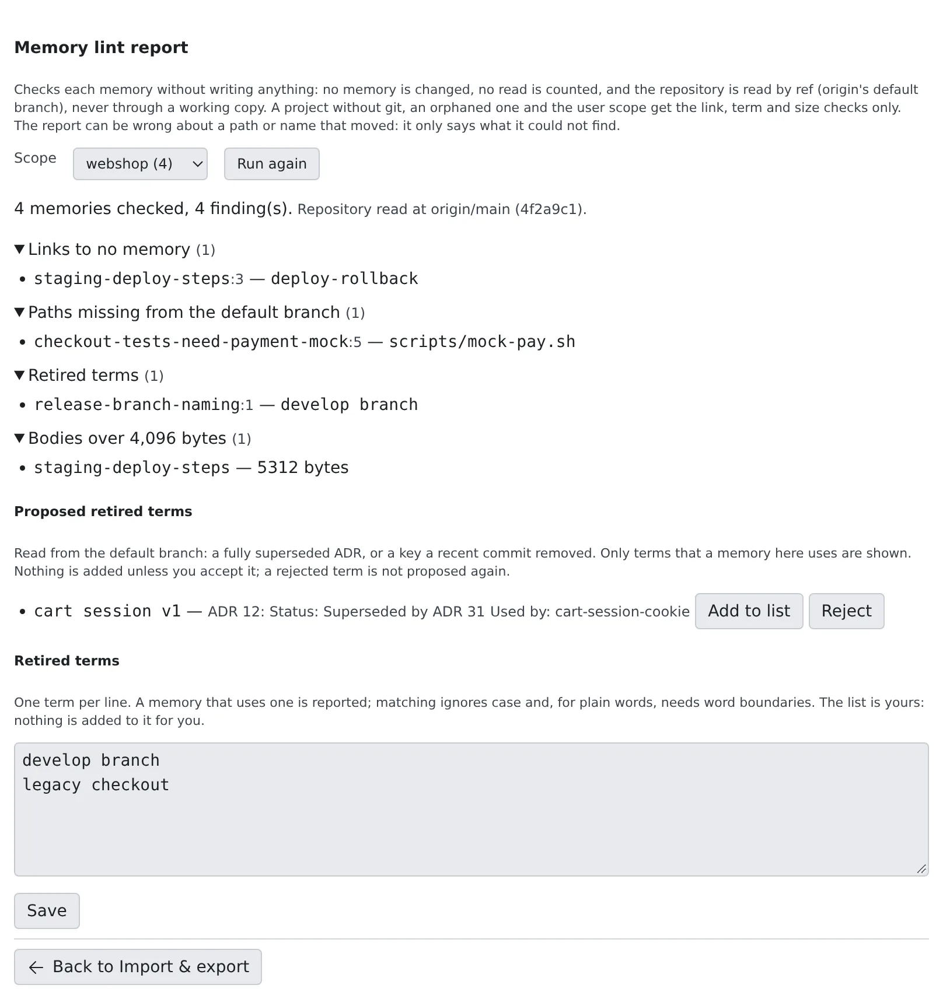

# Find stale memories

English | [日本語](lint.ja.md)

Memories go stale silently when the code changes. The lint report finds memories that use paths that are gone or terms you retired.
Write its findings into the memories and agents read them as suspect.

## How it works

| What you do | What the agent does |
|---|---|
| Check one scope's memories with the lint report | (Nothing. The report writes nothing) |
| Write the findings into memory with `af-memory lint --apply` or Automatic lint marks | Gets a memory with findings as suspect, with its reasons, whenever it reads it |
| Fix memories reported as stale or wrong | Reports a memory that failed it with `memory_feedback` |

## Read the lint report

1. Open **⚙ Settings → Agent memory → Import & export**
2. Under Maintenance, press **Start** on **Memory lint report**
3. In **Scope**, pick a project or **User memory**

The report only checks: it writes nothing, no memory changes, and reading is not counted as a use. From a terminal, `af-memory lint [--user | --project <id or name>] [--json]` prints the same report. With no scope given, it checks every scope.

| Finding | Meaning |
|---|---|
| Links to no memory | A `[[link]]` to a memory that does not exist |
| Paths missing from the default branch | A repository path missing from the default branch (only a path whose first folder exists in the repository) |
| Symbols found nowhere in the default branch | A `Test*` or code-shaped name in backticks that cannot be found |
| ADR numbers with no record | A number such as `ADR 0123` with no record |
| Retired terms | A word from your Retired terms list |
| Bodies over 4,096 bytes | More than other sessions see in recall |

- The repository is read from `origin`'s default branch, not from a working copy. It does not fetch, so a stale clone gives a stale answer. The report says which ref and commit it read
- A project without git, a project whose working copy is gone, and user memory get the link, term and size checks only
- A path or symbol that was renamed is reported as missing too. Treat a finding as a prompt to check, not a verdict

### Register retired terms

In the **Retired terms** box, write the words you no longer use, one per line. Matching ignores case, and plain words match whole words.

- The list is yours. Nothing is ever added to it by itself
- **Proposed retired terms** shows candidates found on the default branch (the name of a fully superseded ADR, an `AF_*` key a recent commit removed) with their evidence. Only words this scope's memories use are shown
- **Add to list** puts a proposal on the list; **Reject** means it is never proposed again

## Write the findings into memory

Run `af-memory lint --apply` in a terminal (the scope flags are the same as for the report) to write the report's findings into memory.

- Link, path, symbol, ADR and retired-term findings become the memory's reasons (`reasons`). Size findings are not written
- A memory with reasons is suspect: wherever an agent reads it, the reasons come with it. It is also left out of the write-back to Claude Code
- Each memory changes in one change authored `lint`, listed in [Changes](changes.md), and can be reverted
- At most 100 memories are written per run. Running it again continues
- When a missing path was moved by a git rename on the default branch, only that path in the text is replaced with the new one
- A lint reason is removed once someone changes the memory and the rule no longer fires

## Mark memories automatically

Turn on **Automatic lint marks** in **⚙ Settings → Agent memory → Settings** and the same thing as `af-memory lint --apply` runs by itself over user memory and every project that holds memory.

- It is **off by default**. "Let sessions use Agent Fleet memory" must be on too
- It uses no model and spends no tokens. It is separate from the Memory tidy-up (suggestions) switch
- It runs only when no session has run a turn for 15 minutes, at most once every 6 hours. When the 100-memory cap left some unwritten, it continues after 30 minutes
- If a session starts working during a run, the run stops between scopes
- Only you can switch it, in the Console. A session cannot

## Reports from agents

When a memory it read turned out stale or wrong, an agent reports it with `memory_feedback`.

- A report on the current revision becomes a reason on the memory. A change of the text clears it
- A report on an older revision is only kept as an observation
- One report per session per revision counts
- Reports and reasons are material for [memory tidy-up](tidy-up.md)

## When it goes wrong

### `af-memory lint --apply` is refused with "already in progress"

A manual run and an automatic run never overlap. Run it again once the automatic run has finished.
If a run over all scopes is refused part-way, the scopes already done keep their changes; running it again finishes the rest.

### A path that exists is reported as missing from the default branch

Lint does not fetch. Run `git fetch` in the repository, then press **Run again** in the report.

## Related

- [Read and correct agent memory](overview.md): read and fix suspect memories
- [Check memory changes](changes.md): revert changes authored `lint`
- [Use memory tidy-up](tidy-up.md): have a model draft fixes from the findings
