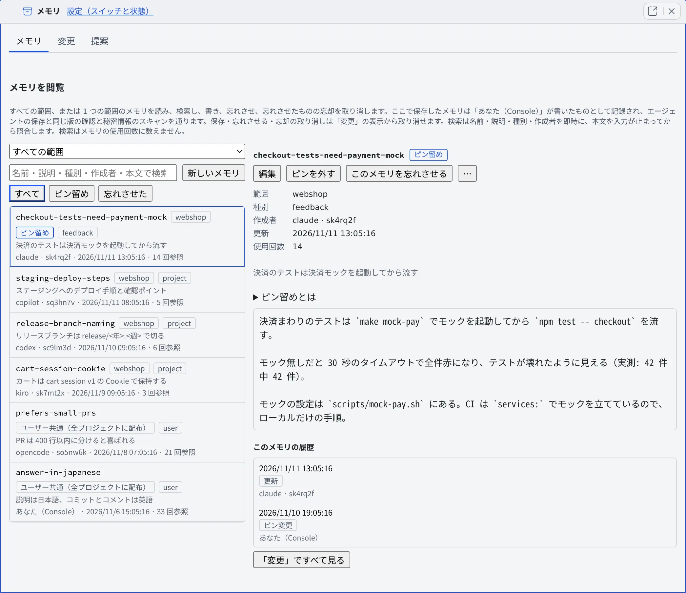

# エージェントのメモリを見る・直す

[English](overview.md) | 日本語

エージェントメモリは、どの種類のエージェントも共有する Agent Fleet 自身のメモリです。
このページでは、エージェントが覚えたことを一覧で読み、書き直し、ピン留めし、忘れさせる方法を説明します。
指示のファイルやエージェント自身のメモリとの違いは、[どのメモリを使うか決める](which-memory.ja.md)にあります。

## 全体像

| あなたがやること | エージェントがやること |
|---|---|
| [メモリの使いかたを設定する](settings.ja.md)で、セッションにメモリを使わせる（既定ではオフ） | 作業の始めに索引を読み、必要なメモリを検索して読む |
| メモリビューで、覚えた内容を読む・直す・ピン留めする | 学んだことを `memory_save` で保存し、一部だけを `memory_patch` で直す |
| 要らないメモリを忘れさせる | 忘れさせたメモリは、どのエージェントからも見えなくなる |
| [変更](changes.ja.md)を確かめて、まずいものを元に戻す | 古くなった・間違っていたメモリを `memory_feedback` で報告する |

- メモリには、プロジェクトごとの範囲と、全プロジェクトに配られる「ユーザー共通」の範囲があります。worktree はリポジトリのものを共有します
- エージェントの種類を替えても、引き継いでも、別の種類の子セッションでも、覚えたことは残ります
- エージェントの保存は**承認なしで**すぐ共有されます。秘密情報らしき記述を含む保存は断られます

## メモリビューを開く

**⚙設定 →「エージェントメモリ」** の先頭にある「**メモリビューを開く**」を押します。メモリビューは専用のペイン（「**メモリ**」タブ）で開き、
「**メモリ**」「**変更**」「**提案**」の 3 つのタブがあります。

- コマンドパレットの「**メモリ**」の範囲で検索して、「**エージェントメモリで開く**」からも開けます（[キーボードとコマンドパレットを使う](../start/shortcuts.ja.md#コマンドパレットで探して開く)）
- メモリビューはワークスペースに 1 つです。もう一度開くと、開いているものに移ります
- メモリはワークスペースの中にあるので、ワークスペースが動いている間だけ読めます

## メモリを探して読む

左の一覧の上で、範囲とチップを選びます。

| 選ぶもの | 一覧に出るもの |
|---|---|
| 範囲「**すべての範囲**」（既定） | ユーザー共通と全プロジェクトのメモリ。各行に所属が出ます |
| 範囲「**ユーザー共通（全プロジェクトに配布）**」か、1 つのプロジェクト | その範囲のメモリだけ |
| チップ「**すべて**」「**ピン留め**」「**忘れさせた**」 | 全部、ピン留めしたもの、忘れさせたもの |

- 「**メモリを検索**」の欄は、入力したすべての語（順不同）を、名前・説明・種別・作成者からすぐに探します。入力が止まると本文も探します
- すべての語を含むメモリがないときは、一部の語を含むものを「**すべての語を含むメモリはありません。一部の語だけを含むメモリを表示しています。**」の注記つきで出します
- 行を選ぶと、右に本文・範囲・種別・**作成者**・**更新**・**使用回数**（エージェントに読まれた回数）が出ます。あなたが読んでも、検索しても、使用回数は増えません
- 名前や本文が秘密情報らしいメモリは一覧に出さず、件数だけを表示します
- スマートフォンでは一覧と詳細が別の画面になります。詳細から「**一覧に戻る**」（または Escape）で戻ります

## メモリを書く・直す

- 「**新しいメモリ**」で、表示中の範囲にメモリを作ります。「すべての範囲」を表示しているときは、ユーザー共通に作ります
- 詳細の「**編集**」で、名前・説明・種別・本文を直して「**保存**」します
- 保存は、エージェントの保存と同じ版の確認と秘密情報の検査を通り、「**あなた（Console）**」が書いたものとして「変更」に残ります。あとから元に戻せます
- プロジェクトに書けるのは、そのプロジェクトにすでにメモリがあるときだけです
- 編集しても、メモリを読めるエージェントの種類（限定されているメモリの場合）は変わりません

## ピン留めする

詳細の「**ピン留め**」を押すと、そのメモリは、エージェントが作業の始めに読む索引の先頭に必ず載ります。「**ピンを外す**」で元に戻ります。

- ピン留めしていないメモリは、種別（feedback と user が先）→ 読まれた回数 → 新しさの順に並びます
- 索引には大きさの上限（説明つきの行で約 24 KiB）があり、ピンも同じ枠を使います。ピンだけで収まらないと、末尾のピンは名前だけの一覧に回ります。全セッションに要るものだけを留めてください
- ピンを付け外しできるのはあなただけです。エージェントがあとでメモリを書き換えても、ピンは残ります
- ピンの付け外しは「**ピン変更**」として「変更」に残り、元に戻せます

## 忘れさせる

詳細の「**このメモリを忘れさせる**」を押すと、そのメモリはどのエージェントからも見えなくなります。内容は履歴に残ります。

- 忘れさせたメモリは、チップ「**忘れさせた**」に新しい順に並びます。行か詳細の「**忘却を取り消す**」で、忘れさせる直前のテキストに戻ります
- 以前のテキストが今は秘密情報の検査に掛かるときは、取り消せません。[変更](changes.ja.md)でその忘却に「**この変更を元に戻す**」を使い、内容を確かめて戻します
- 手で置いたファイルのように、履歴に変更がないメモリは、ここからは忘れさせられません
- 詳細の下の「**このメモリの履歴**」には、そのメモリの変更だけが並びます。選ぶと差分が出ます。古い変更が足りないときは「**古い変更を読み込む**」を押します

## 過去のテキストを履歴から消す

忘れさせても隠すだけで、過去のテキストは履歴とエクスポートに残ります。秘密を書き込んでしまったときなど、過去の版をワークスペースから消すには次のようにします。

1. メモリの詳細で「**その他の操作**」（⋯）→「**履歴から消去…**」を押します。忘れさせたメモリなら、行と詳細にも出ます
2. ダイアログに、消える変更記録の件数、書き換わる履歴、過去の版で秘密情報の検査が見つけたもの（値は伏せてあります）が出ます
3. 確認のためメモリの名前を入力し、「**履歴から消去する**」を押します

- **現在のテキストは残ります**。今のテキストも消したいときは、先にメモリを編集して保存してから消去します
- 忘れさせたメモリは、忘れた記録を含めてすべての版が消え、あとから忘却を取り消せなくなります
- 消去したメモリの以前の変更は、もう元に戻せません。ほかのメモリには影響しません
- **すでに作ったエクスポートは取り消せません**。ダウンロードしたバンドルやアーカイブ、ほかへコピーしたものは、自分で削除してください
- 消去はこの画面からだけ始められます。セッションからは始められません

## エージェントに見えるメモリ

メモリには状態があり、エージェントにどう見えるかが変わります。状態を付けるのは、リント・エージェントの報告・自動整理・あなたです。エージェント自身は付けられません。

| 状態 | エージェントからの見え方 |
|---|---|
| ふつう | 索引・検索・読み取りのどれにも出ます |
| 要確認（理由がある） | どこに出るときも理由が添えられます（[古くなったメモリを見つける](lint.ja.md)） |
| quiet、または種類が `log` | 索引の説明つきの部分には載りません。名前だけの一覧・検索・読み取りには出ます |
| アーカイブ済み・置き換え済み | 索引にも検索にも出ません。読むと、本文の代わりに理由などの要約が返ります |

- あなたのメモリビューは、どの状態のメモリもすべて表示します
- 変更を元に戻すと、状態も含めて以前の版がそのまま戻ります

## 困ったとき

### 保存すると「秘密情報を含む可能性があるため保存しませんでした」と出る

本文か名前が秘密情報の検査に掛かりました。該当する部分を取り除いて、もう一度保存してください。

### 「1 分ほど待ってから再試行してください」と出る

ワークスペースが起動してから 30 秒ほどは、保存・ピン・忘れさせる操作を受け付けません。1 分ほど待ってから、もう一度押してください。

### 「ここから忘れさせられません」と出る

履歴に変更がないメモリ（手で置いたファイルなど）は、ここからは忘れさせられません。

## 関連

- [メモリの使いかたを設定する](settings.ja.md)：セッションにメモリを使わせるスイッチ
- [メモリの変更を確かめる](changes.ja.md)：誰が・いつ・何を変えたかと、元に戻す方法
- [古くなったメモリを見つける](lint.ja.md)：リンク切れや古いパスを点検する
- [メモリの自動整理を使う](tidy-up.ja.md)：直す提案をモデルに作らせる
