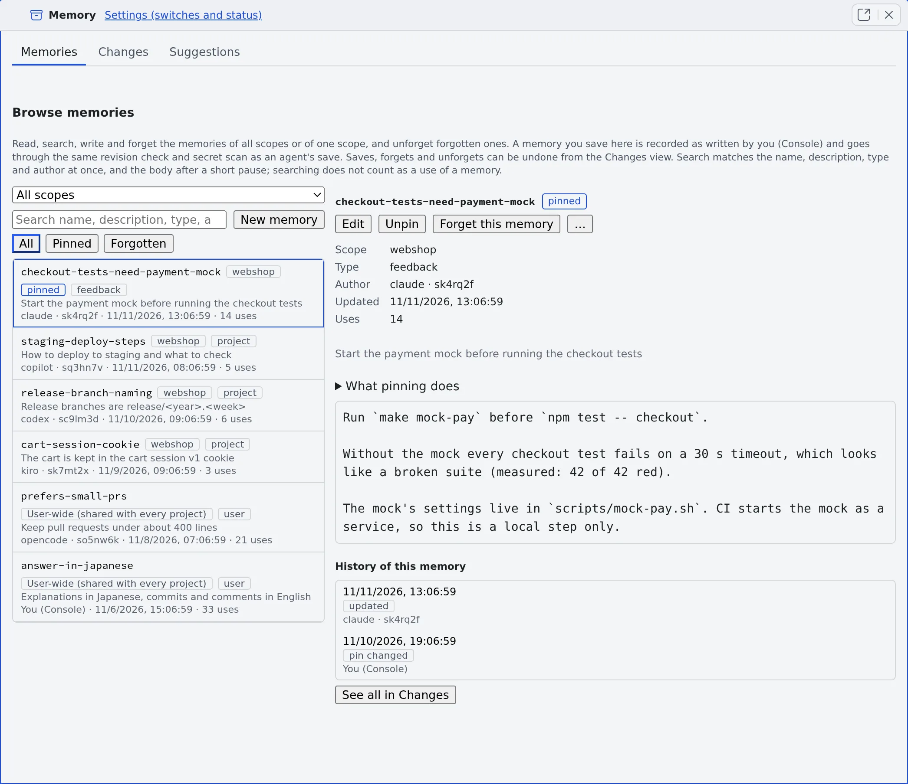

# Read and correct agent memory

English | [日本語](overview.ja.md)

Agent memory is Agent Fleet's own memory, shared by every kind of agent.
This page shows how to read what agents remembered, rewrite it, pin it and make agents forget it.

## How it works

| What you do | What the agent does |
|---|---|
| Let sessions use memory in [Set how memory is used](settings.md) (off by default) | Reads the index when it starts work, and searches and reads the memories it needs |
| Read, correct and pin memories in the Memory view | Saves what it learned with `memory_save`, and fixes part of one with `memory_patch` |
| Make agents forget a memory you do not want | A forgotten memory disappears from every agent's view |
| Check the [changes](changes.md) and revert bad ones | Reports a memory that was stale or wrong with `memory_feedback` |

- Memory has one scope per project plus a "user-wide" scope that every project receives. A worktree shares its repository's memory
- What one agent learned survives a switch of agent kind, a handoff, and a child session of another kind
- An agent's save is shared at once, **without your approval**. A save that looks like it holds a secret is refused

## Open the Memory view

Open **⚙ Settings → Agent memory** and press **Open memory view** at the top. The Memory view opens in a pane of its own (the
**Memory** tab), with three tabs: **Memories**, **Changes** and **Suggestions**.

- You can also search in the command palette's **Memory** scope and use **Open in Agent memory** ([Use the keyboard and the command palette](../start/shortcuts.md#find-and-open-with-the-command-palette))
- There is one Memory view per workspace. Opening it again moves you to the one already open
- Memory lives inside the workspace, so you can read it only while the workspace is running

## Find and read memories

Above the list on the left, pick a scope and a chip.

| What you pick | What the list shows |
|---|---|
| Scope **All scopes** (the default) | The user-wide memories and those of every project. Each row says where it lives |
| Scope **User-wide (shared with every project)**, or one project | Only that scope's memories |
| Chip **All**, **Pinned** or **Forgotten** | Everything, the pinned ones, or the forgotten ones |

- The **Search memories** box looks at once for every word you typed (in any order) in the name, description, type and author. When you stop typing it searches the bodies too
- When no memory holds every word, it shows the ones that hold some, under "**No memory contains every word. Showing memories that contain some of the words only.**"
- Pick a row and the right side shows the text, scope, type, **Author**, **Updated** and **Uses** (how often agents read it). Your own reading and searching do not count as uses
- A memory whose name or text looks like a secret is not listed, only counted
- On a phone the list and the detail are two screens. **Back to the list** (or Escape) returns from the detail

## Write and correct memories

- **New memory** creates a memory in the scope on screen. While all scopes are shown it goes to the user-wide scope
- **Edit** in the detail lets you change the name, description, type and text, then **Save**
- A save goes through the same revision check and secret scan as an agent's save, and is recorded in Changes as written by **You (Console)**. You can revert it later
- You can write into a project only once that project already holds memory
- An edit does not change which kinds of agent may read the memory (when it is limited to some)

## Pin a memory

Press **Pin** in the detail and the memory is always listed first in the index agents read when they start work. **Unpin** takes it back.

- Memories that are not pinned are ordered by type (feedback and user first), then by how often they are read, then by recency
- The index has a size limit (about 24 KiB of described lines), and pins share it. If the pins alone do not fit, the last of them drop to the names-only list. Pin only what every session needs
- Only you can pin and unpin. An agent's later update of a pinned memory keeps the pin
- A pin or unpin is recorded in Changes as "**pin changed**" and can be reverted

## Forget a memory

Press **Forget this memory** in the detail and no agent sees the memory any more. Its text stays in the history.

- Forgotten memories are listed under the **Forgotten** chip, newest first. **Unforget**, on the row or in the detail, brings back the text it had just before
- If that earlier text now trips the secret scan, Unforget is refused. Use **Revert this change** on its forget entry in [Changes](changes.md), where you can check the text before bringing it back
- A memory with no change in its history, such as a file put in place by hand, cannot be forgotten from here
- **History of this memory**, below the detail, lists that memory's own changes. Pick one to see its diff. If older changes are missing, press **Load older changes**

## Remove past text from the history

Forgetting only hides a memory: its past text stays in the history and in exports. To delete past revisions from the workspace, for example after writing a secret into one:

1. In the memory's detail, open **More actions** (⋯) → **Purge history…**. For a forgotten memory it is also on the row and in the detail
2. The dialog shows how many change records go, which histories are rewritten, and what the secret scan found in past revisions (values masked)
3. Type the memory's name to confirm, and press **Purge history**

- **The current text stays**. To remove the current text too, edit the memory and save it first, then purge
- A forgotten memory loses every revision, the forget record included, and can no longer be unforgotten
- The memory's earlier changes can no longer be reverted. Other memories are not affected
- **Exports you already made cannot be recalled**. Delete downloaded bundles or archives, and copies made elsewhere, yourself
- A purge can only be started from this screen. A session cannot start one

## What agents see of a memory

A memory has a status that changes how agents see it. Lint, agents' reports, the tidy-up and you set it; an agent cannot set it itself.

| Status | How agents see it |
|---|---|
| Normal | In the index, in search and when read |
| Suspect (has reasons) | Wherever it appears, its reasons come with it ([Find stale memories](lint.md)) |
| Quiet, or of kind `log` | Not in the described part of the index. In the names-only list, in search and when read |
| Archived or superseded | Not in the index and not in search. Reading it returns a stub with the reason instead of the text |

- Your own Memory view shows every memory, whatever its status
- Reverting a change brings back the earlier version whole, its status included

## When it goes wrong

### Saving says "The text looks like it contains a secret, so it was not saved"

The text or the name tripped the secret scan. Remove that part and save again.

### "Try again in a minute" appears

For about half a minute after the workspace starts, saving, pinning and forgetting are not accepted. Wait a minute and press it again.

### "cannot be forgotten from here" appears

A memory with no change in its history (a file put in place by hand, for example) cannot be forgotten from here.

## Related

- [Set how memory is used](settings.md): the switch that lets sessions use memory
- [Check memory changes](changes.md): who changed what and when, and how to revert it
- [Find stale memories](lint.md): check for broken links and old paths
- [Use memory tidy-up](tidy-up.md): have a model draft fixes
