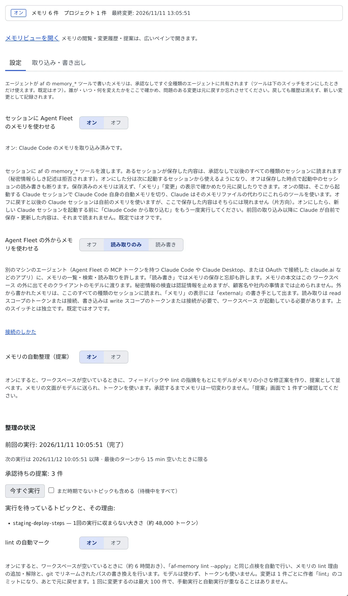

# メモリの使いかたを設定する

[English](settings.md) | 日本語

エージェントメモリは**既定ではオフ**です。スイッチを 1 つオンにすると、どの種類のセッションも同じメモリを読み書きするようになります。
Claude Code と Muse Code が自前で持つメモリは、このスイッチに合わせて自動で切り替わります。

## 全体像

| あなたがやること | エージェントがやること |
|---|---|
| 「セッションに Agent Fleet のメモリを使わせる」をオンにする | 次に起動したセッションから、af の `memory_*` ツールでメモリを読み書きする |
| オフにする | 起動中のセッションも含めて、読み書きが断られる。保存済みのメモリは消えない |
| 外から使わせる・自動整理・リントのスイッチを選ぶ | それぞれのスイッチがオンの間だけ、その処理が動く |

## スイッチを入れる

**⚙設定 →「エージェントメモリ」→「設定」** を開きます。ワークスペースが止まっていても、この表示だけは使えます。スイッチは次の起動に向けて保存されます。

| スイッチ | 決めること | 既定 |
|---|---|---|
| セッションに Agent Fleet のメモリを使わせる | セッションにメモリのツールを渡すか | オフ |
| Agent Fleet の外からメモリを使わせる | 別のマシンのエージェントや接続したアプリに使わせるか（「**オフ**」「**読み取りのみ**」「**読み書き**」） | オフ |
| メモリの自動整理（提案） | モデルに直す提案を作らせるか（[メモリの自動整理を使う](tidy-up.ja.md)） | オフ |
| lint の自動マーク | 古くなったメモリに自動で印を付けるか（[古くなったメモリを見つける](lint.ja.md#自動で印を付ける)） | オフ |

- 表示の先頭の行に、オンかオフか、プロジェクトとメモリの件数、最後に変わった時刻が出ます。Claude Code との同期に確認が要るときは「**Claude Code との同期に確認が必要です。**」と「**設定で確認**」が出ます
- 「Agent Fleet の外からメモリを使わせる」は、上のスイッチとは独立しています。つなぎ方は「**接続のしかた**」から開けます

## オンにすると何が変わるか

- オンは**次に起動するセッションから**効きます。オフは、起動中のセッションの読み書きもその場で断ります
- 各エージェントの指示ファイルに「メモリのツールがあること・いつ呼ぶか」の短い決まった文が入ります。メモリそのものは入りません。オフにすると、あなたの文章には触れずにその部分だけ消えます
- Cursor には指示ファイルの置き場がないため、同じ案内はツールの説明に入ります
- ローカルモデル（lcpp）のセッションは、システムプロンプトにそのプロジェクトのメモリの索引が最初から載ります
- 「メモリ」「変更」のタブは、スイッチがオフでも使えます

## Claude Code のメモリの引き継ぎ

Claude Code は自前のメモリ（`MEMORY.md` など）を持っています。スイッチを切り替えると、その中身を自動で引き継ぎます。

| 切り替え | 確認のダイアログ | 起きること |
|---|---|---|
| オンにする | 「**Agent Fleet のメモリをオンにしますか？**」→「**オンにして取り込む**」 | `~/repos` の作業コピーに対応する Claude のプロジェクトのメモリを、バックグラウンドで取り込みます。以後に起動する Claude セッションは、Claude Code 自身の自動メモリを切った状態で動きます |
| オフにする | 「**Agent Fleet のメモリをオフにしますか？**」→「**オフにして書き戻す**」 | 先に Claude のメモリのスナップショットを取り、上書きせずに Claude Code へ書き戻します。終わるまで Claude Code 自身のメモリは切ったままです |

- ダイアログには、取り込む・書き戻すメモリの件数と、秘密情報らしき記述でスキップするファイルの件数が出ます。ワークスペースが止まっているときは件数は出ず、起動した時点で処理します
- 自動の取り込みは、ここで編集したメモリを Claude のファイルで上書きしません。競合として一覧に出すだけです。忘れさせたメモリも戻しません
- スイッチより前に起動した Claude セッションは、自前のメモリを使い続けます。最後の 1 つが終わった時点で、その保存内容をもう一度取り込みます
- スイッチの下に、進み具合・前回の結果・確認が必要なファイル（競合・秘密情報）が出ます。残ったファイルがあると通知が 1 件届きます
- 処理はワークスペースを再起動しても続きます

### Codex と Muse Code

| エージェント | オンの間 | オフに戻すと |
|---|---|---|
| Codex | codex 自身の `features.memories` を切ります。取り込みも書き戻しもしません | 以前の値に戻します（自分からオンにはしません） |
| Muse Code | Muse Code 自身のメモリを切った状態で起動します。自分の環境の設定より優先されます | 何も変えず、Muse の既定のままです |

どちらも、切り替えたあとに**起動した**セッションだけが対象です。起動中のセッションは起動時のままです。

## 困ったとき

### 書き戻しが失敗し続ける

スイッチの下に「**書き戻しが失敗し続けています**」と理由が出ます。成功するまで Claude Code 自身のメモリは切ったままで、Agent Fleet は間隔を延ばしながら再試行します。

- 「**今すぐ再試行**」で、すぐにもう一度試します
- 「**それでもネイティブメモリをオンに戻す**」で、書き戻しを待たずに Claude Code のメモリを戻します。Agent Fleet で溜めた内容は、書き戻しが成功するまで Claude 側には現れません

### オンにしたのに、セッションがメモリを使わない

オンは次に起動するセッションから効きます。新しいセッションを始めてください。

## 関連

- [エージェントのメモリを見る・直す](overview.ja.md)：メモリビューでメモリを読む・直す
- [メモリの自動整理を使う](tidy-up.ja.md)：「メモリの自動整理（提案）」のスイッチ
- [古くなったメモリを見つける](lint.ja.md)：「lint の自動マーク」のスイッチ
