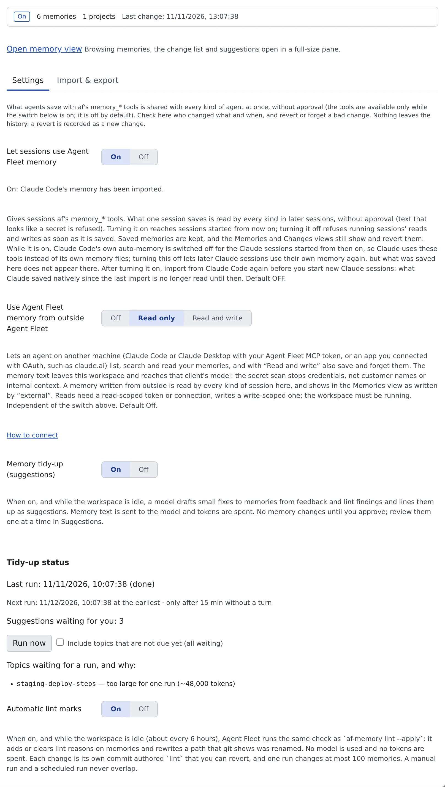

# Set how memory is used

English | [日本語](settings.ja.md)

Agent memory is **off by default**. Turn on one switch and every kind of session reads and writes the same memory.
What the switch does to the agent's own memory is summed up in [Choose which memory your agents use](which-memory.md).

## How it works

| What you do | What the agent does |
|---|---|
| Turn on "Let sessions use Agent Fleet memory" | From the next session it starts, reads and writes memory with af's `memory_*` tools |
| Turn it off | Reads and writes are refused, in running sessions too. Saved memories stay |
| Choose the outside, tidy-up and lint switches | Each of those runs only while its switch is on |

## Turn the switches on

Open **⚙ Settings → Agent memory → Settings**. This view works even while the workspace is stopped; the switches are saved for the next start.

| Switch | What it decides | Default |
|---|---|---|
| Let sessions use Agent Fleet memory | Whether sessions get the memory tools | Off |
| Use Agent Fleet memory from outside Agent Fleet | Whether agents on other machines and connected apps may use it (**Off**, **Read only**, **Read and write**) | Off |
| Memory tidy-up (suggestions) | Whether a model drafts fixes ([Use memory tidy-up](tidy-up.md)) | Off |
| Automatic lint marks | Whether stale memories are marked automatically ([Find stale memories](lint.md#mark-memories-automatically)) | Off |

- The line at the top shows whether memory is on, how many memories in how many projects, and when it last changed. When the sync with Claude Code needs you, "**Syncing with Claude Code needs your attention.**" and **Review in Settings** appear
- "Use Agent Fleet memory from outside Agent Fleet" is independent of the switch above. **How to connect** opens how to connect

## What turning it on changes

- On takes effect **from the next session started**. Off refuses running sessions' reads and writes at once
- Each agent's instruction file gets a short fixed note that the memory tools exist and when to call them. It never holds memories. Turning the switch off removes that part only, without touching your own text
- Cursor has no place for an instruction file, so the same guidance is in the tool descriptions
- Local-model (lcpp) sessions start with the project's memory index in their system prompt
- The Memories and Changes tabs work even with the switch off

## Carrying Claude Code's memory across

Claude Code keeps a memory of its own (`MEMORY.md` and the like). Flipping the switch carries its contents across by itself.

| Flip | Confirmation dialog | What happens |
|---|---|---|
| Turn on | **Turn on Agent Fleet memory?** → **Turn on and import** | Imports, in the background, the memory of every Claude project that matches a working copy under `~/repos`. Claude sessions started from then on run with Claude Code's own auto-memory switched off |
| Turn off | **Turn off Agent Fleet memory?** → **Turn off and write back** | Takes a snapshot of Claude's memory first, then writes back to Claude Code without overwriting anything. Claude Code's own memory stays off until that has finished |

- The dialog shows how many memories are imported or written back, and how many files are skipped because they look like secrets. While the workspace is stopped there are no counts; the work runs when it starts
- The automatic import never overwrites a memory you edited here with a Claude file: it only lists it as a conflict. A memory you made agents forget is not brought back either
- Claude sessions started before the switch keep using their own memory. When the last of them ends, what they saved is imported once more
- Under the switch, the page shows the progress, the last result and the files that need you (conflicts, secrets). One notification tells you when files were left
- The work carries on across a restart of the workspace

### Codex and Muse Code

| Agent | While on | When switched back off |
|---|---|---|
| Codex | Switches codex's own `features.memories` off. Nothing is imported or written back | Puts back the earlier value (never turns it on by itself) |
| Muse Code | Starts Muse Code with its own memory switched off. This wins over the setting in your own environment. Turning the switch on also imports Muse's existing notes, as below | Changes nothing; Muse keeps its default. Nothing is written back into Muse's stores |

For both, only sessions **started** after the flip are affected. A running session keeps what it started with.

#### What is imported from Muse Code

Turning the switch on runs the same import as [Import from muse](import-export.md#import-from-muse), in the same background run as Claude's and with the same rules: secrets are skipped, a memory you made agents forget is not brought back, and a note whose Agent Fleet version differs is never overwritten.

| Muse store | On turning the switch on |
|---|---|
| Project notes (`.agents/memory` in a working copy) | Imported into that working copy's project. They sit inside the repository and may be committed to git |
| Personal project notes | Imported into the project of the matching working copy |
| Personal notes | **Not imported.** They would be visible to every project, so the page lists them as "needs your confirmation". Import them yourself with **Import from muse** and the user-wide option |

- The dialog also counts the Muse notes it leaves alone and the personal notes that are waiting. Under the switch, a Muse note whose Agent Fleet version differs is listed as "Agent Fleet has its own version, left as is"
- Switching on twice imports nothing twice. A Muse folder that cannot be read is counted and skipped; it never stops the switch
- Muse sessions already running keep using their own memory, and what they save is not imported again by itself. Use **Import from muse** for that

## When it goes wrong

### The write-back keeps failing

"**The write-back keeps failing**" appears under the switch, with the reason. Until it succeeds Claude Code's own memory stays off, and Agent Fleet retries with growing pauses.

- **Retry now** tries again at once
- **Switch Claude Code's own memory back on anyway** gives Claude Code its memory back without waiting for the write-back. What Agent Fleet holds does not appear on the Claude side until a write-back succeeds

### Memory is on, but sessions do not use it

On takes effect from the next session started. Start a new session.

## Related

- [Read and correct agent memory](overview.md): read and correct memories in the Memory view
- [Use memory tidy-up](tidy-up.md): the Memory tidy-up (suggestions) switch
- [Find stale memories](lint.md): the Automatic lint marks switch
