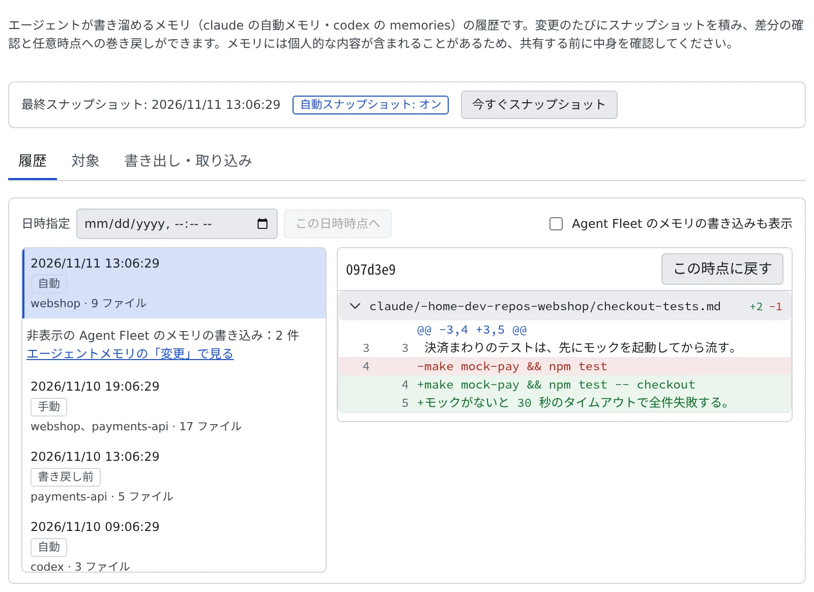

# スナップショットでメモリを戻す

[English](snapshots.md) | 日本語

エージェント自身のメモリ（Claude Code・Codex・Muse Code が自分のファイルに溜めるメモリ）の履歴を見て、ある時点の状態に戻せます。
「覚えてほしくないことを覚えた」「いつからおかしくなったのか」をあとから直せます。別の環境へ持っていくこともできます。

Agent Fleet のメモリとの違いは、[どのメモリを使うか決める](which-memory.ja.md)にあります。Agent Fleet のメモリの変更は、メモリの「変更」の表示で確かめて元に戻します。

## 全体像

| あなたがやること | 起きること |
|---|---|
| ふだんは何もしない | エージェントが止まって数分たつと、メモリのスナップショットが自動で積まれる |
| 履歴から時点を選び、戻す | メモリがその時点の内容に置き換わる。戻す直前の状態もスナップショットに残る |
| 書き出して、別の環境で取り込む | メモリとその履歴が、別の環境へ移る |

## 画面を開く

**⚙設定 →「メモリのスナップショット」** を開きます。ワークスペースが起動している間だけ使えます。

上には、最終スナップショットの日時と自動スナップショットのオン・オフ、「**今すぐスナップショット**」のボタンがあります。
その下に「履歴」「対象」「書き出し・取り込み」の 3 つの表示があり、最後に開いていた表示を覚えています。

## 履歴を見る

「履歴」には、スナップショットが新しい順に並びます。1 件を選ぶと、その時点で何が変わったかの差分が出ます。

| 契機 | いつ積まれるか |
|---|---|
| 自動 | エージェントが止まって数分たったとき |
| 手動 | 「**今すぐスナップショット**」を押したとき |
| 巻き戻し前 | 戻す直前 |
| 巻き戻し | 戻したとき |
| 書き戻し前 | Agent Fleet のメモリを Claude Code へ書き戻す直前 |
| 取り込み | 書き出したファイルを取り込んだとき |
| エージェントの記録 | Agent Fleet のメモリへの書き込み（ふだんは隠れています） |

- **日時から探す**：「日時指定」に日時を入れて「**この日時時点へ**」を押すと、その時点のスナップショットを選びます
- **Agent Fleet のメモリの書き込みは隠れています。** その書き込みはメモリの「変更」の表示に並ぶからです。
  隠れている分は「非表示の Agent Fleet のメモリの書き込み：N 件」の 1 行にまとまり、「**エージェントメモリの「変更」で見る**」で開けます。
  一覧に出したいときは「Agent Fleet のメモリの書き込みも表示」にチェックを入れます（このブラウザに保存されます）

## ある時点に戻す

1. 「履歴」で、戻したい時点のスナップショットを選びます
2. 「**この時点に戻す**」を押します
3. 戻す範囲を選びます。「すべて」か、「選んで戻す」でエージェントの種類（Claude Code・Codex・Muse Code）やプロジェクトを選びます
4. 「**戻す**」を押し、確認で「**戻す**」を押します

- **戻す操作も取り消せます。** 戻す直前の状態が、自動でスナップショット（契機「巻き戻し前」）に残ります
- 実行中のセッションがあるときは、確認に警告が出ます。戻したあとにそのセッションが書いた内容は、新しいスナップショットとして履歴に出ます

## 対象を確かめる

「対象」には、履歴を取っているメモリが、エージェントの種類ごとにファイル数・サイズ・プロジェクトと一緒に並びます。

- **Codex のメモリ機能は既定でオフです。** 履歴を取りたいときは、ここでオンにします。オンにすると、Codex が会話からメモリを作るために
  トークンを使い続けます
- Agent Fleet のメモリをオンにすると、Codex のメモリ機能は一度オフになります。そのあとここでオンにすれば、Agent Fleet のメモリと並んで動き、
  Agent Fleet のメモリをオフにしてもそのままです
- **Muse Code のメモリ**は、あれば履歴の対象になります。`~/.local/share/muse/memory/` の下のノート（個人メモリと、個人用のプロジェクトメモリ）が対象で、1 つの種類としてまとめて戻します。リポジトリの中の Muse Code の*プロジェクト*メモリ（`.agents/memory`）は、リポジトリの中にあって git で履歴を管理しているため、ここでは対象にしません
- Muse Code のセッションが動いている間でも、メモリを戻せます。ファイルは 1 つずつ、書きかけにならない形で置き換え、Muse Code のロックファイルには触りません。戻したあとに Muse Code が書いた分は、新しいスナップショットとして履歴に出ます
- **自動スナップショット**のスイッチで、自動で積むかどうかを決めます。変更がなければ何も積みません。配備によっては、運用者が自動スナップショットを止めています

## 書き出す

「書き出し・取り込み」で、メモリをファイルに書き出します。

1. 形式を選びます

   | 形式 | 中身 |
   |---|---|
   | bundle（全履歴） | すべてのスナップショット。Agent Fleet のメモリも入ります |
   | tar.gz（最新のみ） | 今の内容だけ |

2. 「**書き出す**」を押します

秘密情報らしき記述が見つかったときは、先頭の数文字だけを見せて確認を求めます。確かめて問題なければ「**確認のうえ書き出す**」を押します。
書き出したファイルは暗号化されていません。共有する前に中身を確かめてください。

## 取り込む

別の環境で書き出したファイルを取り込みます。選んだだけでは何も変わりません。

1. 「書き出し・取り込み」で、bundle か tar.gz のファイルを選びます
2. 形式・スナップショットの件数・最終の日時と、秘密情報らしき記述の件数を確かめます
3. bundle なら、適用のしかたを選びます

   | 適用のしかた | 結果 |
   |---|---|
   | 選んだ範囲だけ置き換える（履歴はこの環境のまま） | 選んだプロジェクトや種類のメモリを、取り込んだ内容で置き換えます |
   | 履歴ごと移設する（この環境の履歴を置き換える） | 取り込んだスナップショットがこの環境の履歴になり、その時点へ戻せるようになります。範囲はいつも全体です |

4. 置き換える範囲を選び、「**取り込む**」（履歴ごとなら「**移設する**」）を押します

- 置き換える前の状態はスナップショットに残るので、取り込みもあとから取り消せます。履歴ごと移設したときは、それまでの履歴は退避され、一覧には出なくなります
- 取り込めるファイルは 64 MiB までです。管理者が最大 128 MiB まで上げられます（[上限](../../ref/limits.ja.md)）
- **バンドルの Agent Fleet のメモリは、ここでは書き込みません。** バンドルに入っていると「このバンドルには Agent Fleet のメモリも入っています」と出るので、
  「**取り込み・書き出しを開く**」から[別に取り込みます](import-export.ja.md#バンドルの-agent-fleet-のメモリを取り込む)

## 困ったとき

### 「ワークスペースが停止しています」と出る

履歴はワークスペースの中にあります。「**ワークスペースを起動**」を押してから開き直してください。

### 自動スナップショットがオンにならない

スイッチの下に、運用側の設定で自動取得が止められているという説明が出ているときは、運用者が止めています。
「**今すぐスナップショット**」で手動で積むことはできます。

### Codex の履歴が出ない

「対象」で Codex が「メモリ機能がオフです（Codex の既定）」になっています。オンにすると、次に Codex が動いたときから履歴の対象になります。

### 取り込みで「この環境に取り込み先がないため取り込めません」と出る

ファイルに入っているエージェントの種類のメモリが、この環境では使われていません（たとえば Codex のメモリ機能がオフ）。
その種類は選べません。Codex なら「対象」でオンにしてから、取り込み直してください。Muse Code のメモリにはこうしたスイッチはなく、いつでも取り込めます（フォルダがなければ作られます）。

### 取り込みで「取り込む内容の秘密情報スキャンに失敗しました」と出る

秘密情報がないことを確かめられていません。中身を自分で確かめてから取り込むかどうかを決めてください。

## 関連

- [メモリを取り込む・書き出す](import-export.ja.md)：Agent Fleet のメモリの取り込みと、Claude Code への書き戻し
- [外部のエージェントからメモリを使う](external.ja.md)：ワークスペースの外から Agent Fleet のメモリを読み書きする
