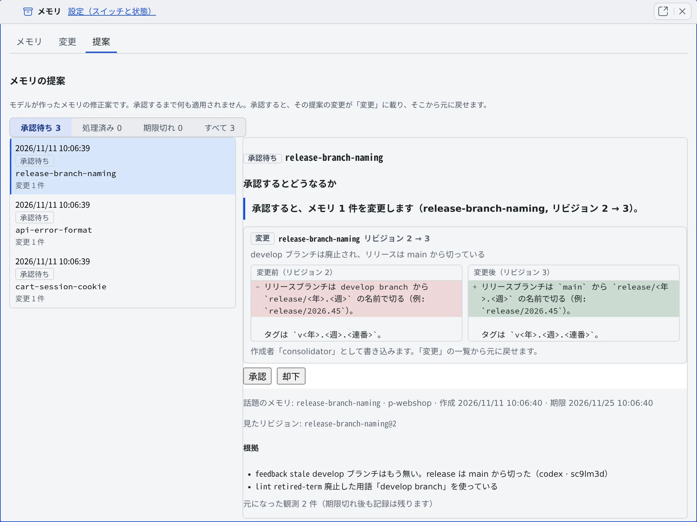

# メモリの自動整理を使う

[English](tidy-up.md) | 日本語

自動整理をオンにすると、ワークスペースが空いている間に、モデルがメモリを直す小さな提案を作ります。
**承認するまでメモリは一切変わりません**。提案を 1 件ずつ読んで、承認するか却下します。

## 全体像

| あなたがやること | エージェントがやること |
|---|---|
| 「メモリの自動整理（提案）」をオンにする | 古い・間違っているという報告やリントの指摘をメモリごとに集める |
| （待つ。急ぐときは「今すぐ実行」） | 空いている間に、モデルが小さな修正案を作って「提案」に並べる |
| 「提案」タブで、承認するとどうなるかを読んで承認か却下する | 承認された提案だけを、作者「consolidator」の変更としてメモリに書く |

材料になるのは、エージェントの `memory_feedback` の報告と、リントの指摘です（[古くなったメモリを見つける](lint.ja.md)）。

## オンにする

**⚙設定 →「エージェントメモリ」→「設定」** の「**メモリの自動整理（提案）**」をオンにします（[スイッチの画面](settings.ja.md#スイッチを入れる)）。

- **既定ではオフ**です。「セッションに Agent Fleet のメモリを使わせる」もオンである必要があります
- オンにすると、メモリの文面がモデルに送られ、トークンを使います。使うモデルは、既定で `claude:haiku` と、置き換えや統合のときの `claude:sonnet` です
- 切り替えられるのは Console のあなただけです。セッションからは変えられません

スイッチの下の「**整理の状況**」に、次のものが出ます。

| 行 | 内容 |
|---|---|
| 前回の実行 | 時刻と結果（「**完了**」「**途中まで**」「**対象なし**」「**失敗**」） |
| 次の実行 | 次に動ける最短の時刻 |
| 承認待ちの提案 | 件数 |
| 実行を待っているトピックと、その理由 | トークン予算を使い切った、ワークスペースが止まっていた、空きがなかった、1 回に収まらないサイズ、など |

## いつ動くか

- どのセッションも 15 分間ターンを実行していないときだけ動きます。間隔は最短 3 時間です
- 対象は、時期が来たトピックだけです。古い・間違っているという報告が 1 件ある、新しい観察が 3 件ある、24 時間待った観察がある、のどれかで時期が来ます
- 1 回の実行が使うトークンには上限があり（既定でおよそ 60,000）、収まらない分は次の実行に回ります
- 実行中にターンが始まると、進行中のモデル呼び出しだけ終えて、残りは次に回します

### 今すぐ実行する

セッションが一日中動いていると、自動の実行がなかなか来ません。そのときは自分で始めます。

1. 「整理の状況」の横の「**今すぐ実行**」を押します
2. 確認の「**今すぐ整理を実行しますか？**」に、1 回の実行で使うトークンの上限が出ます
3. 待機中のトピックをすべて対象にするなら「**まだ時期でないトピックも含める（待機中をすべて）**」にチェックを入れます
4. 「**今すぐ実行**」を押します。進み具合（トピック n / m）が「整理の状況」に出ます

- 空きの確認と 3 時間の間隔は無視し、ほかのセッションのターンでも止まりません
- 同時に動く実行は 1 つだけです。実行中にもう一度押すと「**整理がすでに実行中です。終わるまでお待ちください。**」と断られます
- 手動の実行は、自動の実行の間隔を消費もリセットもしません

## 提案を確かめる

[メモリビュー](overview.ja.md#メモリビューを開く)の「**提案**」タブに提案が並びます。「**承認待ち**」「**処理済み**」「**期限切れ**」「**すべて**」で絞り込めます。
提案の題名は、作る・変えるメモリの名前です。まとめた元の話題のメモリは、その下の小さな行に出ます。

提案を開くと、承認ボタンの前に「**承認するとどうなるか**」が出ます。

| 提案の種類 | 承認すると |
|---|---|
| 変更 | 1 つのメモリの一部を書き換えます。「**変更前**」「**変更後**」がリビジョンつきで左右に並びます |
| 新しいメモリ | 新しいメモリを 1 件作ります。範囲・名前・種類・説明・本文が出ます |
| 置き換え | 新しいメモリを書き、置き換える対象のメモリを「置き換え済み」にしてエージェントから隠します。1 つの変更として公開され、1 回で全部元に戻せます |
| 退役 | メモリを「アーカイブ済み」にしてエージェントから隠します。何も削除しません。隠れる本文と、読んだときに返る理由が出ます |
| 助言のみ | モデルの案が検証を通らなかった提案です。承認はできません。内容を読んで、「メモリ」タブから手で直します |

- その下に、根拠（元になった報告やリントの指摘）と、提案を作ったときに見たリビジョンが出ます
- メモリや報告が挙げている GitHub の Issue やプルリクエストが閉じているかを、あなたの GitHub 接続で調べてからモデルに伝えます。調べられなかったものは「不明」として扱います
- ピン留めしたメモリは退役させません。助言になります

## 承認する・却下する

- 「**承認**」は、その 1 件だけを適用します。「**この提案を承認しますか？**」で書き込む内容を確かめてから実行します
- 承認すると、作者「consolidator」の変更として[変更](changes.ja.md)に並び、そこから元に戻せます
- 「**却下**」で捨てます
- 「**再検討**」（却下・期限切れ・適用不可・一部適用の提案に出ます）は、そのトピックを次の実行で見直させます
- まとめて承認すること、待つだけで承認されること、通知から承認することはありません
- 14 日間決めなかった提案は期限切れになります

### 毎日の通知

スイッチがオンで承認待ちが 1 件でもある間、1 日に 1 回まで「**承認待ちのメモリの提案が N 件あります**」と通知が届きます。
件数だけで、メモリの文面は載りません。開くとメモリビューの「提案」に移ります。通知の種類は「**メモリの提案**」です（[通知を受け取る](../settings/notifications.ja.md)）。

## 困ったとき

### 承認すると「リビジョンの不一致」と出る

提案を作ったあとにメモリが変わったため、その提案はもう当てはまりません。提案は「**適用不可**」になります。「**再検討**」で作り直せます。

### 承認すると「期限切れです」と出る

14 日間決めなかった提案は承認できません。「**再検討**」で作り直せます。

### 「実行を待っているトピック」が 1 回に収まらないサイズで止まっている

そのトピックの材料が大きすぎて、1 回の実行のトークン予算に収まりません（既定の予算で約 180 KB 以上）。メモリや報告を減らすと、次の実行が取り込みます。

### 以前のメモリレビューの提案はどうなったか

以前のバージョンのメモリレビューで承認待ちだった提案は、捨てずにファイルへ書き出してあります。メモリには入っておらず、自動整理だけが提案の材料として読みます。

## 関連

- [古くなったメモリを見つける](lint.ja.md)：自動整理の材料になる指摘
- [メモリの変更を確かめる](changes.ja.md)：承認した提案を元に戻す
- [メモリの使いかたを設定する](settings.ja.md)：ほかのスイッチ
