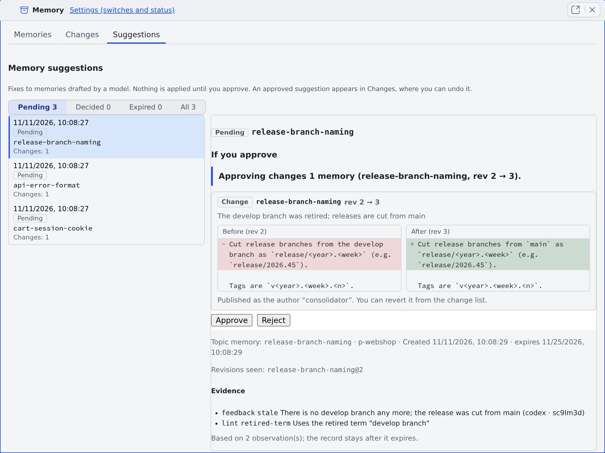

# Use memory tidy-up

English | [日本語](tidy-up.ja.md)

With tidy-up on, a model drafts small fixes to memory while the workspace is idle.
**Nothing in memory changes until you approve**. Read the suggestions one by one, and approve or reject each.

## How it works

| What you do | What the agent does |
|---|---|
| Turn on Memory tidy-up (suggestions) | Collects reports that a memory is stale or wrong, and lint findings, per memory |
| (Wait. When in a hurry, Run now) | While idle, has a model draft small fixes and lists them in Suggestions |
| Read If you approve in the Suggestions tab, then approve or reject | Writes only the approved suggestions into memory, as changes authored `consolidator` |

The material is agents' `memory_feedback` reports and lint findings ([Find stale memories](lint.md)).

## Turn it on

Turn on **Memory tidy-up (suggestions)** in **⚙ Settings → Agent memory → Settings** ([the switches screen](settings.md#turn-the-switches-on)).

- It is **off by default**. "Let sessions use Agent Fleet memory" must be on too
- Turning it on sends memory text to a model and spends tokens. The default models are `claude:haiku`, and `claude:sonnet` for replacing and merging
- Only you can switch it, in the Console. A session cannot

Under the switch, **Tidy-up status** shows the following.

| Line | Content |
|---|---|
| Last run | When, and how it ended (**done**, **partial**, **nothing to do**, **failed**) |
| Next run | The earliest time it can run |
| Suggestions waiting for you | The count |
| Topics waiting for a run, and why | The token budget ran out, the workspace was stopped, it was never idle, too large for one run, and so on |

## When it runs

- Only when no session has run a turn for 15 minutes, at most once every 3 hours
- Only topics that are due: one report that a memory is stale or wrong, 3 new observations, or an observation that has waited 24 hours
- A run spends at most a token budget (about 60,000 by default); what does not fit waits for the next run
- If a turn starts during a run, the model call in flight finishes and the rest waits

### Run it now

If sessions are busy all day, the automatic run may never come. Start one yourself.

1. Press **Run now** next to Tidy-up status
2. The confirmation **Run the tidy-up now?** shows the token limit of one run
3. To take every waiting topic, tick **Include topics that are not due yet (all waiting)**
4. Press **Run now**. The progress (topic n of m) shows in Tidy-up status

- It ignores the idle check and the 3-hour interval, and a turn in another session does not stop it
- Only one run goes at a time. Pressing it during a run is refused with "**A tidy-up run is already in progress. Wait for it to finish.**"
- A manual run neither uses up nor resets the automatic run's interval

## Review the suggestions

Suggestions are listed in the **Suggestions** tab of the [Memory view](overview.md#open-the-memory-view). Filter with **Pending**, **Decided**, **Expired** and **All**.
A suggestion is titled by the name of the memory it creates or changes. The topic memory it was grouped under is in the smaller line below.

Open one and **If you approve** appears before the Approve button.

| Kind | Approving it |
|---|---|
| Change | Rewrites part of one memory. **Before** and **After** are shown side by side with their revisions |
| New memory | Creates one new memory. Its scope, name, type, description and text are shown |
| Replacement | Writes a new memory and marks the memories it replaces as superseded, hidden from agents. It is published as one change, and one revert undoes all of it |
| Retire | Marks the memory archived and hides it from agents. Nothing is deleted. The text that will be hidden and the reason a read will return are shown |
| Advice only | The model's draft failed validation. It cannot be approved: read it and fix the memory by hand in the Memories tab |

- Below that come the evidence (the reports and lint findings it rests on) and the revisions the suggestion was drafted against
- Whether the GitHub issues and pull requests a memory or report names are closed is looked up with your GitHub connection and told to the model. A lookup that fails counts as unknown
- A pinned memory is never retired: you get advice instead

## Approve or reject

- **Approve** applies that one suggestion. **Approve this suggestion?** shows what will be written before it runs
- Once approved, it shows in [Changes](changes.md) as a change authored `consolidator`, and can be reverted from there
- **Reject** drops it
- **Look again** (shown on rejected, expired, not applicable and partly applied suggestions) has the next run look at the topic afresh
- Nothing is approved in bulk, by waiting, or from a notification
- A suggestion left undecided for 14 days expires

### The daily notice

While the switch is on and at least one suggestion is pending, you get at most one notification a day: "**N memory suggestions are waiting for your review**".
It carries the count only, never a memory's text, and opens Suggestions in the Memory view. The notification kind is **Memory suggestions** ([Get notified](../settings/notifications.md)).

## When it goes wrong

### Approving says "revision mismatch"

The memory changed after the suggestion was drafted, so it no longer applies. The suggestion becomes **Not applicable**. **Look again** has it redrafted.

### Approving says "has expired"

A suggestion left undecided for 14 days cannot be approved. **Look again** has it redrafted.

### A waiting topic is too large for one run

Its notes do not fit one run's token budget (about 180 KB or more at the default budget). Trim the memory or the reports and the next run takes it.

### What happened to the old memory review's suggestions

Suggestions that were still waiting in an earlier version's memory review were not dropped: they were written to a file. They are not in memory, and only the tidy-up reads them, as material for its suggestions.

## Related

- [Find stale memories](lint.md): the findings tidy-up works from
- [Check memory changes](changes.md): revert an approved suggestion
- [Set how memory is used](settings.md): the other switches
