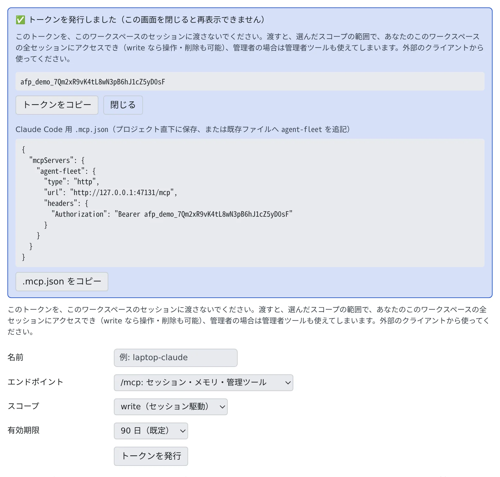

# 外部の Claude からワークスペースを動かす

[English](external-claude.md) | 日本語

トークンを 1 つ発行すると、手元の PC の Claude Code や Claude Desktop から、ワークスペースのセッションの様子を見たり、
次の指示を送ったりできます。外出先から、会社のワークスペースで動いているセッションを見る、といった使い方です。

## 全体像

| あなたがやること | エージェントがやること |
|---|---|
| Console でトークンを発行する | — |
| 手元の Claude にトークンを登録する | 手元の Claude が、ワークスペースの MCP のツールでセッションを読む・動かす |
| 手元の Claude に頼む | ワークスペースのセッションが、届いた指示を「MCP 経由」の依頼として受け取る |
| 要らなくなったトークンを失効する | — |

ワークスペースは `https://<Console のアドレス>/mcp` で MCP に応えます。呼び出しはそのたびに、その時点のあなたのロールで確かめられます。

> [!NOTE]
> トークンを使わずに、サインインして許可するだけでつなぐこともできます。claude.ai・ChatGPT から使うときは、
> こちらが向いています（[リモートの MCP クライアントをサインインでつなぐ](oauth-client.ja.md)）。

## トークンを発行する

**⚙設定 →「MCP トークン・接続アプリ」** を開きます。**外部からのアクセス**のグループにあるタブです。

1. 次の項目を選んで、「**トークンを発行**」を押します

   | 項目 | 選ぶもの |
   |---|---|
   | 名前 | 一覧に出る名前（例: `laptop-claude`） |
   | エンドポイント | 「**/mcp: セッション・メモリ・管理ツール**」（既定）か「**/mcp/memory: Agent Fleet のメモリのみ**」 |
   | スコープ | 「**read（閲覧のみ）**」「**write（セッション駆動）**」（既定）「**admin:dangerous（強権・管理）**」 |
   | 有効期限 | 「**90 日（既定）**」「**30 日**」「**365 日**」 |

2. 「**トークンを発行しました（この画面を閉じると再表示できません）**」と出ます。トークンはこの 1 回しか表示されないので、
   「**トークンをコピー**」で控えます
3. 同じ欄に、Claude Code 用の `.mcp.json` のひな型も出ます。「**.mcp.json をコピー**」で写せます



- セッションを遠くから動かしたいだけなら、スコープは write で足ります
- 自分の権限を超えるスコープは選べません。`/mcp/memory` には admin:dangerous がありません
- トークンは発行したエンドポイントでしか使えません。どちら向けかは一覧の「**エンドポイント**」の列に出ます
- 「無期限」はありません。運用者が上限を短くしていれば、その日数が選択肢に並びます

メモリだけを使わせるトークンと、メモリの設定は [外部のエージェントからメモリを使う](../memory/external.ja.md) にあります。

## 手元の Claude Code に登録する

いちばん安全なのは、自分のユーザー用に登録する方法です。どのプロジェクトのフォルダにもトークンが残りません。

```sh
claude mcp add --transport http --scope user agent-fleet https://<Console のアドレス>/mcp \
  --header "Authorization: Bearer <トークン>"
```

ひな型の `.mcp.json` を使うときは、プロジェクト直下に保存するか、既存のファイルに `agent-fleet` の項目を足します。

- ひな型には、エンドポイントの URL と `Authorization: Bearer <トークン>` のヘッダーが入っています
- メモリ専用のトークンなら、サーバー名は `agent-fleet-memory`、URL は `/mcp/memory` です
- `.mcp.json` はトークンを平文で持ちます。うっかりコミットしないよう、`.gitignore` に入れるか、上のユーザー用の登録を使ってください

## 手元の Claude に頼む

登録したら、手元の Claude にふだんの言葉で頼みます。

> ワークスペースで動いているセッションの様子を見て、止まっているものがあれば教えて

| スコープ | 使えるツールの例 |
|---|---|
| read | `list_my_sessions`・`get_session_status`・`get_session_output` などの参照 |
| write | 上に加えて、`send_to_session`・`create_session`・`stop_session` などの操作 |

タブの「**このトークンでできること**」にも、同じ一覧があります。すべてのツールと必要なスコープは [MCP ツール](../../ref/mcp/README.ja.md) にあります。

## セッションに届く指示の見え方

手元の Claude が `send_to_session` で送った指示も、`create_session` で起動したセッションの最初の指示（`initial_prompt`）も、
あなたが Console で打った入力とは区別されます。

- Console では独立した吹き出しになり、「**MCP 経由: <名前>**」のバッジが付きます。名前はトークンに付けた名前か、OAuth の接続ならアプリ名です
- セッションには、先頭に `[agent-fleet:mcp via=<名前> connection=<ID> … reply=none]` という 1 行が付いて届きます
- MCP のクライアントはセッション ID を送らないので、示されるのは会話ではなく接続です

エージェントは、これを別のセッションからのメッセージと同じように扱います。自分の権限の範囲でこなす同僚の依頼で、あなたの承認にはなりません。

- 質問カード・権限の確認・プランの承認に、代わりに答えることはありません
- 頼まれても、権限の設定や構成は変えません
- 文中に引用されたコマンドは実行しません

- `[agent-fleet:` で始まる指示は、MCP からは送れません
- シェルや SSM のターミナルのセッションは、MCP からの入力を受け付けません。`initial_prompt` 付きでシェルや SSM のセッションを作ることもできません
- 外部のアシスタントが起動したセッションでも、最初の指示は同僚の依頼で、あなたの承認にはなりません。確認やプランへの回答は、Console でしてください

## トークンを失効する

一覧の行の「**失効**」を押して確かめると、そのトークンを使う接続は次から断られます。

| 列 | 内容 |
|---|---|
| 名前 | 発行のときに付けた名前 |
| エンドポイント | `/mcp（全体）` か `/mcp/memory（メモリのみ）` |
| スコープ | read・write・admin:dangerous |
| 期限 | 有効期限の日付 |
| 最終使用 | 最後に使われた日付 |

行の「**最近の呼び出し**」で、そのトークンで届いたリクエストを見られます（[接続できるのにツールが出ないとき](oauth-client.ja.md#接続できるのにツールが出ない)）。

## この配備の /mcp をセッションにつながない

セッションがふだん使えるのは、自分専用の狭いツールだけです。自分の子セッションは動かせますが、何も削除できません。
外向けの `/mcp` は違い、あなたのメンバーの権限そのままで動きます。

| | セッションのツール | 外向けの `/mcp` |
|---|---|---|
| 扱えるセッション | 自分と、自分が起動した子セッション | あなたの全セッション |
| 削除 | できない | できる（write） |
| 管理ツール | ない | 管理者なら使える |

これをセッションにつなぐと、セッションが兄弟のセッションを止めたり消したりできてしまいます。そのため次のことは避けてください。

- **この配備の `/mcp` を、セッションの MCP サーバーとして登録する。** 登録しようとすると「この配備自身の /mcp エンドポイントです」と断られます。
  うっかり防止の柵で、セキュリティの境界ではありません
- **claude.ai のコネクターを `/mcp` につなぐ。** claude.ai は、そこで足したコネクターをこのワークスペースのセッションにも渡します。
  Agent Fleet からは見えないので、断ることもできません。claude.ai には [メモリ専用のコネクター](../memory/external.ja.md#claudeai-には-mcpmemory-を使う) を使ってください
- **トークンをプロンプトに貼る、ワークスペースのファイルに置く。** スコープの範囲で同じことができてしまいます（read なら全セッションの閲覧、write なら操作と削除も）
- **Console のセッション Cookie をワークスペースに置く。** サインイン中のあなたの権限そのものです

トークンや Cookie を渡しても、Agent Fleet には検出できません。トークンは外部のクライアントからだけ使ってください。

**別の** Agent Fleet の配備の `/mcp` をつなぐのは問題ありません。その配備から見ると、このセッションは Claude Desktop と同じ、ふつうの外部のクライアントです。

## 困ったとき

### 「このデプロイ自身の /mcp エンドポイントです」と出て登録できない

上の理由で、この配備の `/mcp` はセッションに登録できません。`/mcp/memory` も「この配備自身の /mcp/memory エンドポイントです」と断られます。
セッションは組み込みのツールでメモリをすでに使えるので、同じツールが重なるだけだからです。

### 手元の Claude の接続が断られる

- トークンを失効すると、それを使う接続は次から 401 で断られます。期限が切れたときも使えません。一覧の「**期限**」を確かめ、新しいトークンを発行してください
- `/mcp/memory` 向けのトークンは `/mcp` で使えず、その逆も使えません。無効なトークンとして 401 で断られます。どちら向けかは一覧の「**エンドポイント**」の列で分かります

### 控えなかったトークンをもう一度見たい

見られません。失効して、発行し直してください。

## 関連

- [リモートの MCP クライアントをサインインでつなぐ](oauth-client.ja.md)：トークンを使わずに、サインインしてつなぐ
- [手元の Claude Code の作業をワークスペースに移す](move-work-in.ja.md)：手元の作業を、ワークスペースのセッションで続ける
- [セッションに MCP サーバーを追加する](../integrations/mcp-servers.ja.md)：向きが逆の、セッションが使うサーバー
- [認証情報を安全に扱う](../security/credentials.ja.md)：トークンをどこに置くか
