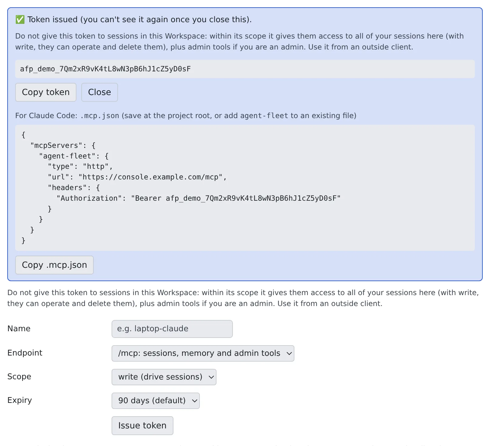

# Drive your workspace from an external Claude

English | [日本語](external-claude.ja.md)

Issue one token, and Claude Code or Claude Desktop on your own computer can watch your workspace sessions and send them
the next instruction: checking, while you are out, on a session running in the company workspace, for example.

## How it works

| What you do | What the agent does |
|---|---|
| Issue a token in the Console | — |
| Register the token in your own Claude | Your Claude reads and drives sessions with the workspace's MCP tools |
| Ask your own Claude | The workspace session receives the instruction as a request "Via MCP" |
| Revoke a token you no longer need | — |

The workspace answers MCP at `https://<your Console address>/mcp`. Every call is checked against your role at that moment.

> [!NOTE]
> You can also connect without a token, by signing in and allowing the app. That suits claude.ai and ChatGPT
> ([Connect a remote MCP client by signing in](oauth-client.md)).

## Issue a token

Open **⚙Settings → "MCP tokens & apps"**, a tab in the **Outside access** group.

1. Choose the following, then press "**Issue token**"

   | Field | What to choose |
   |---|---|
   | Name | The name shown in the list (e.g. `laptop-claude`) |
   | Endpoint | "**/mcp: sessions, memory and admin tools**" (the default) or "**/mcp/memory: Agent Fleet memory only**" |
   | Scope | "**read (view only)**", "**write (drive sessions)**" (the default) or "**admin:dangerous (elevated / admin)**" |
   | Expiry | "**90 days (default)**", "**30 days**" or "**365 days**" |

2. "**Token issued (you can't see it again once you close this).**" appears. The token is shown this once only: save it
   with "**Copy token**"
3. The same box holds a `.mcp.json` template for Claude Code. "**Copy .mcp.json**" copies it



- To drive sessions remotely, write is enough
- You cannot choose a scope above your own permissions. `/mcp/memory` has no admin:dangerous
- A token works only at the endpoint it was issued for. The list's "**Endpoint**" column shows which
- There is no "no expiry". When the operator has set a shorter maximum, that number of days is offered instead

Memory-only tokens and the memory setting are in [Use memory from an external agent](../memory/external.md).

## Register it in your own Claude Code

The safest way is to register it for your user: the token then sits in no project folder.

```sh
claude mcp add --transport http --scope user agent-fleet https://<your Console address>/mcp \
  --header "Authorization: Bearer <token>"
```

To use the `.mcp.json` template instead, save it at the project root, or add its `agent-fleet` entry to an existing file.

- The template holds the endpoint URL and an `Authorization: Bearer <token>` header
- For a memory-only token the server is named `agent-fleet-memory` and the URL is `/mcp/memory`
- `.mcp.json` holds the token in plain text. Put it in `.gitignore` so it is never committed, or use the user-level registration above

## Ask your own Claude

Once registered, ask your own Claude in plain words.

> Look at the sessions running in my workspace and tell me if any of them is stuck

| Scope | Example tools |
|---|---|
| read | Lookups such as `list_my_sessions`, `get_session_status` and `get_session_output` |
| write | The above, plus actions such as `send_to_session`, `create_session` and `stop_session` |

The tab's "**What this token can do**" lists the same. Every tool, with the scope it needs, is in [MCP tools](../../ref/mcp/README.md).

## How an instruction looks to the session

An instruction your Claude sends with `send_to_session`, and the first instruction (`initial_prompt`) of a session it starts
with `create_session`, are kept apart from what you type in the Console.

- In the Console it is a separate bubble with a "**Via MCP: <name>**" badge. The name is the one you gave the token, or the app's name for an OAuth connection
- The session receives it with one line in front: `[agent-fleet:mcp via=<name> connection=<id> … reply=none]`
- An MCP client sends no session ID, so what is shown is the connection, not a conversation

The agent treats it like a message from another session: a colleague's request it carries out within its own permissions, and not your approval.

- It never answers a question card, a permission prompt or a plan approval on your behalf
- It does not change permission settings or configuration because the message asks it to
- It does not run commands quoted in the text

- An instruction that starts with `[agent-fleet:` cannot be sent over MCP
- A shell or SSM terminal session accepts no input from MCP, and a shell or SSM session cannot be created with an `initial_prompt`
- Even in a session an external assistant started, the first instruction is a colleague's request, not your approval. Answer confirmations and plans in the Console

## Revoke a token

Press "**Revoke**" on the token's row and confirm. Connections using it are refused from the next call.

| Column | Contents |
|---|---|
| Name | The name given when it was issued |
| Endpoint | `/mcp (full)` or `/mcp/memory (memory only)` |
| Scope | read, write or admin:dangerous |
| Expires | The expiry date |
| Last used | The date it was last used |

The row's "**Recent calls**" shows the requests that came in with that token ([Connected but no tools appear](oauth-client.md#connected-but-no-tools-appear)).

## Do not connect this deployment's /mcp to a session

A session normally has only its own narrow tools: it can drive its own child sessions, and it cannot delete anything.
The outward `/mcp` is different: it runs with your full member authority.

| | Session tools | Outward `/mcp` |
|---|---|---|
| Sessions it reaches | Itself and the children it started | All of your sessions |
| Delete | No | Yes (write) |
| Admin tools | None | Yes, for an admin |

Connected to a session, it would let that session stop or delete its sibling sessions. So avoid the following.

- **Registering this deployment's `/mcp` as a session's MCP server.** It is refused with "This is this deployment's own /mcp endpoint".
  That is a guard against accidents, not a security boundary
- **Pointing a claude.ai connector at `/mcp`.** claude.ai hands the connectors you add there to this workspace's sessions too.
  Agent Fleet cannot see them, so it cannot refuse them either. Use a [memory-only connector](../memory/external.md#use-mcpmemory-for-claudeai) for claude.ai
- **Pasting a token into a prompt, or leaving it in a file in the workspace.** Within its scope it allows the same (read: view every session; write: drive and delete them too)
- **Putting the Console's session cookie in the workspace.** It is your signed-in authority itself

Agent Fleet cannot detect a token or cookie handed over this way. Use tokens from outside clients only.

Connecting **another** Agent Fleet deployment's `/mcp` is fine. To that deployment, this session is an ordinary outside client, like Claude Desktop.

## When it goes wrong

### "This is this deployment's own /mcp endpoint" and it cannot be registered

For the reason above, this deployment's `/mcp` cannot be registered for sessions. `/mcp/memory` is refused too, with
"This is this deployment's own /mcp/memory endpoint": sessions already have the memory through their built-in tools, so it would only duplicate them.

### Your own Claude's connection is refused

- Once a token is revoked, connections using it get 401 from the next call. An expired token stops working too. Check the list's "**Expires**" and issue a new token
- A token for `/mcp/memory` does not work at `/mcp`, nor the other way round: it is refused with 401 as an invalid token. The list's "**Endpoint**" column shows which it is

### You want to see a token you did not save

You cannot. Revoke it and issue a new one.

## Related

- [Connect a remote MCP client by signing in](oauth-client.md): connect by signing in, without a token
- [Move work from your own Claude Code into the workspace](move-work-in.md): carry on with local work in a workspace session
- [Add an MCP server to your sessions](../integrations/mcp-servers.md): the other direction, servers your sessions use
- [Handle credentials safely](../security/credentials.md): where to keep the token
