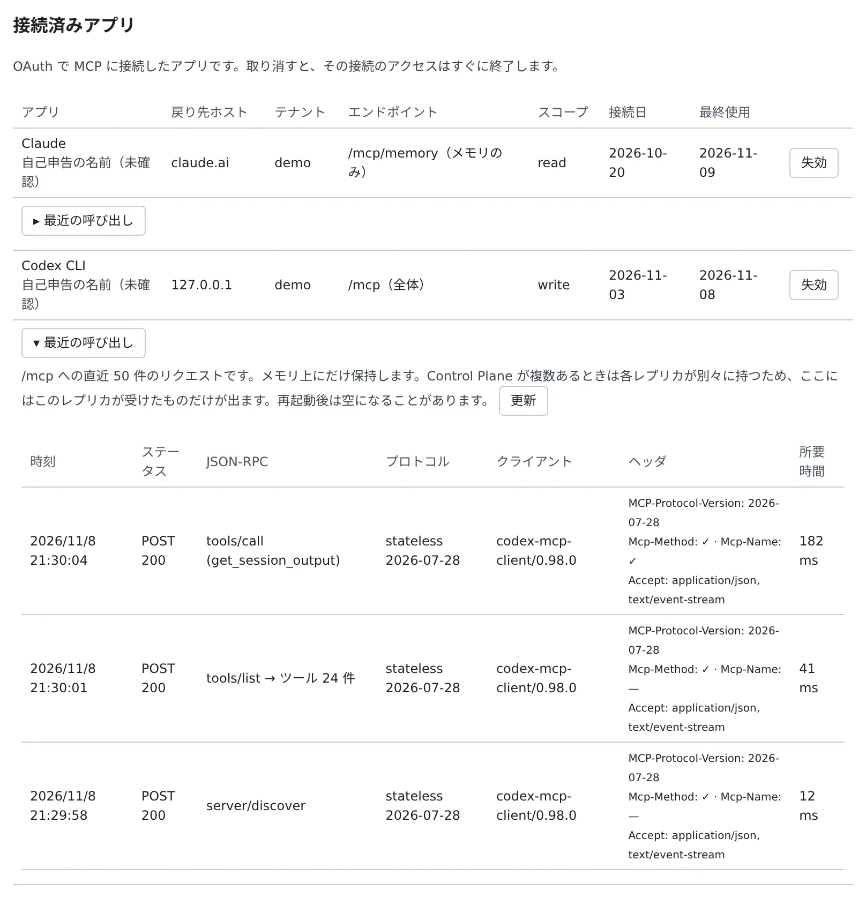

# リモートの MCP クライアントをサインインでつなぐ

[English](oauth-client.md) | 日本語

claude.ai・ChatGPT・Claude Code・Codex を、トークンを発行せずにワークスペースへつなげます。
クライアントから Console にサインインして、確認ページで許可するだけです。

## 全体像

| あなたがやること | クライアントがやること |
|---|---|
| クライアントに、ワークスペースのアドレスを追加する | Console のサインインと確認ページを開く |
| 確認ページで、テナントと範囲を選んで許可する | 有効期限の短いアクセストークンを受け取り、自動で更新しながら MCP のツールを呼ぶ |
| 要らなくなった接続を失効する | 次の呼び出しから断られる |

> [!NOTE]
> この方法は、管理者が配備で有効にしている場合だけ使えます。有効でなければ、クライアントはトークンを求めます。
> そのときは [外部の Claude からワークスペースを動かす](external-claude.ja.md#トークンを発行する) のトークンを使ってください。

## 接続する

1. クライアントで、カスタムコネクターかリモートの MCP サーバーを追加します。アドレスは次のどちらかです。クライアント ID とシークレットの欄は空のままにします

   | アドレス | 使えるもの |
   |---|---|
   | `https://<Console のアドレス>/mcp` | セッションのツールとメモリ |
   | `https://<Console のアドレス>/mcp/memory` | Agent Fleet のメモリだけ |

2. クライアントが Console を開きます。サインインしていなければサインインすると、確認ページが開きます
3. 確認ページの中身を確かめて（下の表）、「許可する」を押します。断るときは「キャンセル」です。キャンセルすると、アプリに拒否が伝わります

> [!IMPORTANT]
> **claude.ai では `/mcp/memory` を使ってください。** claude.ai は、そこで追加したコネクターをこのワークスペースのセッションにも渡すので、
> `/mcp` につなぐとセッションにあなたの全権限が渡ります（[メモリ専用のコネクター](../memory/external.ja.md#claudeai-には-mcpmemory-を使う)）。

Claude Code でつなぐときは、サーバーを自分のユーザー用に登録してから、Claude Code の中で `/mcp` → `agent-fleet` → **Authenticate** を選びます。

```sh
claude mcp add --transport http --scope user agent-fleet https://<Console のアドレス>/mcp
```

## 確認ページで確かめる

確認ページは「アプリが Agent Fleet に接続しようとしています」という見出しで開きます。`/mcp/memory` なら「アプリが Agent Fleet のメモリに接続しようとしています」です。

| 欄 | 見るところ |
|---|---|
| 接続後の戻り先 | 大きく表示されるホスト（`claude.ai`、`chatgpt.com`、コマンドラインのクライアントなら「このパソコン自身」）。自分で始めた接続かどうかは、ここで判断します |
| 登録方法 | アプリの提供元が公開した文書で確かめた登録（CIMD）か、誰でも登録できる動的クライアント登録（DCR）か |
| アプリ名 | 「アプリ自身の申告であり、確認されたものではありません」と添えられます。アプリが自由に付けた名前なので、判断には使いません |
| 接続するテナント | 所属しているテナントから 1 つ選びます。接続はそのテナントに固定されます |
| 許可する範囲 | `read` か `write` |

許可する範囲は次のとおりです。

| 範囲 | できること |
|---|---|
| `read` | セッションの状態や出力を読む。メモリの一覧・検索・読み取り |
| `write` | 読み取りに加えて、セッションへの送信などの操作。メモリの保存と削除 |

- 最初は `read` が選ばれています。`write` は、アプリが `write` を求めたときだけ選べます。アプリの求めより狭く選ぶこともできます
- メモリが使えるのは、あなたが [外からのメモリの利用](../memory/external.ja.md#始める前に) を許可していて、テナント管理者がブロックしていないときだけです
- `admin:dangerous` は、この方法では渡せません。必要ならトークンを使います

許可すると、クライアントは 1 時間で切れるアクセストークンを受け取り、自分で更新しながら接続を保ちます。毎回の確認はありません。

## 接続が続く期間

| 終わるとき | その後 |
|---|---|
| 30 日間使われなかったとき | アプリが、もう一度サインインと許可を求める |
| 許可してから 90 日たったとき | 同上 |
| テナントを抜けたとき | 次の呼び出しから断られる |
| テナント管理者が MCP OAuth を無効にしたとき | そのテナントの接続はすべて取り消され、新しい接続もできない。トークンはそのまま使える |

接続を通した操作は、監査ログに MCP からの操作として残ります。

## 接続済みアプリを確かめる・失効する

**⚙設定 →「MCP トークン・接続アプリ」** の、トークンの一覧の下に「**接続済みアプリ**」が出ます。配備が MCP OAuth を提供しているときだけ表示される欄です。



| 列 | 内容 |
|---|---|
| アプリ | アプリ名。「**自己申告の名前（未確認）**」と添えられます |
| 戻り先ホスト | 許可したときの戻り先 |
| テナント | 接続しているテナント |
| エンドポイント | `/mcp（全体）` か `/mcp/memory（メモリのみ）` |
| スコープ | `read` か `write` |
| 接続日・最終使用 | 許可した日と、最後に使われた日 |

「**失効**」を押して確かめると、更新用のトークンも含めて、その接続はすぐに使えなくなります。また使うときは、アプリからつなぎ直します。

## 困ったとき

### 接続できるのにツールが出ない

接続済みアプリやトークンの行の「**最近の呼び出し**」を開くと、その接続に届いた直近 50 件のリクエストが見られます。

| 列 | 内容 |
|---|---|
| 時刻・ステータス | 受けた時刻と、HTTP のメソッドとステータス |
| JSON-RPC | メソッド（バッチは要素ごと）。`tools/list` なら返したツールの数、エラーならそのコード |
| プロトコル | プロトコルの世代とバージョン |
| クライアント | クライアントの名前とバージョン |
| ヘッダー | `MCP-Protocol-Version`、`Mcp-Method` / `Mcp-Name` の有無、`Accept` |
| 所要時間 | 応答までの時間 |

- トークン、認可のヘッダー、ツールの引数と結果は記録されません
- 一覧は Control Plane のメモリの中にだけあり、再起動で消えます
- Control Plane が複数あるときは、それぞれが別に持つので、開いたときに応えたものの分しか見えません。「**更新**」を何度か押すか、運用担当者に Control Plane のログを見てもらってください。ログには、サインインの前に断ったものも含めて、すべてのリクエストが残ります

### エラーページが出て、サインインに進まない

サインインの結果を受け取れるのは、配備が認めた戻り先だけです。既定は `claude.ai`・`claude.com`・`chatgpt.com` と、
自分の PC で動くコマンドラインのクライアント（`127.0.0.1`、`localhost`）です。それ以外の戻り先を指定したクライアントは
エラーページで断られ、コードは送られません。ほかのクライアントを使いたいときは、管理者に相談してください。

### 前は使えた接続が、急にサインインを求める

30 日使わなかったか、許可から 90 日たちました。アプリの案内に従って、もう一度サインインして許可します。

## 関連

- [外部の Claude からワークスペースを動かす](external-claude.ja.md)：トークンでつなぐ。セッションに届く指示の見え方
- [手元の Claude Code の作業をワークスペースに移す](move-work-in.ja.md)：サインインでつないだ Claude Code から、作業を移す
- [外部のアプリからの OAuth 接続を止める](../../admin/mcp-distribute.ja.md#外部のアプリからの-oauth-接続を止める)：管理者が MCP OAuth を有効にする
- [認証情報を安全に扱う](../security/credentials.ja.md)
