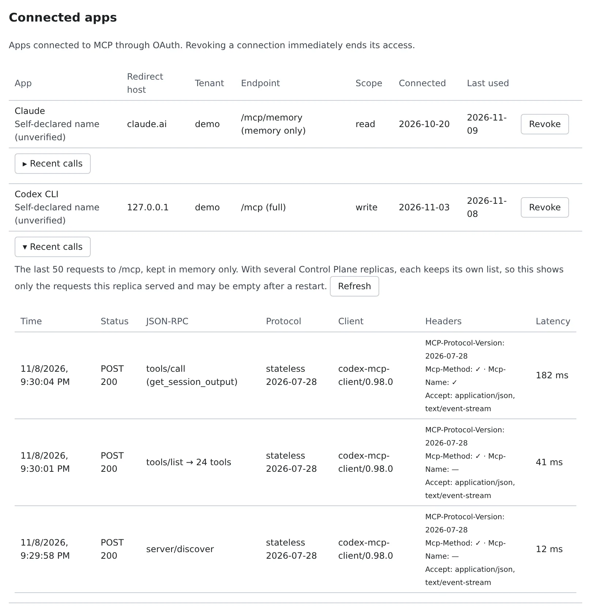

# Connect a remote MCP client by signing in

English | [日本語](oauth-client.ja.md)

claude.ai, ChatGPT, Claude Code and Codex can connect to your workspace without a token.
Sign in to the Console from the client and allow it on the consent page; that is all.

## How it works

| What you do | What the client does |
|---|---|
| Add your workspace's address to the client | Opens the Console's sign-in and the consent page |
| Choose a tenant and a scope on the consent page, and allow | Receives a short-lived access token and calls the MCP tools, renewing it on its own |
| Revoke a connection you no longer need | Is refused from its next call |

> [!NOTE]
> This works only where an administrator has enabled it for the deployment. Otherwise the client asks for a token:
> use one from [Drive your workspace from an external Claude](external-claude.md#issue-a-token).

## Connect

1. In the client, add a custom connector or remote MCP server, with one of these addresses. Leave any client ID and secret fields empty

   | Address | What it reaches |
   |---|---|
   | `https://<your Console address>/mcp` | The session tools and memory |
   | `https://<your Console address>/mcp/memory` | Agent Fleet memory only |

2. The client opens the Console. Sign in if you are not signed in, and the consent page opens
3. Check the consent page (table below) and press "Allow". To decline, press "Cancel": the app is told you refused

> [!IMPORTANT]
> **For claude.ai, use `/mcp/memory`.** claude.ai hands the connectors you add there to this workspace's sessions too, so a
> connector to `/mcp` would give those sessions your full authority ([A memory-only connector](../../member/19-outside-access.md#a-memory-only-connector-for-claudeai)).

To connect Claude Code, register the server for your user, then choose `/mcp` → `agent-fleet` → **Authenticate** inside Claude Code.

```sh
claude mcp add --transport http --scope user agent-fleet https://<your Console address>/mcp
```

## Check the consent page

The consent page opens under the heading "An app wants to connect to Agent Fleet", or "An app wants to connect to your Agent Fleet memory" for `/mcp/memory`.

| Field | What to look at |
|---|---|
| After connecting, you are sent back to | The host in large type (`claude.ai`, `chatgpt.com`, or "this computer itself" for a command-line client). This is what tells you whether you started the connection |
| Registered by | A registration checked against a document the app's publisher published (CIMD), or dynamic client registration (DCR), which anyone can do |
| App name | Marked "declared by the app itself, not verified". The app chose it freely, so do not rely on it |
| Tenant to connect | One of the tenants you belong to. The connection is fixed to it |
| What to allow | `read` or `write` |

The scopes are:

| Scope | What it allows |
|---|---|
| `read` | Read session status and output. List, search and read memory |
| `write` | Read, plus act: send to sessions and similar. Save and forget memory |

- `read` starts selected. `write` is offered only when the app asked for `write`. You can always choose less than the app asked for
- Memory is reachable only once you have [allowed outside use of memory](../../member/18-agent-memory.md#using-agent-fleet-memory-from-an-external-agent) and your tenant administrator has not blocked it
- `admin:dangerous` is never granted this way. Use a token if you need it

Once you allow it, the client receives an access token that expires after an hour and renews it on its own to stay connected. You are not asked again.

## How long a connection lasts

| It ends when | Then |
|---|---|
| It has not been used for 30 days | The app asks you to sign in and allow it again |
| 90 days have passed since you allowed it | Same |
| You leave the tenant | It is refused from the next call |
| A tenant administrator turns MCP OAuth off | Every connection in that tenant is revoked and no new one can be made. Tokens keep working |

What a connection does is recorded in the audit log as an action over MCP.

## Check and revoke connected apps

In **⚙Settings → "MCP tokens & apps"**, "**Connected apps**" appears below the token list. The section is shown only when the deployment offers MCP OAuth.



| Column | Contents |
|---|---|
| App | The app's name, marked "**Self-declared name (unverified)**" |
| Redirect host | Where you were sent back to when you allowed it |
| Tenant | The tenant it is connected to |
| Endpoint | `/mcp (full)` or `/mcp/memory (memory only)` |
| Scope | `read` or `write` |
| Connected and Last used | The day you allowed it, and the day it was last used |

Press "**Revoke**" and confirm, and the connection stops working at once, refresh token included. To use it again, connect again from the app.

## When it goes wrong

### Connected but no tools appear

Open "**Recent calls**" on a connected app's or a token's row to see the last 50 requests that came in on that connection.

| Column | Contents |
|---|---|
| Time and Status | When it arrived, and the HTTP method and status |
| JSON-RPC | The method (per element in a batch). The number of tools returned for `tools/list`, or the error code |
| Protocol | The protocol era and version |
| Client | The client's name and version |
| Headers | `MCP-Protocol-Version`, whether `Mcp-Method` / `Mcp-Name` were sent, and `Accept` |
| Latency | The time to answer |

- Tokens, authorization headers, and tool arguments and results are not recorded
- The list lives only in the Control Plane's memory and is lost on restart
- With several Control Planes, each keeps its own list, so you see only what the one that answered received. Press "**Refresh**" a few times, or ask an operator to check the Control Plane's log: it records every request, including those refused before sign-in

### An error page appears instead of the sign-in

Only addresses the deployment approved may receive the sign-in result. By default those are `claude.ai`, `claude.com`, `chatgpt.com`,
and command-line clients on your own computer (`127.0.0.1`, `localhost`). A client asking to be sent back anywhere else is refused
with an error page, and no code is sent. To use another client, talk to your administrator.

### A connection that used to work asks you to sign in

It was not used for 30 days, or 90 days have passed since you allowed it. Follow the app's prompt, sign in and allow it again.

## Related

- [Drive your workspace from an external Claude](external-claude.md): connect with a token; how an instruction looks to the session
- [Move work from your own Claude Code into the workspace](move-work-in.md): move work from a Claude Code connected by signing in
- [MCP distribution and outside access](../../admin/04-mcp-outside.md): an administrator enables MCP OAuth
- [Handle credentials safely](../security/credentials.md)
