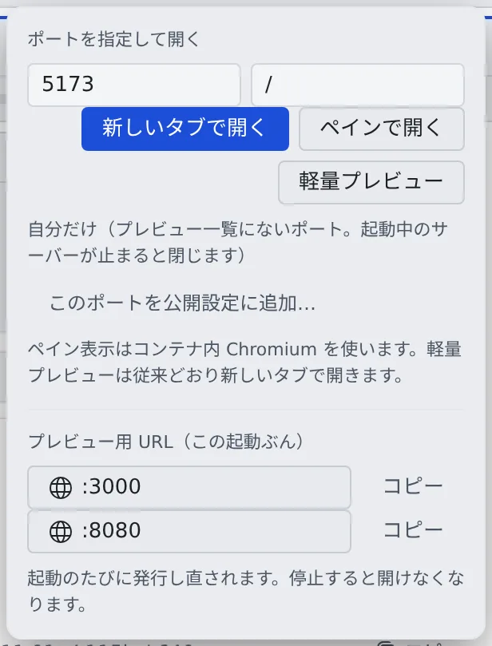

# 起動した Web アプリを見る

[English](browser-pane.md) | 日本語

ワークスペースの中で起動した開発サーバーや Web アプリを、ポートを外に開けたりコンテナを作り直したりせずに、その場で開けます。
画面を触って確かめるならブラウザペイン、HTTP の応答を一度見るだけなら軽量プレビューを使います。

## 全体像

| あなたがやること | エージェントがやること |
|---|---|
| 開発サーバーの起動を頼む | ワークスペースの中で起動し、ポート番号を伝える |
| 「プレビュー」にポートを入れて開く | ― |
| 開いた画面を触って確かめる | ― |

エージェントには、あなたのブラウザペインを開いたり見たりするツールがありません。ペインに何が出ているかは、あなたが確かめます。

## 開き方を選ぶ

| 開き方 | ボタン | 向いているもの |
|---|---|---|
| プレビュー用サブドメイン | 「**新しいタブで開く**」 | いちばん素直な方法。アプリがルート直下に配られ、ふつうの Web サイトと同じように動きます。発行されている環境だけです（[プレビュー用のサブドメインを使う](subdomains.ja.md)） |
| ブラウザペイン | 「**ペインで開く**」 | 画面を触って確かめるもの。HMR、WebSocket、SSE、Cookie、リダイレクト、絶対パスのアセットがふつうの localhost と同じように動きます |
| 軽量プレビュー | 「**軽量プレビュー**」 | JSON や health のような、HTTP の応答を一度見るだけのもの |

迷ったら、サブドメインがあればそれを、なければブラウザペインを使います。2 つの経路の違いの詳細は [ブラウザペインの仕様](../../ref/browser-pane.ja.md) にあります。

軽量プレビューの URL は `/preview/<ポート>/` というサブパスになるので、`/static/...` のような絶対パスを使うアプリや、
ルートパスや Cookie のパスに頼る画面は崩れます。

- プレビュー用ドメインがある環境では、軽量プレビューもプレビュー用サブドメインに転送されます
- プレビュー用ドメインがない環境では、ページは自分の Cookie やストレージを持てず、自分自身への WebSocket も断られます。
  素の HTML や通常のスクリプトのページは動きますが、Vite や Next.js のようなアプリは「ペインで開く」で開いてください

## 開く

1. shell かエージェントに、開発サーバーを起動させます。ワークスペースの中の `127.0.0.1`（またはすべてのインターフェース）で待ち受けさせてください
2. ワークスペース操作バーの「**プレビュー**」を開きます
3. 「**ポートを指定して開く**」にポート番号を入れます。必要なら `/` で始まるパスも入れます
4. 目立つほうのボタンか Enter で、既定の開き方で開きます。ほかの開き方は横のボタンで選びます

- 既定の開き方は、プレビュー用 URL が発行されていればサブドメイン、なければブラウザペイン、ブラウザペインのない環境では軽量プレビューです。使えない開き方はグレーになります
- 入れられるポートは 1〜65535 です。7700 は Agent Fleet 自身が使うので開けません。ホスト名や外部の URL は入れられません
- どれも、ワークスペースが稼働中のときだけ使えます
- スマートフォンでは操作バーに「プレビュー」がありません。右端の **⋯** を開くと、同じ欄とボタンが出ます

ほかの入口もあります。

- **セッションの行のポート**：待ち受けているポートがセッションの行に出ます。押すと既定の開き方で開き、横の ⋯（右クリックや長押しでも）で開き方を選べます
- **文書の中のリンク**：返信や文書の中の `http://127.0.0.1:3000/` のような URL を押すと、同じように開きます（[ドキュメントや図を表示する](../files/view.ja.md#文書の中のリンク)）

## 構成ごとの例

| 構成 | 入れるもの | 開き方 |
|---|---|---|
| Node・Vite | `5173` と `/` | HMR で WebSocket を使うので、ブラウザペイン |
| Spring Boot | `8080` と `/` か `/actuator/health` | リダイレクトや Cookie を使う画面はブラウザペイン。health の JSON を見るだけなら軽量プレビュー |
| API だけ | `8080` と `/api/health` | JSON の確認は軽量プレビュー。SSE・Cookie・リダイレクトを使うならブラウザペイン |
| フロントエンドと API（ポートが 2 つ） | `5173` と `8080` | サブドメインがあればそれ（ポートごとに URL が出ます）。なければ `5173` をブラウザペインで開きます。そこから `8080` への fetch・WebSocket・SSE も使えます（ふつうのブラウザと同じく、CORS の設定は必要です） |

Spring Boot のリンクやリダイレクトを正しく解決させるには、アプリに `server.forward-headers-strategy=framework`（か `native`）を設定してください。

## ブラウザペインを操作する

ペインの中では、クリック・スクロール・文字入力（日本語も）・戻る・進む・再読み込み・パスの移動ができます。
ペインの中の「Console」で、そのページの `error` や `warn` のログを見てコピーできます。

タブレットなどのタッチ画面では、次のように操作します。

| 操作 | すること |
|---|---|
| スワイプ | スクロール |
| タップ | クリック |
| 長押ししてドラッグ | テキストの選択、スライダー |
| 2 本指のピンチ | 拡大縮小。ページを狭い幅で描き直すので、文字は原寸で読めます |
| ダブルタップ | 幅に合わせた表示と等倍を行き来する |

タップしてもキーボードは出ません。入力欄に打つときは、欄をタップしてから、ペインの左下のキーボードのボタンで開きます。

## 知っておくこと

- 同時に開けるペインの数・表示のサイズ・フレームレートには上限があります（[上限](../../ref/limits.ja.md#製品として固定のもの)）。動画や動きの速い画面の確認には向きません
- ペインを別の表示に切り替えたり裏に回したりすると、描画は止まり、ページはしばらく残ります。すぐ戻れば同じ状態のままで、時間が過ぎると同じポートとパスから開き直します
- ワークスペースの停止と起動、Console の再読み込み、「**再接続**」では、同じポートとパスから自動で開き直しますが、Cookie や入力の途中の状態は戻りません
- 外の URL を開くブラウザではありません。ワークスペースの中のポートだけを開きます。開発者ツールの代わりにもなりません

## 困ったとき

### ペインに状態が出て、画面が出ない

| 出ている状態 | 意味 | 対処 |
|---|---|---|
| `target-unreachable` | そのポートとパスにまだつながらない。開発サーバーの起動待ちもこれです | ポート番号とパス、サーバーが待ち受けているかを確かめ、起動してから「**再読み込み**」。残るなら「**再接続**」 |
| `target-unreachable`（HTTP で応答しない） | ポートで何かが待ち受けているが、Web サーバーではない | データベースやデバッガーのポートではないか確かめる |
| `target-unreachable`（HTTPS で動いている） | 開発サーバーが HTTPS で配っている | 開発サーバーの HTTPS を切ってから「**再接続**」 |
| `disconnected` | ペインとの通信が切れた | ワークスペースが稼働中か、通信が戻ったかを確かめて「**再接続**」 |
| `crashed` | ワークスペースの中のブラウザが落ちた | 「**再接続**」。繰り返すなら、ワークスペースのメモリの使い方と、開いているアプリを確かめる |

ワークスペースの停止中や起動中に開こうとすると、そのことが出ます。稼働中になってから開き直してください。

### 「ペインで開く」が押せない

ワークスペースを Kubernetes（プレビュー版）か ECS Fargate で動かす配備には、ブラウザペインがありません。
制限付きのコンテナでは Chromium のサンドボックスを起動できないためで、ツールチップとヒントに理由が出ます。

- 軽量プレビューは使えます。セッションの行のポートも、軽量プレビューで開きます
- 保存していたレイアウトに残っていたブラウザペインには、理由と、同じページを軽量プレビューで開くボタンが出ます

## 関連

- [プレビュー用のサブドメインを使う](subdomains.ja.md)：アプリをルート直下の URL で開く、人に見せる
- [プレビューで Google ログインを試す](dev-signin.ja.md)：プレビューの URL でサインインを試す
- [エージェントが開いたブラウザを操作する](agent-browser.ja.md)：エージェントのブラウザでログインなどを代わりにする
- [ブラウザペインの仕様](../../ref/browser-pane.ja.md)：2 つの経路の詳しい違い
