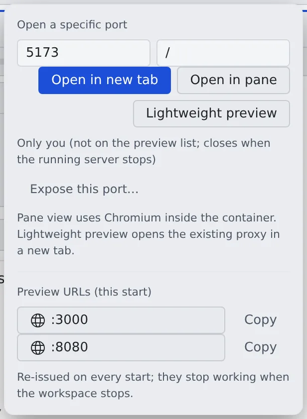

# See a web app you started

English | [日本語](browser-pane.ja.md)

Open a dev server or web app started inside the workspace right where it is, without exposing a port or recreating the
container. Use the browser pane to try the screen by hand, and the lightweight preview to look at an HTTP response once.

## How it works

| What you do | What the agent does |
|---|---|
| Ask for the dev server to be started | Starts it inside the workspace and tells you the port |
| Enter the port under "Preview" and open it | ― |
| Try the screen that opens | ― |

Agents have no tool to open or see your browser pane. What the pane shows is yours to check.

## Choose how to open it

| Way | Button | Good for |
|---|---|---|
| Preview subdomain | "**Open in new tab**" | The most natural way. The app is served at its own root and behaves like any website. Only where they are issued ([Use preview subdomains](subdomains.md)) |
| Browser pane | "**Open in pane**" | Screens you try by hand. HMR, WebSocket, SSE, cookies, redirects and absolute-path assets behave as on a normal localhost |
| Lightweight preview | "**Lightweight preview**" | A one-off look at an HTTP response, such as JSON or a health check |

When in doubt, use the subdomain if there is one, otherwise the browser pane. The detailed difference between the two
routes is in [Browser pane — the usage contract](../../ref/browser-pane.md).

The lightweight preview's URL is a sub-path, `/preview/<port>/`, so an app that uses absolute paths such as
`/static/...`, or a screen that relies on the root path or the cookie path, breaks.

- Where there is a preview domain, the lightweight preview forwards to the preview subdomain as well
- Where there is none, the page cannot keep its own cookies or storage, and its own WebSocket is refused.
  Plain HTML and ordinary scripts work, but open an app such as Vite or Next.js with "Open in pane"

## Open it

1. Have a shell or an agent start the dev server. Make it listen on `127.0.0.1` (or on every interface) inside the workspace
2. Open "**Preview**" in the workspace bar
3. Enter the port number under "**Open a specific port**". Add a path starting with `/` if you need one
4. The prominent button, or Enter, opens it the default way. The buttons beside it pick another way

- The default is the subdomain when preview URLs have been issued, otherwise the browser pane, and the lightweight preview where there is no browser pane. Ways you cannot use are greyed out
- Ports from 1 to 65535 are accepted. 7700 is Agent Fleet's own and cannot be opened. A host name or an outside URL cannot be entered
- All of them work only while the workspace is running
- On a phone the workspace bar has no "Preview". Open **⋯** at the right end for the same fields and buttons

There are other ways in, too.

- **A port on a session row**: ports being listened on show on the session's row. Click to open the default way; the ⋯ beside it (or right-click, or long-press) picks the way
- **A link in a document**: a URL such as `http://127.0.0.1:3000/` in a reply or document opens the same way ([View documents and diagrams](../files/view.md#links-in-documents))

## Examples by setup

| Setup | What to enter | Way to open |
|---|---|---|
| Node, Vite | `5173` and `/` | HMR uses a WebSocket, so the browser pane |
| Spring Boot | `8080` and `/` or `/actuator/health` | Screens with redirects or cookies in the browser pane. Just the health JSON, the lightweight preview |
| API only | `8080` and `/api/health` | Checking JSON, the lightweight preview. With SSE, cookies or redirects, the browser pane |
| Frontend and API (two ports) | `5173` and `8080` | The subdomain if you have one (each port gets its URL). Otherwise open `5173` in the browser pane; fetch, WebSocket and SSE to `8080` work from there (with CORS set up, as in any browser) |

For Spring Boot links and redirects to resolve correctly, set `server.forward-headers-strategy=framework` (or `native`) in the app.

## Operate the browser pane

Inside the pane you can click, scroll, type (Japanese too), go back and forward, reload and change the path.
The pane's "Console" lets you read and copy the page's `error` and `warn` logs.

On a touch screen such as a tablet:

| Gesture | What it does |
|---|---|
| Swipe | Scroll |
| Tap | Click |
| Long-press and drag | Select text, move a slider |
| Two-finger pinch | Zoom. The page is redrawn at the narrower width, so text stays readable at full size |
| Double-tap | Toggle between fit-to-width and 100% |

A tap does not bring up the keyboard. To type into a field, tap the field, then open the keyboard with the keyboard
button at the bottom left of the pane.

## Good to know

- There are limits on how many panes can be open, the view size and the frame rate ([Limits and defaults](../../ref/limits.md#fixed-in-the-product)). It is not meant for video or fast-moving screens
- Switching the pane to another view or putting it in the background stops drawing, and the page is kept for a while. Come back soon and it is as you left it; later, it reopens from the same port and path
- Stopping and starting the workspace, reloading the Console, or "**Reconnect**" reopens it from the same port and path automatically, but cookies and half-typed input do not come back
- It is not a browser for outside URLs; it opens the workspace's ports only. Nor is it a replacement for developer tools

## When it goes wrong

### The pane shows a state instead of the page

| State | Meaning | What to do |
|---|---|---|
| `target-unreachable` | Nothing answers at that port and path yet. Waiting for the dev server to start looks like this too | Check the port, the path and that the server is listening; once it is up, "**Reload**". If it stays, "**Reconnect**" |
| `target-unreachable` (does not speak HTTP) | Something listens on the port, but it is not a web server | Check that it is not a database or debugger port |
| `target-unreachable` (running HTTPS) | The dev server serves HTTPS | Turn HTTPS off in the dev server, then "**Reconnect**" |
| `disconnected` | The connection to the pane dropped | Check that the workspace is running and the network is back, then "**Reconnect**" |
| `crashed` | The browser inside the workspace crashed | "**Reconnect**". If it repeats, check the workspace's memory use and the app you opened |

Opening it while the workspace is stopped or starting says so. Open it again once it is running.

### "Open in pane" cannot be pressed

A deployment that runs workspaces on Kubernetes (a preview) or ECS Fargate has no browser pane. Chromium's sandbox
cannot start in its restricted container, and the tooltip and hint say so.

- The lightweight preview works. Ports on session rows open in the lightweight preview too
- A browser pane left in a saved layout shows the reason and a button that opens the same page in the lightweight preview

## Related

- [Use preview subdomains](subdomains.md): open the app at its own root URL, show it to others
- [Try Google sign-in on a preview](dev-signin.md): try sign-in on a preview URL
- [Operate a browser the agent opened](agent-browser.md): log in and the like in the agent's browser for it
- [Browser pane — the usage contract](../../ref/browser-pane.md): the detailed difference between the two routes
