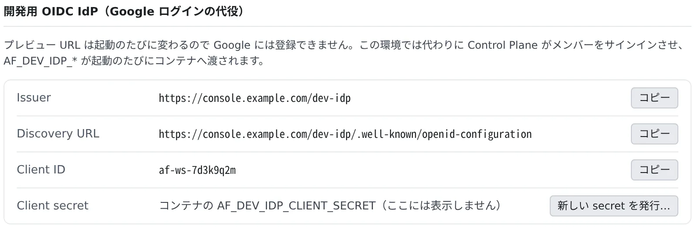

# プレビューで Google ログインを試す

[English](dev-signin.md) | 日本語

Google は OAuth クライアントに登録したリダイレクト URI しか受け付けず、プレビューの URL は起動のたびに変わります。
そこで開発中に限って、Control Plane が Google の代わりにサインインさせます。アプリの設定（issuer、client id、client secret）を
替えるだけで、コードの変更も Google Cloud コンソールでの登録も要りません。

## 全体像

| あなたがやること | エージェントがやること |
|---|---|
| アプリの設定を、開発用の issuer に向ける | ⚙設定の「アプリの設定例」をもとに設定を書く |
| プレビューの URL でアプリを開き、サインインする | ― |
| 権限の出し分けを試すなら、テスト用ペルソナを作る | ― |

ワークスペースには、起動のたびに次の値が渡されます。

| 環境変数 | 中身 |
|---|---|
| `AF_DEV_IDP_ISSUER` | issuer |
| `AF_DEV_IDP_WELL_KNOWN` | discovery の URL |
| `AF_DEV_IDP_CLIENT_ID` | あなたのワークスペース専用の client id |
| `AF_DEV_IDP_CLIENT_SECRET` | client secret |

## 使えるか確かめる

⚙設定の「**プレビュー用サブドメイン**」に「**開発用 OIDC IdP（Google ログインの代役）**」が出ていれば使えます。
ワークスペースごとにオン・オフするスイッチはありません。



- 使えるのは、プレビュー用サブドメインを発行する配備で、管理者が「**開発用 OIDC IdP を提供する**」をオフにしていないときです。既定ではオンです
- client secret は画面に出ません。コンテナの中の `AF_DEV_IDP_CLIENT_SECRET` を読んでください
- client id と secret は、再起動しても変わりません

## アプリを設定する

「**アプリの設定例**」が、Spring Boot、Auth.js、Go、Better Auth、環境変数だけの形の設定を書き出します。

| 選ぶもの | 決めること |
|---|---|
| 形式 | Spring Boot なら「dev プロファイル（推奨）」「既定値付き 1 ファイル」「環境変数だけ」、Auth.js なら「Auth.js v5」か「next-auth v4」など |
| ポート | 公開するポートの一覧から選ぶ |
| プレビュー用の設定も含める | プレビューの URL 向けの設定を足すかどうか |
| 値 | 環境変数を参照するか、値を埋めるか。client secret はいつも環境変数の参照です |

考え方は「変数があるときだけ開発用の issuer を使う」です。次の 2 つは例です。

**Auth.js（NextAuth）v5**

```ts
// auth.ts
import NextAuth from "next-auth"
import Google from "next-auth/providers/google"

export const { handlers, auth } = NextAuth({
  providers: [
    Google(
      process.env.AF_DEV_IDP_ISSUER
        ? {
            issuer: process.env.AF_DEV_IDP_ISSUER,
            clientId: process.env.AF_DEV_IDP_CLIENT_ID,
            clientSecret: process.env.AF_DEV_IDP_CLIENT_SECRET,
          }
        : {},
    ),
  ],
})
```

v4 なら `GoogleProvider({ wellKnown: process.env.AF_DEV_IDP_WELL_KNOWN, clientId, clientSecret })` です。汎用の OIDC プロバイダーに
同じ値を渡しても動きます。

**Spring Boot**：登録名は `google` のまま、プロバイダーの側を差し替えます。

```yaml
# application-devidp.yml  (activate with SPRING_PROFILES_ACTIVE=devidp, in the workspace only)
spring:
  security:
    oauth2:
      client:
        registration:
          google:
            client-id: ${AF_DEV_IDP_CLIENT_ID}
            client-secret: ${AF_DEV_IDP_CLIENT_SECRET}
            scope: openid,email,profile
        provider:
          google:
            issuer-uri: ${AF_DEV_IDP_ISSUER}
      resourceserver:
        jwt:
          issuer-uri: ${AF_DEV_IDP_ISSUER}   # only for a backend that verifies the ID token itself
```

`server.forward-headers-strategy=framework` を付けておくと、Spring はコールバックの URL をプレビューのホストから組み立てます。

> [!WARNING]
> **本番の設定に、この issuer を信用させないでください。** Console にサインインできる人なら誰でも通ってしまいます。
> 設定はプロファイルか、ワークスペースの中にしかない変数に置いてください。どのトークンにも `af_dev: true` が入るので、バックエンドで断ることもできます。

## サインインする

アプリのサインインを押すと、Console にサインインしている本人としてサインインします。パスワードの入力はありません。

| Console へのサインイン | アプリに渡るもの |
|---|---|
| Google でサインインしている | 本物の Google の `sub` とメールアドレス。アプリにすでにあるユーザーとそのまま一致します |
| それ以外 | Console のメールアドレスと、`af-…` の形の変わらない `sub` |

共有したプレビュー（[プレビュー用のサブドメインを使う](subdomains.ja.md#人に見せる)）を開いた同僚は、その同僚自身としてサインインします。

ブラウザを戻せる先は、次のどれかだけです。それ以外は、再起動前の URL も含めてエラーのページになり、リダイレクトされません。

- あなたの今のプレビュー URL のうち、公開するポートの一覧にあるもの
- 一覧に加えずに自分用に開いているポート（その開き方が続いている間、サインインするのがあなた自身のときだけ）
- `http://localhost:<ポート>`・`http://127.0.0.1:<ポート>`（ブラウザペインでも使えます）

アプリ自身の URL（`AUTH_URL` など）は `AF_PREVIEW_URL_<ポート>` から設定し、送るコールバックがちょうどそれになるようにしてください。

## テスト用ペルソナで試す

admin や viewer のような権限の出し分けを試すときは、「**テスト用ペルソナ**」で身元を足します。

1. 「**ハンドル**」と、必要なら「**表示名**」を入れて「**追加**」を押します
2. アプリでサインインすると確認の画面が出るので、自分かペルソナを選びます

- ペルソナのメールアドレスは `<ハンドル>@example.test`、`sub` は `persona:` で始まるので、実在のメンバーにはなれません
- ワークスペースごとに 20 個まで作れます。ハンドルは英小文字・数字・`.`・`_`・`-` の 1〜32 文字で、先頭は英小文字か数字です
- 確認の画面は 1 回だけ、5 分の間だけ答えられます。キャンセルを押すと、アプリには `access_denied` のエラーが返ります
- `prompt=none` のサインインは、確認なしで自分として通ります。ペルソナがないワークスペースには、確認の画面は出ません

## 自分の PC のアプリから使う

自分の PC の `http://localhost:<ポート>` で動くアプリも、同じ IdP でサインインできます。ワークスペースが停止中でも使えます。

1. ワークスペースの端末で 3 つの値を読みます：`printenv AF_DEV_IDP_ISSUER AF_DEV_IDP_CLIENT_ID AF_DEV_IDP_CLIENT_SECRET`。secret はコンテナの中にしかないので、読むときだけワークスペースを起動してください
2. 3 つを PC の環境変数に設定します
3. アプリのコールバックを `http://localhost:<ポート>/<コールバックのパス>` にします。`127.0.0.1` でも、ポートは何番でも構いません
4. その PC のブラウザで Console にサインインしたままにします。ほかのログインは要りません

- secret はパスワードと同じに扱ってください。git、チャット、スクリーンショットに載せないでください
- 停止中に受け付けるのは `localhost`・`127.0.0.1` へのリダイレクトだけです。プレビューの URL へは、ワークスペースが起動しているときだけ戻せます
- PC とワークスペースで同じ設定を使うなら、「アプリの設定例」で環境変数を参照する形を選びます。Spring Boot は `devidp` プロファイル（`SPRING_PROFILES_ACTIVE=devidp`）に入れるのがおすすめです。本番の設定が開発用の issuer を名指ししなくて済みます

## secret を替える

「**新しい secret を発行…**」を押すと、client id と secret が両方とも新しくなります。

- 古い組はすぐ使えなくなります。PC に設定したコピーも、まとめて使えなくなります
- 新しい組は次の起動でコンテナに入るので、ワークスペースを停止してから起動してください。PC の側も両方を入れ替えます

## 知っておくこと

- 置き換わるのはサインインだけです。Google API のアクセストークン（Calendar、Drive など）は得られず、`picture` もありません
- トークンの寿命は 10 分、サインインのコードは 60 秒です
- サインインの要求には、`none` 以外の `prompt`、`max_age`、`query` 以外の `response_mode` を付けられません。付けると `invalid_request` のエラーが返ります。Google 向けの例にある `prompt: "consent"` は外してください
- 署名の鍵は 30 日ごとに替わり、古い鍵も 24 時間は JWKS に残ります。鍵を固定せず、ライブラリに discovery の URL から取らせてください

## 困ったとき

### 「開発用 OIDC IdP」の欄が出ない、issuer が 404 を返す

配備で IdP がオフになっているか、プレビュー用ドメインのない環境です。管理者に確かめてください。

### サインインのあとエラーのページになる

戻す先の URL が受け付けられていません。再起動前の URL や、一覧にないポートを使っていないか確かめ、アプリの URL を `AF_PREVIEW_URL_<ポート>` から設定し直してください。

## 関連

- [プレビュー用のサブドメインを使う](subdomains.ja.md)：プレビューの URL と公開するポート
- [起動した Web アプリを見る](browser-pane.ja.md)：ブラウザペインで開く
