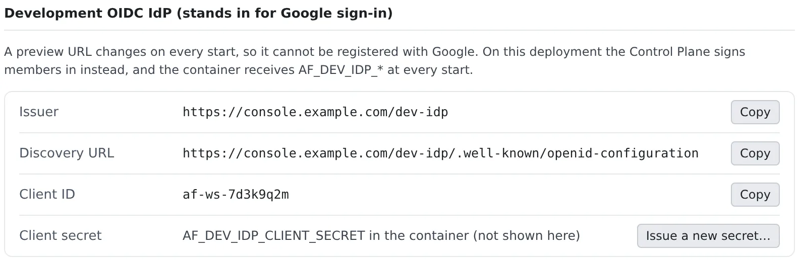

# Try Google sign-in on a preview

English | [日本語](dev-signin.ja.md)

Google accepts only redirect URIs registered on its OAuth client, and a preview URL changes at every start. So during
development only, the Control Plane signs you in in Google's place. Your app changes its settings (issuer, client id,
client secret) and nothing else: no code changes, nothing to register in the Google Cloud console.

## How it works

| What you do | What the agent does |
|---|---|
| Point the app's settings at the development issuer | Writes the settings from "App configuration examples" in ⚙ Settings |
| Open the app on a preview URL and sign in | ― |
| Create test personas to try different permissions | ― |

The workspace receives these values at every start.

| Environment variable | Content |
|---|---|
| `AF_DEV_IDP_ISSUER` | The issuer |
| `AF_DEV_IDP_WELL_KNOWN` | The discovery URL |
| `AF_DEV_IDP_CLIENT_ID` | A client id for your workspace alone |
| `AF_DEV_IDP_CLIENT_SECRET` | The client secret |

## Check that you can use it

If ⚙ Settings, "**Preview subdomains**" shows "**Development OIDC IdP (stands in for Google sign-in)**", you can.
There is no per-workspace switch.



- It is there on a deployment that issues preview subdomains, unless the administrator turned "**Serve the development OIDC IdP**" off. It is on by default
- The client secret is not shown on screen. Read `AF_DEV_IDP_CLIENT_SECRET` inside the container
- The client id and secret stay the same across restarts

## Configure the app

"**App configuration examples**" writes out the settings for Spring Boot, Auth.js, Go, Better Auth and environment variables alone.

| Choice | What it decides |
|---|---|
| Form | For Spring Boot "dev profile (recommended)", "One file with defaults" or "Environment only"; for Auth.js "Auth.js v5" or "next-auth v4"; and so on |
| Port | Picked from the list of exposed ports |
| Include preview settings | Whether to add the settings for the preview URL |
| Values | Refer to environment variables, or fill in the values. The client secret is always a reference to its variable |

The idea is "use the development issuer only when the variables are there". Two examples:

**Auth.js (NextAuth) v5**

```ts
// auth.ts
import NextAuth from "next-auth"
import Google from "next-auth/providers/google"

export const { handlers, auth } = NextAuth({
  providers: [
    Google(
      process.env.AF_DEV_IDP_ISSUER
        ? {
            issuer: process.env.AF_DEV_IDP_ISSUER,
            clientId: process.env.AF_DEV_IDP_CLIENT_ID,
            clientSecret: process.env.AF_DEV_IDP_CLIENT_SECRET,
          }
        : {},
    ),
  ],
})
```

With v4 it is `GoogleProvider({ wellKnown: process.env.AF_DEV_IDP_WELL_KNOWN, clientId, clientSecret })`. Giving the same
values to a generic OIDC provider works too.

**Spring Boot**: keep the registration name `google` and swap the provider side.

```yaml
# application-devidp.yml  (activate with SPRING_PROFILES_ACTIVE=devidp, in the workspace only)
spring:
  security:
    oauth2:
      client:
        registration:
          google:
            client-id: ${AF_DEV_IDP_CLIENT_ID}
            client-secret: ${AF_DEV_IDP_CLIENT_SECRET}
            scope: openid,email,profile
        provider:
          google:
            issuer-uri: ${AF_DEV_IDP_ISSUER}
      resourceserver:
        jwt:
          issuer-uri: ${AF_DEV_IDP_ISSUER}   # only for a backend that verifies the ID token itself
```

With `server.forward-headers-strategy=framework` set, Spring builds the callback URL from the preview's host.

> [!WARNING]
> **Never let a production configuration trust this issuer.** Anyone who can sign in to the Console would get through.
> Keep the settings in a profile or in variables that exist only inside the workspace. Every token also carries `af_dev: true`, so a backend can refuse it.

## Sign in

Press sign-in in the app and you are signed in as whoever is signed in to the Console. There is no password prompt.

| Your Console sign-in | What the app receives |
|---|---|
| Signed in with Google | Your real Google `sub` and email address, so the user the app already has matches as it is |
| Anything else | Your Console email address and a stable `sub` of the form `af-…` |

A colleague who opens a preview you shared ([Use preview subdomains](subdomains.md#show-it-to-others)) signs in as that colleague.

The browser can only be sent back to one of these. Anything else, including a URL from before a restart, ends on an
error page instead of a redirect.

- A port of your current preview URL that is in the list of exposed ports
- A port you opened for yourself without adding it to the list (while that stays open, and only when you are the one signing in)
- `http://localhost:<port>` or `http://127.0.0.1:<port>` (this works in the browser pane too)

Set the app's own URL (`AUTH_URL` and the like) from `AF_PREVIEW_URL_<port>`, so that the callback it sends is exactly that.

## Try it with test personas

To try different permissions such as admin and viewer, add identities under "**Test personas**".

1. Enter a "**Handle**" and, if you like, a "**Display name**", and press "**Add**"
2. When you sign in to the app, a confirmation page appears; pick yourself or a persona

- A persona's address is `<handle>@example.test` and its `sub` starts with `persona:`, so it can never be a real member
- Up to 20 per workspace. A handle is 1 to 32 characters of lower-case letters, digits, `.`, `_` and `-`, starting with a lower-case letter or a digit
- The confirmation page can be answered once, within 5 minutes. Cancel returns an `access_denied` error to the app
- A `prompt=none` sign-in goes through silently as you. A workspace without personas never shows the confirmation page

## Use it from an app on your own machine

An app on your own machine at `http://localhost:<port>` can sign in with the same IdP. It works even while the workspace is stopped.

1. Read the three values in a workspace terminal: `printenv AF_DEV_IDP_ISSUER AF_DEV_IDP_CLIENT_ID AF_DEV_IDP_CLIENT_SECRET`. The secret exists only inside the container, so start the workspace to read it
2. Set the three as environment variables on your machine
3. Set the app's callback to `http://localhost:<port>/<callback path>`. `127.0.0.1` works too, on any port
4. Stay signed in to the Console in that machine's browser. No other login is needed

- Treat the secret like a password. Keep it out of git, chat and screenshots
- While the workspace is stopped, only redirects to `localhost` and `127.0.0.1` are accepted. Preview URLs work only while it is running
- To use the same settings on your machine and in the workspace, pick the form that refers to environment variables under "App configuration examples". For Spring Boot the `devidp` profile (`SPRING_PROFILES_ACTIVE=devidp`) is recommended, so the production configuration never names the development issuer

## Replace the secret

"**Issue a new secret…**" replaces both the client id and the secret.

- The old pair stops working at once, along with every copy you set on your machine
- The new pair reaches the container at its next start, so stop and start the workspace. Replace both on your machine as well

## Good to know

- Only sign-in is replaced. You get no Google API access token (Calendar, Drive and so on) and no `picture`
- Tokens live 10 minutes; a sign-in code lives 60 seconds
- A sign-in request cannot carry a `prompt` other than `none`, `max_age`, or a `response_mode` other than `query`; the app gets an `invalid_request` error. Remove the `prompt: "consent"` that some Google examples carry
- The signing key changes every 30 days, and the old key stays in the JWKS for 24 hours. Do not pin the key; let the library take it from the discovery URL

## When it goes wrong

### The "Development OIDC IdP" block is missing, or the issuer answers 404

The IdP is off on the deployment, or the environment has no preview domain. Ask your administrator.

### An error page after signing in

The URL to return to was not accepted. Check that you are not on a URL from before a restart or on a port outside the list, and set the app's URL from `AF_PREVIEW_URL_<port>` again.

## Related

- [Use preview subdomains](subdomains.md): preview URLs and the exposed ports
- [See a web app you started](browser-pane.md): open it in the browser pane
