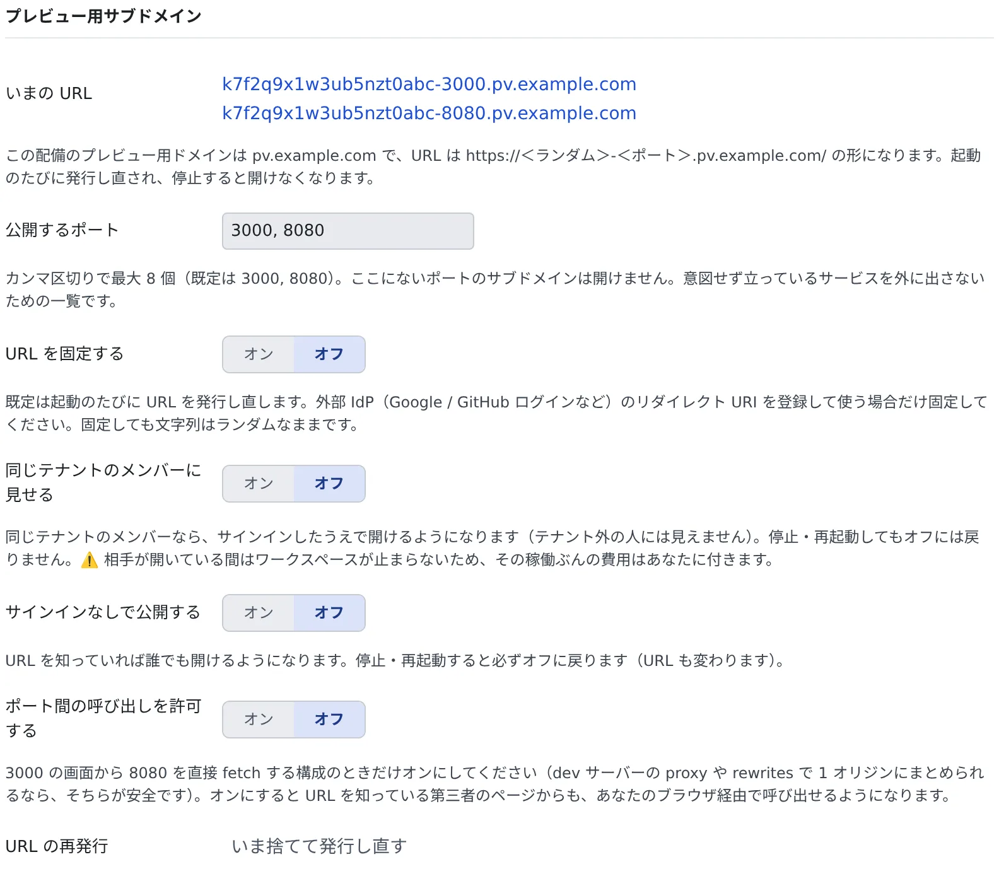

# プレビュー用のサブドメインを使う

[English](subdomains.md) | 日本語

ワークスペースを起動するたびに、ポートごとの URL が発行されます。アプリがルート直下に配られるので、ふつうの Web サイトと同じように動き、
同じテナントの同僚やテナントの外の人に見せることもできます。プレビュー用ドメインが設定された配備でだけ使えます。

## 全体像

| あなたがやること | エージェントがやること |
|---|---|
| 公開するポートを決める | ― |
| 「プレビュー」から URL を開く、コピーする | ― |
| アプリが自分の URL を知る必要があれば、そう頼む | コンテナの中の `AF_PREVIEW_URL_<ポート>` をアプリに渡す |
| 人に見せるときに、見せる範囲を広げる | ― |

## URL を開く

ワークスペース操作バーの「**プレビュー**」を開くと、「**プレビュー用 URL（この起動ぶん）**」にポートごとに並びます。
押すと新しいタブで開き、「**コピー**」で URL を取れます。

```
https://k7f2q9x1w3ub5nzt0abc-3000.pv.example.com/   → 3000 番（React・Next.js など）
https://k7f2q9x1w3ub5nzt0abc-8080.pv.example.com/   → 8080 番（Spring Boot など）
```

- **起動のたびに変わります。** 停止すると開けなくなります（前の URL は 404 になります）。URL を貼った資料はすぐ古くなります
- **既定ではサインインが要ります。** 初めて開くときは Console のサインインに一度移り、戻ってきます
- 3000 と 8080 のように、いくつものポートを同時に開けます

## 設定する

⚙設定の「**プレビュー用サブドメイン**」で決めます。このタブは、プレビュー用サブドメインを発行する配備にだけ出ます。



| 項目 | 決めること |
|---|---|
| いまの URL | 今の起動で発行されている URL です。停止中は「未発行」と出て、その下に使われるドメインが表示されます |
| 公開するポート | サブドメインを開けるポート。カンマ区切りで 8 個まで書けます。既定は `3000, 8080` です |
| URL を固定する | 既定ではオフで、起動のたびに発行し直します。外部の IdP にリダイレクト URI を登録して使うときだけオンにします。固定しても文字列はランダムです |
| 同じテナントのメンバーに見せる | [人に見せる](#人に見せる) を見てください |
| サインインなしで公開する | [人に見せる](#人に見せる) を見てください |
| ポート間の呼び出しを許可する | 既定ではオフです。3000 の画面から 8080 を直接呼ぶ構成のときだけオンにします（[下](#アプリの側で気をつけること)） |
| URL の再発行 | 「**いま捨てて発行し直す**」で、今の URL をすぐ使えなくします |

## 一覧にないポートを開く

ワークスペースで待ち受けているのに一覧にないポート（`5173` の Vite、`4000` の使い捨てのサーバーなど）も、設定を変えずに
サブドメインで開けます。この開き方は**あなただけ**のものです。

- セッションの行のポートを押すか、「プレビュー」の「**ポートを指定して開く**」で開きます。横の ⋯ からは、ブラウザペインや軽量プレビューも選べます
- 公開の設定やテナントへの共有の対象にはなりません
- そのサーバーが止まると閉じます。ワークスペースの停止・再起動や、URL の再発行でも閉じます
- この開き方で開けるポートは、ワークスペースごとに 16 個までです。超えると「一時的に開いているポートが多すぎます」と出るので、サーバーを止めるか、ポートを一覧に加えてください
- ポートが素の HTTP で答えることが条件です。データベース、SSH、HTTPS だけの開発サーバーは、理由を示して断られます
- `AF_PREVIEW_URL_<ポート>` は設定されません

アプリが自分の URL を知る必要があるとき、ほかの人にも見せたいとき、サインインさせたいときは、メニューの
「**このポートを公開設定に追加…**」で一覧に加えてください。

## アプリの側で気をつけること

- **API の呼び先を `http://localhost:8080` と書かない。** ブラウザから見た `localhost` は、画面を見ている人の PC です。
  開発サーバーのプロキシ（Vite の `server.proxy`、Next.js の `rewrites()`）で `/api` を 8080 に流すと、手元の PC でもプレビューでも同じ設定のまま動きます
- **プロキシの転送先は `http://127.0.0.1:8080` のままにする。** ここをプレビューの URL に書き換えると、API がすべて 401
  （`preview requires sign-in`）になります。プロキシはコンテナの中のサーバーから出る通信で、あなたのブラウザのサインインを持っていないためです
- 3000 の画面から 8080 を直接呼ぶ構成にするなら、「**ポート間の呼び出しを許可する**」をオンにします。オンにすると、URL を知っている第三者のページからも、あなたのブラウザを通して呼べるようになります
- **Spring Boot** は `server.forward-headers-strategy=framework` を設定してください
- **Next.js** は `allowedDevOrigins` の設定が要ります。ないと、`/_next/*` への別のオリジンからのアクセスが止められ、レイアウトの枠だけが出て
  データが出ません。開発サーバーのログに `⚠ Blocked cross-origin request to Next.js dev resource` と出ていたらこれです。URL は起動のたびに変わるので、ワイルドカードで書きます

  ```ts
  // next.config.ts
  allowedDevOrigins: ["127.0.0.1", "*.pv.example.com"],  // the domain is AF_PREVIEW_DOMAIN
  ```
- **Vite** の HMR は、`hmr` も `allowedHosts` も設定せずに動きます。ただし、ロードバランサーは一定時間（ある環境では 60 秒）通信のない WebSocket を切ります。
  Vite は 30 秒ごとに ping を送るのでふつうは切れませんが、`server.ws.timeout` をそれより長くすると、切れたときにページ全体を読み込み直して状態が消えます
- コンテナの中には `AF_PREVIEW_URL_3000`・`AF_PREVIEW_URL_8080`・`AF_PREVIEW_DOMAIN` が入っています。`NEXTAUTH_URL` のように自分の公開 URL を環境変数から読むアプリには、これを渡してください

## 人に見せる

見せたい相手によって、使うものが違います。下に行くほど広く開きます。

| 相手 | すること | 知っておくこと |
|---|---|---|
| 自分だけ | 何もしません（既定） | ― |
| 同じテナントの同僚 | 「**同じテナントのメンバーに見せる**」をオン | 相手も Console にサインインして開きます。停止・再起動してもオフに戻らないので、見せ終わったら自分でオフにします |
| テナントの外の人 | 「**サインインなしで公開する**」をオン | URL を知っていれば誰でも開けます。停止・再起動すると必ずオフに戻り、URL も変わります |

同僚に見せるときは：

- 「プレビュー」の「**共有**」でコピーしたリンクを渡してください。このリンクは起動をまたいでも使えます。生の URL は再起動のたびに 404 になります
- 相手の「プレビュー」には「**共有されているプレビュー**」として並びます。あなたのワークスペースが停止中は「停止中」と出て開けません。相手は起動できないので、必要なときはあなたに起動を頼むことになります
- 相手が開いている間は、ワークスペースが自動で止まりません。その間の費用はあなたに付きます。画面を開いたまま放っておいただけなら、やがて止まります

URL を渡す相手を間違えたら、「**いま捨てて発行し直す**」を押します。

- 今開いているタブも、共有した相手のタブも、すぐ 404 になります。取り消せません
- 稼働中のコンテナは作り直さないので、中の `AF_PREVIEW_URL_*` は次の起動まで古いままです
- 停止中に押しても、捨てる URL がないので何も起きません。次に起動すれば、どのみち新しい URL になります

## 関連

- [起動した Web アプリを見る](browser-pane.ja.md)：ブラウザペインと軽量プレビュー
- [プレビューで Google ログインを試す](dev-signin.ja.md)：プレビューの URL でサインインを試す
