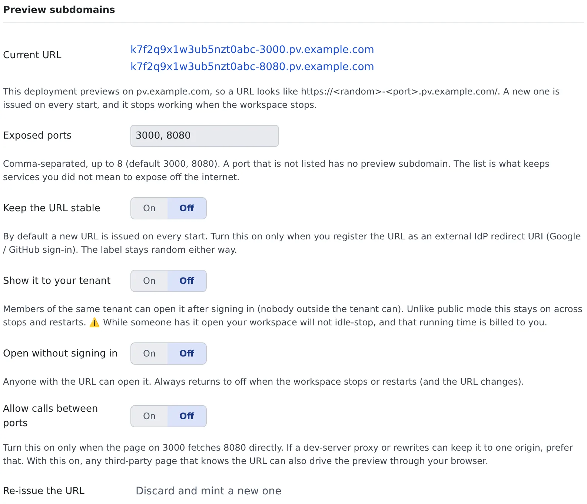

# Use preview subdomains

English | [日本語](subdomains.ja.md)

Every time the workspace starts, it is issued a URL per port. The app is served at its own root and behaves like any
website, and you can show it to colleagues in your tenant or to people outside it. Only on deployments that have a
preview domain set.

## How it works

| What you do | What the agent does |
|---|---|
| Decide which ports to expose | ― |
| Open or copy a URL from "Preview" | ― |
| If the app needs to know its own URL, ask for it | Passes `AF_PREVIEW_URL_<port>` from inside the container to the app |
| Widen who may open it when you show it to someone | ― |

## Open a URL

Open "**Preview**" in the workspace bar and the URLs are listed per port under "**Preview URLs (this start)**".
Click one to open it in a new tab; "**Copy**" takes the URL.

```
https://k7f2q9x1w3ub5nzt0abc-3000.pv.example.com/   → port 3000 (React, Next.js and the like)
https://k7f2q9x1w3ub5nzt0abc-8080.pv.example.com/   → port 8080 (Spring Boot and the like)
```

- **They change with every start.** Once stopped they no longer open (the old URL answers 404). A document you paste one into goes stale quickly
- **Sign-in is required by default.** The first time, you pass through the Console's sign-in once and come back
- Several ports, such as 3000 and 8080, can be open at once

## Set it up

Decide under ⚙ Settings, "**Preview subdomains**". The tab only exists on a deployment that issues preview subdomains.



| Item | What it sets |
|---|---|
| Current URL | The URLs issued for this start. While stopped it says none are issued, with the domain to be used below it |
| Exposed ports | The ports whose subdomain can be opened. Up to 8, comma-separated. The default is `3000, 8080` |
| Keep the URL stable | Off by default: a new URL with every start. Turn it on only when you register a redirect URI with an outside IdP. The string stays random either way |
| Show it to your tenant | See [Show it to others](#show-it-to-others) |
| Open without signing in | See [Show it to others](#show-it-to-others) |
| Allow calls between ports | Off by default. Turn it on only when the screen on 3000 calls 8080 directly ([below](#what-the-app-has-to-get-right)) |
| Re-issue the URL | "**Discard and mint a new one**" makes the current URLs unusable at once |

## Open a port that is not in the list

A port the workspace listens on but that is not in the list (Vite on `5173`, a throwaway server on `4000`) also opens on
a subdomain without changing the settings. Opened this way it is **yours alone**.

- Click the port on the session row, or use "**Open a specific port**" under "Preview". The ⋯ beside it also offers the browser pane and the lightweight preview
- It is not covered by the public setting or by sharing with your tenant
- It closes when that server stops, and also when the workspace stops or restarts or the URL is re-issued
- Up to 16 ports per workspace can be open this way. Past that it says too many ports are temporarily open; stop a server or add the port to the list
- The port has to answer plain HTTP. A database, SSH, or a dev server that only speaks HTTPS is refused with the reason
- `AF_PREVIEW_URL_<port>` is not set for it

When the app needs to know its own URL, or you want others to see it or sign in to it, add it to the list with
"**Expose this port…**" in the menu.

## What the app has to get right

- **Do not hard-code `http://localhost:8080` as the API to call.** To the browser, `localhost` is the PC of whoever is looking.
  Route `/api` to 8080 with the dev server's proxy (Vite's `server.proxy`, Next.js's `rewrites()`) and the same settings work on your own PC and on the preview
- **Leave the proxy's target at `http://127.0.0.1:8080`.** Rewriting it to the preview URL makes every API call answer 401
  (`preview requires sign-in`): the proxy is a request from the server inside the container, and it does not carry your browser's sign-in
- If the screen on 3000 must call 8080 directly, turn on "**Allow calls between ports**". Then a third party's page that knows the URL can also call it through your browser
- **Spring Boot**: set `server.forward-headers-strategy=framework`
- **Next.js** needs `allowedDevOrigins`. Without it, access to `/_next/*` from another origin is blocked, and only the
  layout's frame draws, with no data. If the dev server's log says `⚠ Blocked cross-origin request to Next.js dev resource`, this is it. The URL changes with every start, so use a wildcard

  ```ts
  // next.config.ts
  allowedDevOrigins: ["127.0.0.1", "*.pv.example.com"],  // the domain is AF_PREVIEW_DOMAIN
  ```
- **Vite**'s HMR works with neither `hmr` nor `allowedHosts` set. But the load balancer drops a WebSocket that has been quiet for a while (60 seconds in one environment).
  Vite pings every 30 seconds so it normally stays open, but set `server.ws.timeout` longer than that and a dropped connection reloads the whole page and loses its state
- The container has `AF_PREVIEW_URL_3000`, `AF_PREVIEW_URL_8080` and `AF_PREVIEW_DOMAIN`. Pass them to an app that reads its own public URL from the environment, such as `NEXTAUTH_URL`

## Show it to others

What you use depends on who should see it. Each row opens it wider.

| Who | What to do | Good to know |
|---|---|---|
| Only you | Nothing (the default) | ― |
| Colleagues in your tenant | Turn on "**Show it to your tenant**" | They sign in to the Console to open it. Stopping or restarting does not turn it off, so turn it off yourself when you are done |
| People outside your tenant | Turn on "**Open without signing in**" | Anyone with the URL can open it. Stopping or restarting always turns it off, and the URL changes |

When you show it to colleagues:

- Give them the link copied with "**Share**" under "Preview". That link keeps working across starts; the raw URL answers 404 after every restart
- It appears in their "Preview" under "**Shared with you**". While your workspace is stopped it says "Stopped" and does not open. They cannot start it, so they may ask you to
- While they have it open, your workspace does not stop by itself, and the running cost is yours. A screen merely left open stops it in the end

If you gave the URL to the wrong person, press "**Discard and mint a new one**".

- Your open tabs, and those of anyone you shared with, answer 404 at once. It cannot be undone
- The running container is not rebuilt, so the `AF_PREVIEW_URL_*` inside it stay stale until the next start
- Pressed while stopped, it does nothing, as there is no URL to discard. The next start brings a new URL anyway

## Related

- [See a web app you started](browser-pane.md): the browser pane and the lightweight preview
- [Try Google sign-in on a preview](dev-signin.md): try sign-in on a preview URL
