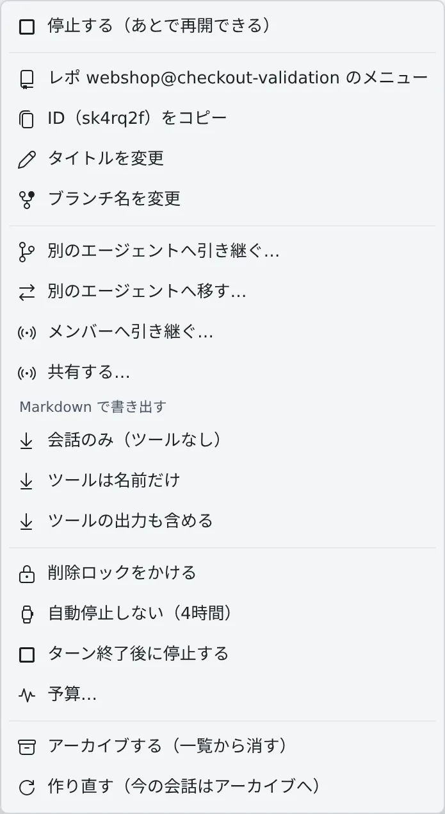

# 終わったら止める・起こしたままにする

[English](auto-stop.md) | 日本語

作業が終わった時点でセッションを止めたり、逆に、長い作業の途中で自動停止されないようにしたりできます。

## 全体像

| あなたがやること | エージェントがやること |
|---|---|
| 「これが終わったら停止して」と頼む | 停止を予約し、今のターンが終わったところで止まる |
| ⋯ メニューで「ターン終了後に停止する」 | 同じ予約が入る。今のターンが終わったところで止まる |
| ⋯ メニューで「自動停止しない（4時間）」 | 4 時間のあいだ、このセッションとワークスペースは自動停止しない |

どちらも止めるのは**再開できる停止**です。会話は残り、あとで続きから再開できます。

## 終わったら止める

夜のうちに長い作業を任せて、終わったセッションには止まっていてほしい、というときに使います。頼み方は 2 つあり、どちらも同じ予約になります。

- **セッションに頼む**：「これが終わったら停止して」と送ります。セッションが自分で予約を入れます
- **自分で入れる**：⋯ メニューの「**ターン終了後に停止する**」を選びます

予約が入ると、行に「**今のターンが終わったら停止します（再開できます）**」というバッジが付きます。止まったときは通知が 1 通届きます。

- 止まるのは、**今動いているターンが終わってから**です。質問待ちのときや、作業が続いている間は止まりません
- **新しい指示を送ると、予約は外れます。**「終わったら止めて」は、その時点の作業について頼んだものだからです
- 取り消すときは、⋯ メニューの「**ターン終了後の停止をやめる**」を選びます。セッションが入れた予約も、ここで取り消せます
- 予約できるのは、動いているセッションだけです

> [!NOTE]
> これは費用を減らす機能ではなく、片付けの機能です。作業を終えたセッションはワークスペースの自動停止を妨げないので、
> 止めてもワークスペースが止まる時刻は変わりません。使っていたメモリがすぐ空き、一覧で「終わった＝停止中」と読めるようになります。
> アイドルの自動停止も同じことをあとでしますが、開いているセッションは対象外なので、見ている前で止められるのはこちらだけです。

## 起こしたままにする

使われていないワークスペースは、自動で止まります。長いビルドや、ターミナルを閉じたまま続ける ssm 越しの作業など、
止められては困るものがあるときに使います。

1. セッション行の ⋯ メニューから「**自動停止しない（4時間）**」を選びます
2. 行に「**自動停止の対象外（残り …）**」と残り時間が出ます

- その間は、このセッションとワークスペースのどちらも、アイドルの自動停止の対象外になります
- 4 時間たつと自動で外れます。途中でやめるときは「**自動停止しないを解除**」を選びます
- 時間を区切ってあるのはわざとです。かけたまま忘れると、ワークスペースが 1 か月動き続けることになるからです

## 関連

- [セッションを止める・再開する](stop-resume.ja.md)
- [使いすぎたセッションを予算で止める](budget.ja.md)
- [終わったセッションを片付ける](cleanup.ja.md)
