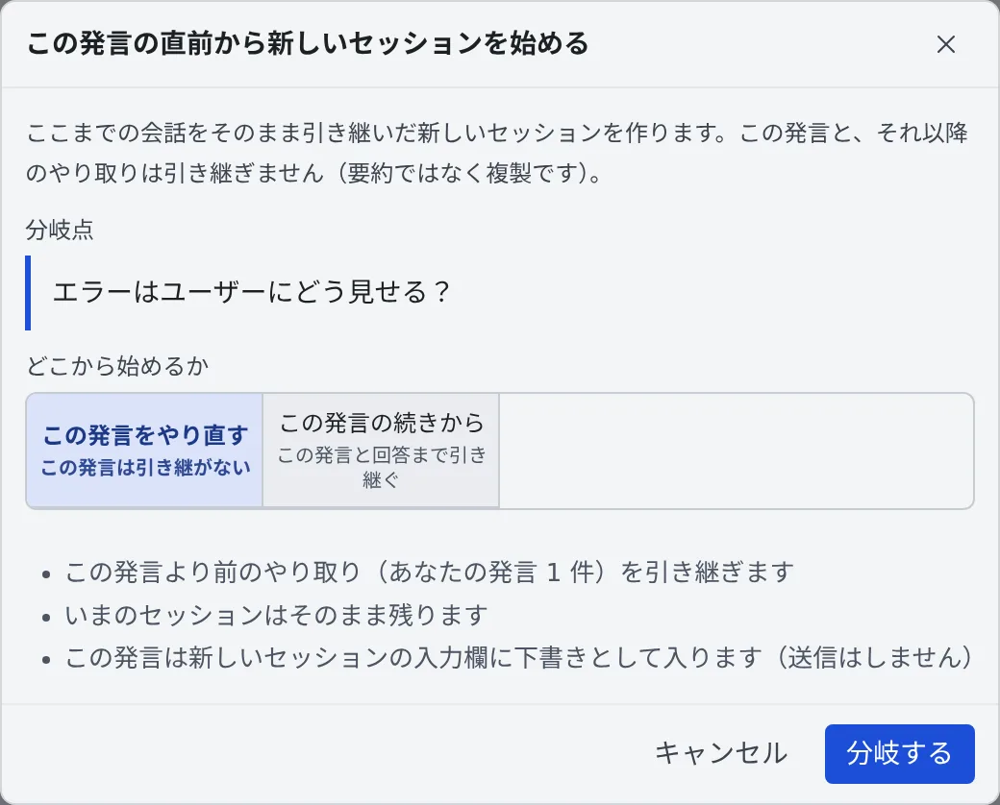

# 過去のメッセージから分岐する

[English](branch-message.md) | 日本語

過去の自分の発言から、そこまでの会話を引き継いだ新しいセッションを作れます。
「あの指示から別のやり方を試したい」「途中で方針を間違えた」というときに、会話をコピーし直さずにやり直せます。

## 全体像

| あなたがやること | エージェントがやること |
|---|---|
| 自分の発言の **「ここから分岐」** を押し、どこから始めるかを選ぶ | 同じ種類のエージェントで、その時点までの会話を持った新しいセッションを始める |
| 新しいセッションで、書き直した指示を送る | 引き継いだ会話の続きとして受け取る |

いまのセッションは、そのまま残ります。

## 分岐する

1. 過去の**自分の発言**にマウスを乗せる（またはフォーカスする）と、吹き出しの下に **「ここから分岐」** が出ます
2. 押すと確認の画面が開きます。分岐点の発言と、引き継ぐやり取りの件数、いまのセッションがそのまま残ることが出ます
3. **「どこから始めるか」** を選び、**「分岐する」** を押します

| どこから始めるか | 引き継ぐもの | 向いているとき |
|---|---|---|
| **この発言をやり直す**（既定） | この発言より前のやり取り。この発言は、新しいセッションの入力欄に**下書き**として入ります（送信はしません） | 指示を書き直したい |
| **この発言の続きから** | この発言と、それへの回答まで | うまくいったところから、別の方向へ進めたい |

「この発言をやり直す」では、書き直して送るのも、そのまま送るのも 1 回の操作です。

## 引き継ぎとの違い

| | 分岐 | 引き継ぎ（handoff） |
|---|---|---|
| 会話 | そのまま複製する | 要約して渡す |
| エージェント | 同じ種類 | 別のエージェントにも渡せる |
| 向いているとき | 言い回しや細かい経緯まで残したい | 続きを別のエージェントに任せたい |

引き継ぎは [別のセッションやエージェントに引き継ぐ](handoff.ja.md#引き継ぐ) にあります。

## 困ったとき

### 「ここから分岐」が出ない

次のどれかです。

- エージェントの発言です。分岐できるのは自分の発言だけです
- まだ送信中の発言です
- そのセッションの種類や実行方式が、分岐に対応していません。[エージェント一覧](../../ref/agents.ja.md)の「過去の発言からの分岐」の行を確かめてください

## 関連

- [セッションに返事をする](reply.ja.md)：前に送った文をもう一度使う
