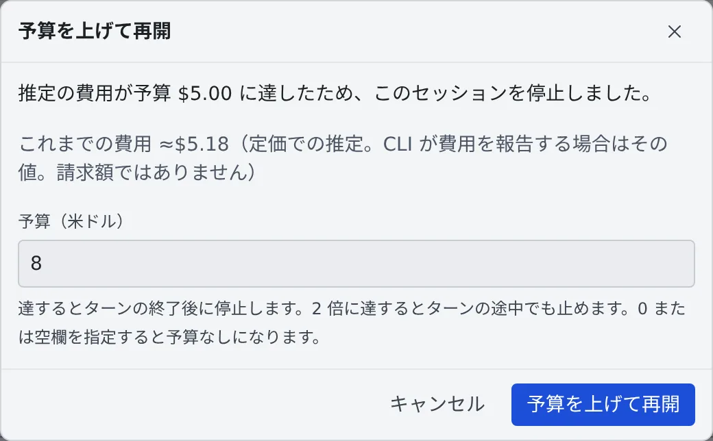

# 使いすぎたセッションを予算で止める

[English](budget.md) | 日本語

セッションに米ドルの予算を付けておくと、推定の費用が予算に達したところでセッションが止まります。
止まったあとは、予算を上げて続けられます。

## 全体像

| あなたがやること | エージェントがやること |
|---|---|
| セッションに予算を付ける | ふだんどおり作業する |
| — | 推定の費用が予算に達すると、今のターンが終わったところで止まる |
| 予算を上げて再開する | 止まったところから続ける |

1 ターンだけで予算の **2 倍**に達したときは、ターンの途中でもすぐに止まります。このときの通知は「予算を大きく超えたため、ターンの途中で停止しました」です。
どちらの停止も、会話の残る**再開できる停止**です。

## 予算を付ける

| どこで | どう付けるか |
|---|---|
| 起動するとき | 起動画面の「**詳細**」→「**予算（米ドル）**」 |
| 起動したあと | セッションの ⋯ メニューの「**予算…**」、またはチャットの費用の表示を押す |
| すべての新しいセッションに | **⚙設定 →「エージェント」** の「**新しいセッションの予算**」 |

- 「新しいセッションの予算」は、予算を指定せずに起動したセッションすべてに付きます。`create_session` やスケジュールで起動したセッションも含みます
- 0 か空欄にすると、予算なしになります
- セント単位まで指定できます

## 費用を見る

チャットのコンテキストの行に、これまでの費用と予算が「**≈$1.84 / $5.00**」のように出ます。

- 予算の 80% から黄色、予算に達すると赤になります
- 押すと、予算を変える画面が開きます
- `create_session` で子セッションを起動したセッションでは、横に子の費用が「子 ≈$0.42」のように出ます。
  子の費用はここで見えるだけで、このセッションの予算には数えません。子はそれぞれ自分の予算を持ちます

## 止まったら

予算で止まると、行に「**予算で停止**」の印が付き、通知センターに「**予算に達して停止**」が届きます。

1. 行の ⋯ メニューか通知の「**予算を上げて再開…**」を押します
2. これまでの費用を確かめて、新しい予算を入れます
3. 「**予算を上げて再開**」を押します

- これまでの費用より高い予算しか受け付けません
- 予算を上げずに再開すると、もう 1 ターン動いたところでまた止まります

## 数字の意味

費用は**見積もり**で、**請求額ではありません**。

- セッション自身の会話記録から、定価で見積もります。opencode のように CLI が費用を報告するときは、その値を使います
- サブスクリプションのプランでは、API で使った場合の金額です
- Claude Code では、サブエージェントや Workflow のエージェントの分も含みます。使用量の画面の累計にも、同じ分が含まれます
- フォークは $0 から数えます。コピーした履歴の分は、フォークには付きません

予算で止まらないものもあります。

| 場合 | 理由 |
|---|---|
| 価格のないモデル | 見積もれないので、予算は効かない（画面にそう出る） |
| Kiro・Cursor・Antigravity | 会話記録にトークン数が入らない |
| 自前のエンジン | 費用が $0 |

## 関連

- [終わったら止める・動かしたままにする](auto-stop.ja.md)
- [セッションを止める・再開する](stop-resume.ja.md)
