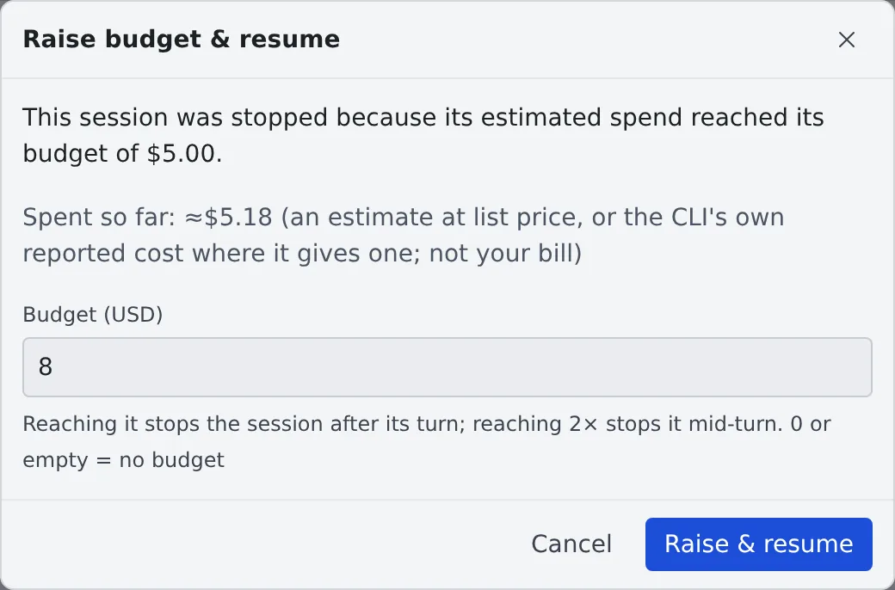

# Stop a session that spends too much with a budget

English | [日本語](budget.ja.md)

Give a session a budget in US dollars and it stops when its estimated spend reaches the budget.
Once it has stopped, you can raise the budget and carry on.

## How it works

| What you do | What the agent does |
|---|---|
| Give the session a budget | Works as usual |
| — | When its estimated spend reaches the budget, stops once the current turn ends |
| Raise the budget and resume | Carries on from where it stopped |

If one turn alone runs on to **twice** the budget, the session is stopped at once, mid-turn.
Both stops are **the resumable stop**, which keeps the conversation.

## Set a budget

| Where | How |
|---|---|
| When you start it | **"More"** → **"Budget (USD)"** in the start dialog |
| After it has started | **"Spend budget…"** in the session's ⋯ menu, or press the spend shown in the chat |
| For every new session | **"Budget for new sessions"** in **⚙ Settings → "Agents"** |

- "Budget for new sessions" applies to every session started without a budget of its own, including sessions started by `create_session` and by schedules
- 0 or empty means no budget
- You can give it to the cent

## See the spend

The chat's context row shows the spend so far against the budget, as **"≈$1.84 / $5.00"**.

- It turns amber from 80% of the budget and red when the budget is reached
- Press it to open the dialog that changes the budget
- For a session that started child sessions with `create_session`, the children's spend sits beside it, as "children ≈$0.42".
  The children's spend is only shown here and is not counted against this session's budget: each child has its own

## When it stops

A session stopped by its budget shows the **"paused: budget"** mark on its row, and the notification centre says **"Stopped by its budget"**.

1. Press **"Raise budget & resume…"** in the row's ⋯ menu or on the notification
2. Check the spend so far and enter a new budget
3. Press **"Raise & resume"**

- Only a budget above the spend so far is accepted
- Resuming without raising the budget gives the session one more turn, after which it stops again

## What the figure is

The spend is **an estimate** and **not your bill**.

- It is an estimate at list price from the session's own transcript, or the CLI's own reported cost where it gives one (opencode)
- On a subscription plan, it is what the same use would cost through the API
- For Claude Code, it includes the session's subagents and Workflow agents. The usage view does not count those yet, so there a session that delegated work shows less than its budget figure
- A fork starts from $0: the history it copied is not charged to it

Some sessions are never stopped by a budget.

| Case | Why |
|---|---|
| A model with no price | It cannot be estimated, so the budget has no effect (the dialog says so) |
| Kiro, Cursor, Antigravity | Their transcripts carry no token counts |
| The self-hosted engine | Its spend is $0 |

## Related

- [Stop when done, or keep a session awake](auto-stop.md)
- [Stop and resume a session](stop-resume.md)
