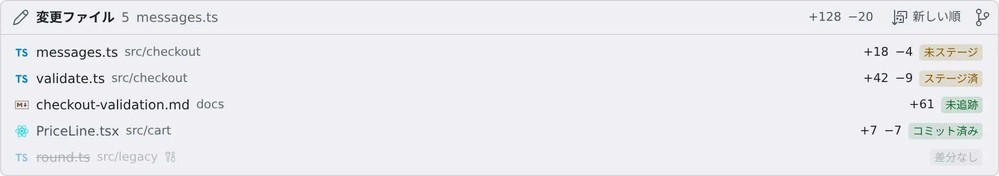

# セッションが変えた内容を見る

[English](changes.md) | 日本語

セッションが実際に触ったファイルを一覧で見て、そこへ直接飛べます。
レビューのときに、会話を全部読み返さずに「この作業コピーに何をしたのか」がわかります。

## 全体像

| あなたがやること | エージェントがやること |
|---|---|
| **「変更ファイル」** の帯を開き、ファイルを開く | ふだんどおりファイルを編集する。一覧は会話とリポジトリの両方から作られます |

エージェントが「やる」と言ったことではなく、**実際に起きたこと**が出ます。

## 一覧を開く

| 開き方 | 動き |
|---|---|
| 会話ヘッダの下の **「変更ファイル」** の帯 | 見出しを押すと開閉します。開いたかどうかは、セッションごとに覚えます |
| **Ctrl+P**（macOS は **⌘P**）から **Tab** で「変更ファイル」に切り替える | 同じ一覧を検索できます |

- 帯を開くと見出しの横に並び順のボタンが出て、**新しい順** と **パス順** を切り替えられます
- その隣のボタン（**ソース管理を開く**）で、作業コピーのソース管理を開けます

## バッジを読む

各行には、ファイルの状態を示すバッジが付きます。

| 場所 | バッジ |
|---|---|
| 作業コピーの中 | **未追跡**・**未ステージ**・**ステージ済**・**コミット済み**・**差分なし** |
| セッション専用の作業用フォルダの中 | **作業用の一時領域**（セッションを削除すると消えます） |
| エージェント自身のメモリのフォルダの中 | **Claude のメモリ**・**Codex のメモリ**（ほかのエージェントでは **エージェント自身のメモリ**）。読み取り専用で開きます |
| それ以外 | **作業コピー外** |

- メモリのバッジは、エージェントの種類ごとのメモリファイルのことです。Agent Fleet の[エージェントメモリ](../memory/overview.ja.md)とは別のものです
- 別の作業コピーのファイルには、その作業コピーの名前が添えられます。このセッションの作業コピーの差分ではありません
- サブエージェントだけが編集したファイルには、その印が付きます

## 関連

- [セッションに返事をする](reply.ja.md)：チャット表示の使い方
- [会話を Markdown で保存する](export.ja.md)：編集の差分も含めて会話を残す
