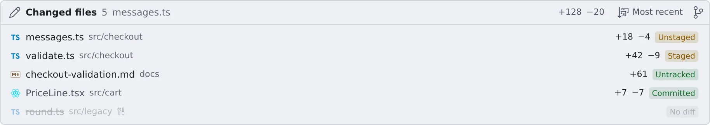

# See what a session changed

English | [日本語](changes.ja.md)

See the files a session actually touched as a list, and go straight to one.
At review time it answers "what did this do to my working copy?" without reading the whole conversation back.

## How it works

| What you do | What the agent does |
|---|---|
| Open the **"Changed files"** strip and open a file | Edits files as usual. The list is built from the conversation and the repository together |

It shows **what actually happened**, not what the agent said it would do.

## Open the list

| How | What happens |
|---|---|
| The **"Changed files"** strip under the conversation header | Its heading folds it open or closed. The choice is remembered per session |
| **Ctrl+P** (**⌘P** on macOS), then **Tab** to "Changed files" | The same list, searchable |

- With the strip open, a sort button beside the heading switches between **Most recent** and **By path**
- The button next to it (**Open source control**) opens source control for the working copy

## Read the badges

Each row carries a badge for the file's state.

| Where the file is | Badge |
|---|---|
| In the working copy | **Untracked**, **Unstaged**, **Staged**, **Committed** or **No diff** |
| In the session's own scratch folder | **Session scratch** (deleted with the session) |
| In the agent's own memory folder | **Claude memory**, **Codex memory** (for another agent, **Agent's own memory**). It opens read-only |
| Anywhere else | **Outside working copy** |

- The memory badges mean the agent kind's own memory files. They are not Agent Fleet's [agent memory](../memory/overview.md)
- A file in another working copy carries that working copy's name. It is not part of this session's working-copy diff
- A file only a subagent edited carries a mark that says so

## Related

- [Reply to a session](reply.md): using the chat view
- [Save a conversation as Markdown](export.md): keep the conversation, edit diffs included
