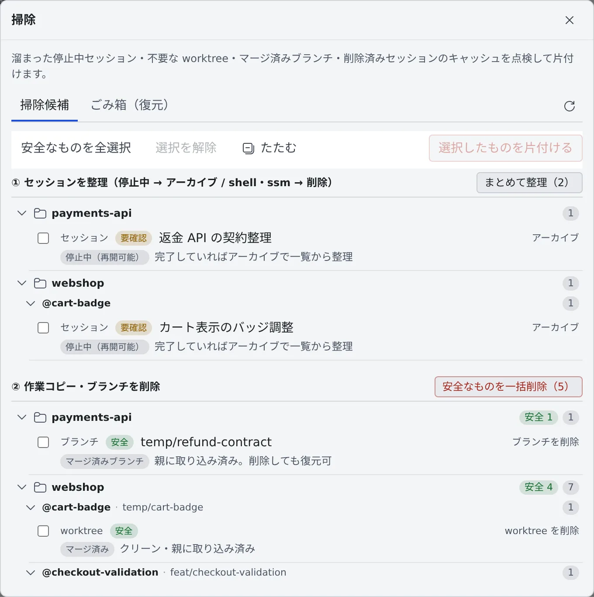

# 終わったセッションを片付ける

[English](cleanup.md) | 日本語

終わったセッションをアーカイブし、要らなくなった作業コピーやブランチを消せます。消したものは、まずごみ箱に入るので、
消しすぎても戻せます。

## 全体像

| あなたがやること | 起きること |
|---|---|
| セッションをアーカイブする | 会話を残したまま、一覧から消える。いつでも復帰できる |
| アーカイブ一覧で削除する | ごみ箱へ移る。掃除の「ごみ箱（復元）」から戻せる |
| 「掃除」でまとめて片付ける | 停止中のセッションと、安全と判定された作業コピー・ブランチを片付ける |
| 作業コピーを削除する | 作業コピーと、その中のセッションを 1 回で片付ける |
| 削除ロックをかける | 掃除にも自動の整理にも消されなくなる |

同じ点検と片付けは、[フリート・オペレーター](../fleet/operator.ja.md)にチャットで頼むこともできます。

## 何が残り、何が消えるか

放っておいて消えるものは、アーカイブした作業用フォルダだけです。会話が本当に消えるのは、ごみ箱から完全に削除したときだけです。

| | アーカイブ | 削除（ごみ箱へ） | ごみ箱から完全に削除 |
|---|---|---|---|
| 一覧の行 | アーカイブ一覧へ移る | ごみ箱へ移る | **消える** |
| claude の会話 | 残る | ごみ箱に入る | **消える** |
| claude 以外の会話 | 残る | エージェント自身の保存場所に残る。ごみ箱には行だけが入る | 行は**消える**（会話のファイルはエージェント自身の保存場所に残る） |
| 作業用フォルダ（`~/.af-work/<セッション名>`） | アーカイブの 7 日後に**消える** | すぐ**消える**（[移動](handoff.ja.md#別のエージェントへ移す)の引き継ぎファイルだけはごみ箱に入る） | **消える** |
| 会話に引いたマーカー、回答の翻訳、引き継ぎ案 | 残る | **消える**（復元しても戻らない） | **消える** |
| 作業コピー（worktree） | 残る | 残る | 残る |

- 動いているセッションをアーカイブ・削除すると、先に止まります
- 作業コピーを消すのは、[作業コピーの削除](#1-つの仕事の作業コピーをまとめて削除する)か、[掃除](#まとめて片付ける掃除)の②だけです
- アーカイブ・削除したセッションのタブは自動で閉じます。別のタブや別のデバイス、掃除で片付けたときは
  「**「…」はアーカイブ（または削除）されたため、タブを閉じました**」と通知が出ます。そのセッションから開いたファイルや計画のタブは残ります

## アーカイブする・復帰する

AI のセッションは、⋯ メニューの「**アーカイブする（一覧から消す）**」で一覧から片付けます。

アーカイブしたセッションは、**リポジトリ**の見出しにある「**アーカイブを開く（復帰）**」のアイコンから開く一覧に並びます。

| ボタン | すること |
|---|---|
| 「**復帰**」 | 普段の一覧に戻す |
| 「**すべて復帰**」 | フォルダが残っているものをまとめて戻す |
| 「**削除（ごみ箱へ退避）**」 | ごみ箱へ移す |
| 「**古いものを削除**」 | 30 日以上前にアーカイブしたものを、まとめてごみ箱へ移す |

- 停止中のまま 7 日たったセッションは、自動でアーカイブへ移ります（[セッションを止める・再開する](stop-resume.ja.md#停止したまま置いておくと)）
- アーカイブから自動で消えるものはありません。ただしセッションの作業用フォルダ（エージェントが使い捨てのファイルを置く場所）は、アーカイブの 7 日後に消えます
- 7 日以内に復帰すれば、作業用フォルダは残ります。すでに消えていれば、次に起動したときに新しく作られます
- 削除ロック中は、作業用フォルダも残ります。早く空けたいときは [マシンと使用状況を見る](../workspace/machine.ja.md#使われなくなったファイル) から消せます

使い捨ての shell / SSM はアーカイブせず、⋯ メニューの「**削除**」でごみ箱へ移します。

## まとめて片付ける（掃除）

**リポジトリ**の見出しにある「**掃除を開く（点検・整理）**」（ごみ箱のアイコン）を押すと、「**掃除**」の画面が開きます。
危ないものほど後ろに来るよう、2 段に分かれています。

| 段 | ボタン | すること |
|---|---|---|
| ① セッションを整理 | 「**まとめて整理**」 | 停止中の AI セッションはアーカイブ、shell / SSM はごみ箱へ移す |
| ② 作業コピー・ブランチを削除 | 「**安全なものを一括削除**」 | 「安全」と判定された作業コピーとブランチだけを消す |
| 削除済みセッションのキャッシュ | 「**まとめて削除**」 | 削除済みでごみ箱にもないセッションの、貼り付け・添付したファイルや codex が読んだ画像を消す |

1 件ずつ選ぶときは、行にチェックを入れて「**選択したものを片付ける**」を押します。「**安全なものを全選択**」で、安全な行にまとめてチェックが入ります。

候補には、安全度と理由が付きます。

| 安全度 | 意味 |
|---|---|
| **安全** | マージ済みでクリーンなど、消しても失うものがない |
| **要確認** | 停止中のセッションや、クリーンだがマージしていない worktree など。中身を見てから決める |
| **保持** | 稼働中、未コミット・未 push、削除ロック中。掃除の対象にならない |

- 停止中のセッションのプルリクエストがすべて終わっていて、1 件以上マージ済みなら、理由に「**PR マージ済み**」と出ます（最後に見たときの状態です）
- **保持**を片付けたいときは、先に停止するか push してください
- アーカイブ済みのセッションは掃除の対象外です

> [!WARNING]
> **削除済みセッションのキャッシュは、ごみ箱を通らずに消えます。元に戻せません。**
> 対象は、もう完全に消えたセッションのものだけです。ごみ箱にあるセッションや、そこからフォークしたセッションが使うかもしれないものは残します。

## ごみ箱から戻す

掃除の画面の「**ごみ箱（復元）**」タブに、削除したセッション・ブランチ・worktree が並びます。

| ボタン | すること |
|---|---|
| 「**復元**」 | 元に戻す |
| 「**完全に削除**」 | 元に戻せなくして、容量を空ける |
| 「**30 日より古いものを完全に削除**」 | 30 日より前のものをまとめて完全に削除する |

- ごみ箱は自動では空になりません。サイズは **⚙設定 →「マシン」** にも出ます
- 復元が途中で止まったものは、もう一度「**復元**」すると続きから終わります。それまでは完全に削除できません

### worktree を削除したとき

worktree の削除も、ごみ箱に入ります。

- 削除の直前に、そのときのコミット・ブランチ・未コミットの変更（未追跡のファイルを含む）を記録します。記録したコミットは、git の gc で消えないよう守られます
- 「**復元**」すると、同じパスに worktree を作り直して変更を戻し、その削除でアーカイブへ移ったセッションも一覧に戻します。変更はすべて未ステージで戻ります
- ブランチが削除のあとに動いていたり、別の作業コピーが使っていたりして、そのまま戻せないときは、[作業コピーを作り直す](stop-resume.ja.md#フォルダなし-再開不可と出て行を開けない)画面が開きます。新しいブランチ名を付けて戻せます
- 中のセッションは、停止中の AI セッションがアーカイブへ、shell / SSM がごみ箱へ移ります。アーカイブへ移ったセッションは、作業コピーを作り直すまで再開できません
- 記録を書けないとき（ディスクがいっぱいなど）や、worktree の中に git の管理外のリポジトリ（中で clone したものなど）があるときは、削除しません

戻らないものもあります。

- `.gitignore` の対象（ビルドの成果物や `.env` など）
- どの変更をステージしていたか。ステージ済みだった新しいファイルは、未追跡のファイルとして戻ります

## 1 つの仕事の作業コピーをまとめて削除する

掃除はワークスペース全体を点検します。終わった仕事ひとつ（親の worktree と、そこから起動した子セッションの worktree）だけを片付けたいときは、
作業コピーの行を右クリックして「**作業コピーを削除**」を選びます。

左ペインでその行の下に並ぶ作業コピーが一覧で出て、**セッションのアーカイブと作業コピーの削除が 1 回で終わります**。
消えるのはローカルの作業コピーだけで、履歴とリモートは残ります。

- **最初からチェックが入るのは、消しても失うものがない行だけです**（親に取り込み済み・未コミットなし・誰も作業していない）。
  未コミットや未マージの行は空のままで、チェックを入れることが「それでも消す」の確認になります
- 稼働中のセッションがある行は、「**稼働中のセッションを先に停止してから削除する（N 件）**」にチェックを入れると、先に止めてから消せます。実行中のターンは中断されます
- 「**マージ済みブランチも削除する（N 件）**」で、使い捨ての `temp/…` ブランチも消せます。ごみ箱から戻せます
- さらに「**リモート（origin）のブランチも削除する**」を選ぶと、origin 側も消します。**これだけは取り消せません**
- 親の履歴に入っていないブランチは、ここからは消せません
- 削除ロック中の行にはチェックを入れられません。先にロックを外してください

## 削除ロックをかける

「これは消えてはいけない」という印です。四半期末に要る会話や、まだ終わっていない worktree に使います。

- **セッション**：⋯ メニューの「**削除ロックをかける**」。行に「**削除ロック中（削除・自動整理の対象外。この一覧に残ります）**」のバッジが付きます
- **作業コピー**：行を右クリックして「**削除ロックをかける**」

ロック中のものは、掃除にも、停止中のセッションの自動のアーカイブにも巻き込まれません。
ロック中のセッションがいる作業コピーは削除できず、黙って避けずに「先にロックを解除してください」と伝えます。
外すときは同じメニューの「**削除ロックを解除する**」を選びます。

## 困ったとき

### 「保持」の行を片付けられない

稼働中か、未コミット・未 push の変更があります。セッションを停止するか、変更を push してから、もう一度点検してください。
それでも消すときは、作業コピーの行の「**作業コピーを削除**」で、その行にチェックを入れて消します。

### 「ロック中セッションあり」と出て worktree を消せない

中に削除ロック中のセッションがいます。そのセッションの ⋯ メニューで「**削除ロックを解除する**」を選んでから消してください。

### 「完全に削除」できない

そのアーカイブの復元が途中で止まっています。もう一度「**復元**」してから削除してください。

## 関連

- [セッションを止める・再開する](stop-resume.ja.md)
- [マシンと使用状況を見る](../workspace/machine.ja.md)：ホームのディスクの空きを作る
