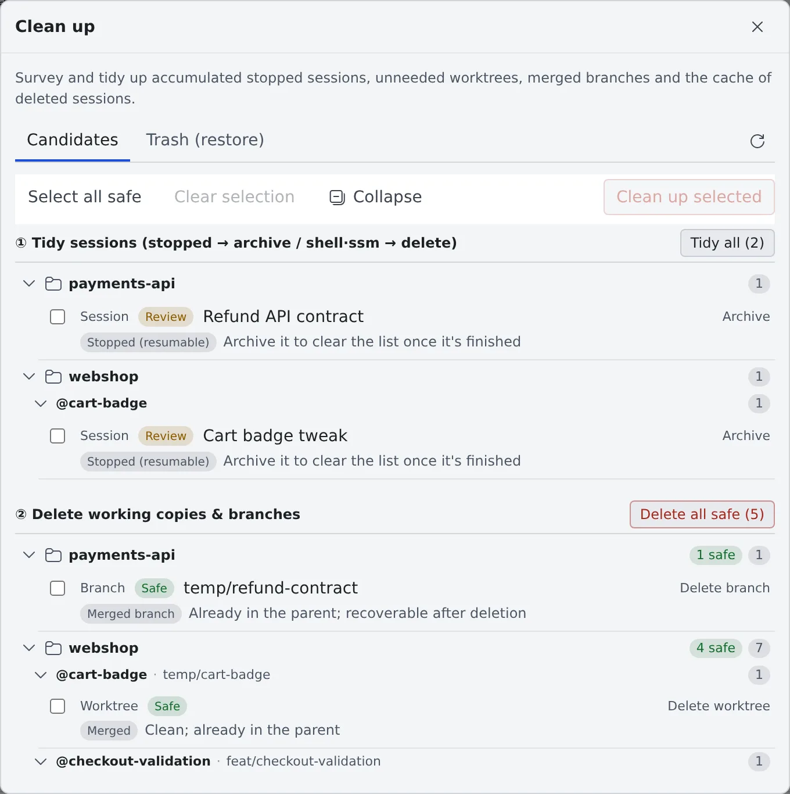

# Clear away finished sessions

English | [日本語](cleanup.ja.md)

You can archive finished sessions and delete the working copies and branches you no longer need. Whatever you delete goes to the
trash first, so deleting too much can be undone.

## How it works

| What you do | What happens |
|---|---|
| Archive a session | It leaves the list with its conversation kept, and can be restored at any time |
| Delete it from the archive list | It moves to the trash, and can be restored from Clean up's "Trash (restore)" |
| Tidy up in bulk with Clean up | Stopped sessions, and working copies and branches judged safe, are cleared away |
| Delete a working copy | The working copy and the sessions in it are cleared in one go |
| Lock something against deletion | Neither cleanup nor automatic tidying removes it |

You can also ask the [Fleet Operator](../fleet/operator.md) to do the same survey and tidy-up from chat.

## What stays and what goes

The only thing that goes on its own is an archived session's scratch folder. A conversation is gone for good only when you delete it permanently from the trash.

| | Archive | Delete (to the trash) | Delete permanently from the trash |
|---|---|---|---|
| The row in the list | Moves to the archive list | Moves to the trash | **Gone** |
| A claude conversation | Stays | Goes into the trash | **Gone** |
| Other kinds' conversations | Stay | Stay in the agent's own store; the trash holds the row only | The row is **gone** (the conversation files stay in the agent's own store) |
| Scratch folder (`~/.af-work/<session name>`) | **Removed** 7 days after archiving | **Removed** at once (only a [move](handoff.md#move-to-another-agent)'s handover file goes into the trash) | **Gone** |
| Highlights in the conversation, answer translations, handoff proposals | Stay | **Removed** (a restore does not bring them back) | **Gone** |
| The working copy (worktree) | Stays | Stays | Stays |

- Archiving or deleting a running session stops it first
- Working copies are removed only by [deleting a working copy](#delete-one-jobs-working-copies) or by [Clean up](#tidy-up-in-bulk-cleanup) ②
- An archived or deleted session's tabs close on their own. When you tidied up from another tab, another device or Clean up,
  a notice says **"Closed the tab for “…” because the session was archived or deleted"**. Tabs of files and plans opened from that session stay

## Archive and restore

Clear an AI session out of the list with **"Archive (remove from the list)"** in its ⋯ menu.

Archived sessions are listed behind the **"Open archive (restore)"** icon in the **Repositories** heading.

| Button | What it does |
|---|---|
| **"Restore"** | Brings it back to the everyday list |
| **"Restore all"** | Brings back every one whose folder still exists |
| **"Delete (moved to trash)"** | Moves it to the trash |
| **"Delete old ones"** | Moves everything archived 30 or more days ago to the trash |

- A session left stopped for 7 days moves to the archive on its own ([Stop and resume a session](stop-resume.md#leave-a-session-stopped))
- Nothing leaves the archive on its own, except the scratch folder (what agents use as `$AF_WORK_DIR`), which is removed 7 days after archiving
- Restore within 7 days and the scratch folder is kept. One already removed is created afresh at the next launch
- While a session is locked, its scratch folder is kept. To free the space sooner, delete it from [See your machine and its usage](../workspace/machine.md#leftover-files)

A throwaway shell / SSM is not archived: **"Delete"** in its ⋯ menu moves it to the trash.

## Tidy up in bulk (cleanup)

Press **"Open cleanup (survey & tidy)"** (the trash icon) in the **Repositories** heading to open the **"Clean up"** window.
It is split into two stages so that the riskier things come last.

| Stage | Button | What it does |
|---|---|---|
| ① Tidy sessions | **"Tidy all"** | Archives stopped AI sessions and moves shell / SSM to the trash |
| ② Delete working copies & branches | **"Delete all safe"** | Removes only the working copies and branches judged "Safe" |
| Cache of deleted sessions | **"Delete all"** | Removes the files pasted or attached into, and the images codex looked at in, sessions that are deleted and not in the trash |

To go row by row, tick the rows and press **"Clean up selected"**. **"Select all safe"** ticks every safe row at once.

Every candidate carries a safety rating and a reason.

| Safety | Meaning |
|---|---|
| **Safe** | Merged and clean, and so on: nothing is lost by removing it |
| **Review** | A stopped session, a clean but unmerged worktree, and the like. Look before you decide |
| **Keep** | Running, uncommitted or unpushed, or locked against deletion. Cleanup leaves it alone |

- When every pull request of a stopped session is finished and at least one is merged, the reason says **"PRs merged"** (as last seen)
- To clear a **Keep**, stop it or push first
- Archived sessions are not cleanup candidates

> [!WARNING]
> **Deleting the cache of deleted sessions skips the trash. It cannot be undone.**
> It covers only sessions that are already gone for good. Anything a trashed session, or a fork made from it, could still need is left alone.

## Restore from the trash

The **"Trash (restore)"** tab of the Clean up window lists the sessions, branches and worktrees you deleted.

| Button | What it does |
|---|---|
| **"Restore"** | Puts it back |
| **"Delete permanently"** | Makes it unrecoverable and frees the space |
| **"Delete permanently: older than 30 days"** | Deletes everything older than 30 days permanently, in one go |

- The trash never empties on its own. Its size is also shown in **⚙ Settings → "Machine"**
- If a restore stopped part way, **"Restore"** again finishes it. Until then it cannot be deleted permanently

### When you delete a worktree

Deleting a worktree goes through the trash too.

- Just before the delete, it records the commit, the branch and the uncommitted changes (untracked files included). The recorded commit is protected from git's garbage collection
- **"Restore"** recreates the worktree at the same path with those changes, and puts the sessions that delete archived back in the list. The changes all come back unstaged
- When it cannot come back as it was (the branch moved after the delete, or another working copy has it checked out), the [Recreate working copy](stop-resume.md#folder-missing-cant-resume-and-the-row-will-not-open) dialog opens instead. It brings it back on a new branch
- Of the sessions in it, stopped AI sessions go to the archive and shell / SSM to the trash. The archived ones cannot resume until the working copy is recreated
- The worktree is not deleted if the record cannot be written (a full disk, for example), or if it holds a repository git does not track (a clone inside it)

Some things do not come back:

- Ignored files (build output, `.env` and so on)
- Which changes were staged. A new file that was staged comes back as an untracked file

## Delete one job's working copies

Clean up surveys the whole workspace. To clear just one finished job (a parent worktree and the worktrees of the child sessions it started),
right-click the working copy's row and choose **"Delete the working copy"**.

The copies the left pane nests under that row are listed, so **archiving the sessions and deleting the working copies happen in one go**.
Only the local working copies are removed: history and the remote stay.

- **Only rows that lose nothing are ticked for you** (already in the parent, nothing uncommitted, nobody working in them).
  A row with uncommitted or unmerged work stays empty, and ticking it is the "delete it anyway" confirmation
- For a row with a running session, tick **"Stop the running sessions first (N)"** to stop them before the delete. A turn in flight is cut off
- **"Delete the merged branches too (N)"** also removes the throwaway `temp/…` branches. The trash can restore them
- Adding **"Delete the branch on the remote (origin) too"** removes it on origin as well. **That one cannot be undone**
- A branch that is not in the parent's history cannot be deleted from here
- A row locked against deletion cannot be ticked. Remove the lock first

## Lock something against deletion

A lock marks something that must not go away. Use it for the conversation you will need at the end of the quarter, or a worktree you have not finished with.

- **A session**: **"Lock against deletion"** in its ⋯ menu. The row carries the badge **"Locked against deletion (skipped by cleanup, and stays in this list)"**
- **A working copy**: right-click its row and choose **"Lock against deletion"**

A locked item is never swept up by cleanup, or by the automatic archiving of stopped sessions.
A working copy that holds a locked session cannot be deleted: rather than quietly working around you, it tells you to unlock first.
To remove the lock, choose **"Unlock (allow deletion)"** in the same menu.

## When it goes wrong

### A "Keep" row cannot be cleared

It is running, or has uncommitted or unpushed changes. Stop the session or push the changes, then survey again.
To delete it anyway, use **"Delete the working copy"** on the working copy's row and tick that row.

### "Locked session inside" stops a worktree delete

A session in it is locked against deletion. Choose **"Unlock (allow deletion)"** in that session's ⋯ menu, then delete.

### "Delete permanently" is refused

A restore of that archive stopped part way. **"Restore"** it again, then delete it.

## Related

- [Stop and resume a session](stop-resume.md)
- [See your machine and its usage](../workspace/machine.md): free up space on the home disk
