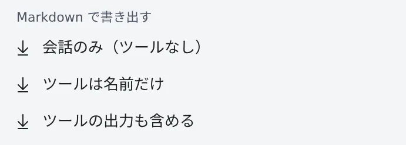

# 会話を Markdown で保存する

[English](export.md) | 日本語

セッションの会話全体を、Markdown のファイルとしてダウンロードできます。
ツールの呼び出しをどこまで入れるかは、3 通りから選べます。

## 全体像

| あなたがやること | 起きること |
|---|---|
| セッションの **⋯** メニューで書き出し方を選ぶ | ワークスペースが会話全体を Markdown にまとめ、ファイルがダウンロードされる |
| 人に渡す前に中身を確かめる | トークンやパスワードらしき文字列は、伏せられた状態で入っている |

## 書き出す

会話のあるセッションの **⋯** メニューに、**「Markdown で書き出す」** の 3 つの項目があります。

| 項目 | 入るもの |
|---|---|
| **会話のみ（ツールなし）** | あなたとエージェントの発言・質問・計画。ツールの呼び出しは入れません |
| **ツールは名前だけ** | 上に加えて、ツールの呼び出しを 1 行ずつに縮めたもの |
| **ツールの出力も含める** | 上に加えて、コマンドの出力や編集の差分 |

- チャット表示が読み込んだ範囲だけでなく、**会話全体**が入ります
- thinking と、サブエージェントの中のやり取りは入りません
- ワークスペースが起動している必要があります。セッション自体は止まっていてもかまいません

## できるファイル

| 項目 | 中身 |
|---|---|
| ファイル名 | `<セッション名>.md`。名前そのものがシークレットらしく見えるときは `session.md` |
| 冒頭 | セッション、エージェント、作業フォルダ、ブランチ、書き出した時刻 |
| 末尾 | エージェントがまだ答えを待っている質問 |
| 時刻 | **⚙設定 →「表示」** の **タイムゾーン**（既定はブラウザのゾーン）。チャット画面と揃います |
| 見出しの言語 | ブラウザではなく、Console の表示言語 |

## 安全に渡す

トークンやパスワードらしき文字列は `[secret redacted]` に伏せます。
ただし、パターンで探す仕組みなので、取りこぼすことがあります。**人に渡す前に、中身を確かめてください。**

## 困ったとき

### 書き出しに失敗した

理由（エラーの内容か HTTP ステータス）が表示されます。ワークスペースが止まっているときは、起動してからやり直してください。

## 関連

- [セッションが変えた内容を見る](changes.ja.md)：触ったファイルを一覧で見る
- [回答を自分の言語で読む](translate.ja.md)：英語の回答を訳して読む
