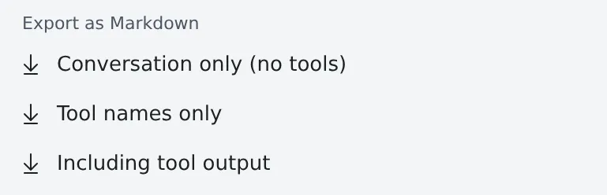

# Save a conversation as Markdown

English | [日本語](export.ja.md)

Download a session's whole conversation as a Markdown file.
You choose from three how much of the tool calls goes in.

## How it works

| What you do | What happens |
|---|---|
| Choose an export in the session's **⋯** menu | The workspace puts the whole conversation into Markdown, and the file downloads |
| Read it before you hand it on | Strings that look like tokens or passwords are already masked in it |

## Export

The **⋯** menu of any session that has a conversation offers three items under **"Export as Markdown"**.

| Item | What goes in |
|---|---|
| **Conversation only (no tools)** | What you and the agent said, asked and planned. No tool calls |
| **Tool names only** | The above, plus each tool call reduced to one line |
| **Including tool output** | The above, plus command output and edit diffs |

- The **whole conversation** goes in, not just the part the chat view has loaded
- Thinking and a subagent's own exchanges are left out
- The workspace has to be running. The session itself may be stopped

## The file

| Item | Contents |
|---|---|
| File name | `<session>.md`, or `session.md` when the name itself looks like a secret |
| Top | The session, the agent, the working folder, the branch and the export time |
| End | A question the agent is still waiting on |
| Times | The **Time zone** in **⚙ Settings → "Display"** (by default your browser's zone), the same as in the chat view |
| Language of the labels | The Console's display language, not the browser's |

## Hand it on safely

Strings that look like tokens or passwords are masked as `[secret redacted]`.
The masking is a pattern match, though, and can miss something. **Read the file before you share it.**

## When it goes wrong

### The export failed

The message says why (the error, or the HTTP status). If the workspace is stopped, start it and try again.

## Related

- [See what a session changed](changes.md): the files it touched, as a list
- [Read an answer in your own language](translate.md): read an answer translated
