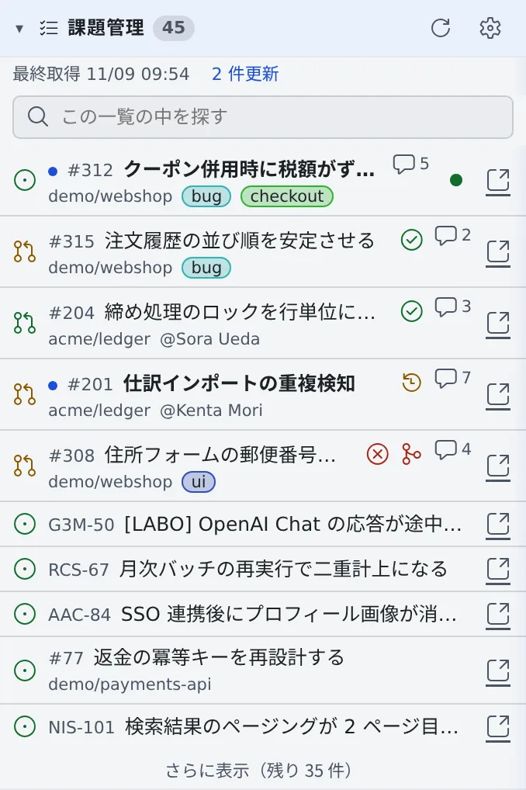
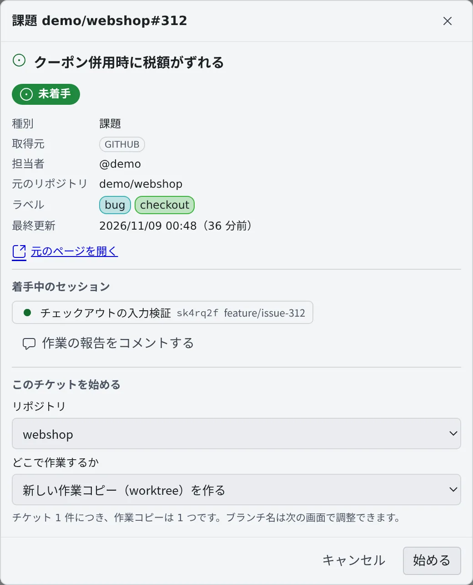
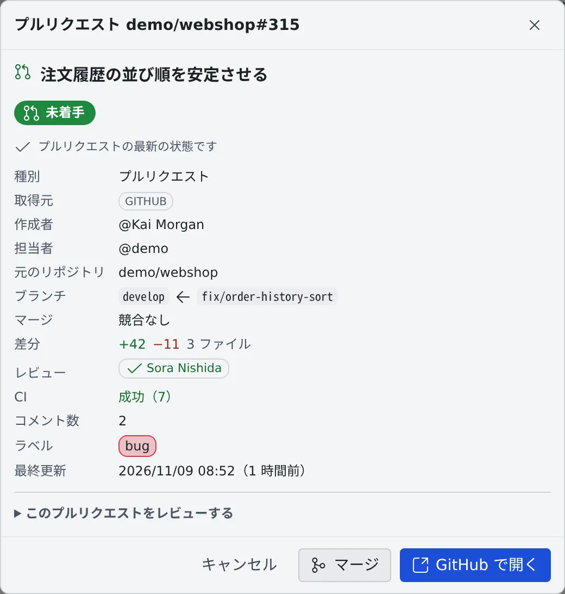

# Issue やチケットから始める

[English](from-issues.md) | 日本語

左ペインの「**課題管理**」に並んだ課題やプルリクエストから、チケットの情報が入った状態でセッションを始められます。
誰がどのチケットに着手しているかも、一覧と詳細でわかります。

## 全体像

| あなたがやること | エージェントがやること |
|---|---|
| 一覧の行を開いて、リポジトリと作業する場所を選ぶ | 最初の指示にあるキーと URL から、本文とコメントを `gh`・`jira`・`bkt` で読む |
| 起動ダイアログでブランチ名と最初の指示を確かめて起動する | 状況を調べて、実装に入る前に方針を出す |
| 終わったら、作業の報告をチケットにコメントする | ブランチやプルリクエストを通じて、セッションとチケットを紐づける |

一覧に何かを出すには、先にクエリを保存しておきます（[課題管理サービスを接続する](../integrations/issue-tracker.ja.md#一覧に出すものを決める)）。
一覧はワークスペースが止まっているときも読めます。

## 一覧を読む

| 表示 | 意味 |
|---|---|
| 見出しの横の数 | 未完了の項目の数。その下の行に、最後に取得した時刻が出ます |
| 点と太字のタイトル | 前回見てから更新や新しいコメントがあった行。見出しの下に「N 件更新」と出ます |
| CI と競合の印 | GitHub の開いているプルリクエストの、最後に取得した時点の CI（失敗・実行中・成功）と、ベースとの競合 |
| コメント数 | GitHub と Bitbucket の行に出ます |
| 🔗 | 元のトラッカーで開きます |
| 丸いバッジ | もう誰かがセッションを始めている印。押すとそのセッションが開きます。2 人目が同じものに着手する前に気づけます |

- 行に出るのは、行ごとに違う情報だけです。クエリの全行で担当者やリポジトリが同じなら、その欄は出ません
- 更新の相対時刻は、24 時間以上動いていない行にだけ出ます
- 見たかどうかはブラウザごとに覚えます。詳細を開くと見たことになり、初めて一覧に出た項目には印が付きません
- 行が多いと 10 行で畳まれ、「**さらに表示（残り N 件）**」が出ます。開いている間は、左ペインの下端に「**たたむ**」が残ります

### 一覧の中を探す

10 行を超えると、「**この一覧の中を探す**」の欄が出ます。キー・タイトル・担当者・ラベル・リポジトリで、いま出ている行を絞り込みます。

- 「×」か Escape で消せます
- 一致する行がないときや、クエリが一致の一部しか取得できていないときは、「**トラッカーで「…」を探す**」で、打った語をトラッカーに問い合わせられます。ワークスペースが動いているときだけ使えます

### 更新のタイミング

ワークスペースが動いている間は、約 5 分ごとに取り直します。見出しの「**更新**」（⟳）ですぐ取り直せます。
ワークスペースが止まっている間は、取得済みの一覧をそのまま出し、そのことが見出しの下に出ます。一覧のためにワークスペースを起動することはありません。

## 行からセッションを始める

行を押すと詳細が開きます。状態・種別・取得元・担当者・元のリポジトリ・ラベル・最終更新と、「**元のページを開く**」が並びます。

1. 「**このチケットを始める**」の「**リポジトリ**」で、作業するリポジトリを選びます。クエリの既定の作業コピーか、課題の元のリポジトリが選ばれています。Jira の課題はリポジトリがわからないので、ここで確かめてください
2. 「**どこで作業するか**」を選びます

   | 選ぶもの | 起きること |
   |---|---|
   | 新しい作業コピー（worktree）を作る | チケット 1 件に作業コピーを 1 つ作ります |
   | （リポジトリ）でそのまま作業する | 元の作業コピーの、今のブランチで作業します |
   | 既存の作業コピー: （ブランチ） | その作業コピーの今のブランチで作業します。新しいブランチは作りません |

3. 「**始める**」を押すと、起動ダイアログが開きます。エージェント・モデル・最初の指示が入っています
4. ブランチ名と最初の指示を確かめて起動します

### 最初の指示に入るもの

最初の指示には、キー・タイトル・URL と、本文とコメントをどのコマンドで読めばよいかが入ります。本文そのものは貼りません。

| 取得元 | エージェントが本文を読むコマンド |
|---|---|
| GitHub | `gh issue view`（プルリクエストなら `gh pr view`） |
| Jira | `jira issue view` |
| Bitbucket | `bkt pr view` と `bkt pr comments` |

本文は詳細の画面にも出ません。読むのはセッションの中のエージェントです。

### ブランチ名

課題から始めると、起動ダイアログに、ブランチの命名規則から作ったブランチ名と基点ブランチが入ります。

- 既定では、課題の種別やラベルから接頭辞が決まり、番号とタイトルが続きます（`feature/45-empty-list`、`fix/PROJ-123`）
- git-flow や Bitbucket のブランチ設定があるリポジトリでは、その接頭辞と基点を使い、基点を決めた規則がダイアログに出ます
- `origin` に `develop` があるのに git-flow の設定がないリポジトリでは、「**Git Flow を初期化…**」を勧めます（[Git Flow を初期化](../code/git-flow.ja.md)）
- 規則から外れた名前には注意が出るだけで、そのまま使えます
- テンプレートは「保存したクエリ」の「ブランチ名テンプレート」で変えられます（[ブランチ名を決める](../integrations/issue-tracker.ja.md#ブランチ名を決める)）。テナント管理者がチームの既定を決めていることもあり、リポジトリの規則とあなたのテンプレートがそれより優先されます

エージェントも af のツール `branch_name` で、同じ規則に沿ったブランチ名を問い合わせます。ブランチを作るスキルも、ダイアログと同じ名前を使えます。

## 作業を報告する

着手したあとは、詳細に「**作業の報告をコメントする**」が出ます。

- 下書きに入るのは、ブランチと変更したファイルだけです。要約は作らないので、何をしたかは自分で書きます
- 「**投稿する**」を押すと、そのままチケットにコメントされます
- Bitbucket のプルリクエストでは、接続にプルリクエストの書き込みスコープ（`pullrequest:write`）があるとわかっているときだけ出ます（[Bitbucket のスコープ](../integrations/bitbucket-cli.ja.md#スコープ)）

## セッションとチケットの紐づき

セッションは、起動元のチケットのほかにも、次のようにチケットやプルリクエストと紐づきます。

| こうなると | 紐づくもの |
|---|---|
| セッションから別のセッションを起動した | 子のセッションが、親のチケットをウォッチする |
| エージェントが `branch_name` でチケットにちなんだブランチ名を付けた | そのチケット（作業中） |
| セッションのブランチにプルリクエストができた | そのプルリクエスト |
| ブランチ名やプルリクエストのタイトルに Jira のキー（`PROJ-123`）がある | その課題。大文字で、接続した Jira にあるプロジェクトのキーだけです |
| GitHub のプルリクエストが Issue を閉じる | その Issue |
| エージェントが af のツール `link_work_item` を使った | 指定したチケットやプルリクエスト |

- 紐づいた項目はセッションの行に出て、押すと詳細が開きます。セッションが別のブランチに移っても残ります
- 項目の詳細には、紐づいたセッションが紐づき方（起動元・作成・作業中・レビュー中・ウォッチ中）と一緒に並びます
- アーカイブしたセッションは、詳細の「**着手中のセッション**」から確認のうえ復帰できます。作業フォルダがないものは、会話は読めますが再開はできません。削除したセッションには「削除済み」と出ます
- 最後に見たときにマージ済み・クローズ済みだったプルリクエストは、行の最後に薄く出ます
- ワークスペースが止まっている間は、最後に動いていたときの紐づきが出ます

### 紐づけを外す

項目の詳細で、そのセッションの横の「**外す**」を押します。セッションとその作業はそのままです。

- 起動元の項目は外せません
- 外したプルリクエストが、セッションのブランチから再び紐づくことはありません

## プルリクエストを開いたとき

GitHub と Bitbucket のプルリクエストは、詳細を開いたときにその場で取り直します。下書きかどうか・競合・レビュー・CI・base ← head・差分の量が並びます。

- 先頭の 1 行に、取り直した内容か、取得済みの内容かが出ます。ワークスペースが止まっているときは取り直さず、取得済みの内容を出します
- 取り直しに失敗したときは「**再取得**」を押します
- 差分やレビューのやり取りは、「**GitHub で開く**」「**Bitbucket で開く**」で元のページを読みます

### マージする

接続でマージできる GitHub と Bitbucket のプルリクエストには、「**マージ**」ボタンが出ます。

1. 「**マージ**」を押すと、プルリクエスト・base ← head・マージ方式の確認が開きます
2. 方式はリポジトリが許すものから選べます。最初は、GitHub ではマージコミット・スカッシュ・リベースの順で最初に使えるものが、Bitbucket ではマージ先ブランチの既定のマージ戦略が選ばれています。既定の戦略が許されているものの中にないときは、許されているものの最初が選ばれます
3. Bitbucket では「**ソースブランチを閉じる**」もあり、最初はプルリクエストの設定どおりにチェックが入っています
4. 「**マージする**」を押すと、GitHub や Bitbucket の上ですぐにマージします

- GitHub では、マージするのは詳細に出ていたコミットだけです。その後にブランチが進んでいたら何もマージせず、最新の内容を出し直します
- Bitbucket では、マージの直前にヘッドを確かめ直し、進んでいたら何もマージしません。その確認の後に push されたものは止められません
- Bitbucket でマージキューがあるときや大きなマージのときは、確認を閉じた時点でまだ処理中のことがあります。結果は、後で詳細を開き直して確認します
- GitHub では、マージしたあともブランチは消しません。Bitbucket のソースブランチは、「**ソースブランチを閉じる**」にチェックがあるときだけ閉じます
- Bitbucket のプルリクエストは、頼めばエージェントも `bkt pr merge` でマージできます。接続のプルリクエストの書き込み権限とあなたのアカウントで許される範囲に限ります（[Bitbucket の CLI を使う](../integrations/bitbucket-cli.ja.md#スコープ)）。チェックボックスと違い、`bkt pr merge` は既定でソースブランチを閉じます。残したいときは `--close-source=false` を付けるよう頼みます

### レビューを始める

プルリクエストの「**このプルリクエストをレビューする**」は畳まれています。開いて「**レビューを始める**」を押すと、レビューのセッションが始まります。

- 新しい作業コピーは、新しいブランチを切らずに、そのプルリクエストの head ブランチを取り込みます
- 最初の指示は、計画ではなくレビューを頼む内容になります
- そのブランチの作業コピーがすでにあれば、そこが既定になります

## 会話の中の課題番号から開く

ミラーとアシスタントのチャットでは、エージェントが書いた課題の参照がリンクになります。押すと、同じ詳細が開きます。

| 書かれ方 | リンクになる条件 |
|---|---|
| `#956` | そのセッションの作業コピーの `origin`（github.com・bitbucket.org）の番号として、マージ済み・クローズ済みも含めて。範囲（`#573-#598`）は両端がリンクになります |
| `owner/name#956` | 作業コピーのないチャットでも、この形ならリンクになります。Bitbucket のリポジトリの名前のときは除きます |
| `PROJ-123` | 一覧に同じプロジェクトの課題があるか、Jira の接続で見られるプロジェクトのキーのとき |
| バッククォートで囲まれた番号やキー | 課題管理の一覧にあるときだけ |

- Bitbucket の作業コピーでは、`#N` は一覧にあるプルリクエストだけがリンクになります
- `UTF-8` や `SHA-256` のような形の語は、同じキーのプロジェクトがない限りリンクになりません
- Ctrl / ⌘ を押しながら、または中ボタンで押すと、元のトラッカーを直接開きます
- 左ペインを畳んでいても開きます。共有されたセッションを読む側では、リンクになりません

一覧にない課題は、キーと元のページへのリンクがある詳細が開き、そこからもセッションを始められます。
ワークスペースが動いていれば、GitHub・Bitbucket・Jira の課題はその場で読み込みます。止まっているときは「**ワークスペースが停止中のため、… には問い合わせていません**」と出ます。

開いたファイルの中のリンクの扱いは [ドキュメントや図を表示する](../files/view.ja.md#文書の中のリンク) にあります。

## 困ったとき

### 「マージ」ボタンが出ない

マージできるとわかっている接続でなければ、ボタンは出ません。

| 接続 | ボタンが出る条件 |
|---|---|
| classic トークン（GitHub のデバイスフローでログインしたとき） | `repo` スコープがある（公開リポジトリなら `public_repo` でもよい） |
| GitHub App | インストールがこのリポジトリで Contents: write を許可していて、あなたに push 権限があると GitHub が示したとき。読めなかったとき（エラー・レート制限・タイムアウト）は出ません |
| fine-grained トークン | 何ができるかを GitHub が返さないので出ません。GitHub 上でマージしてください |
| Bitbucket | 接続にプルリクエストの書き込み権限（OAuth なら Pull requests: Write、API トークンなら `write:pullrequest:bitbucket`）があると分かっていて、あなたのアカウントがマージできると Bitbucket が示し、マージ先ブランチが使えるマージ戦略を 1 つ以上許しているとき。どれかが読めなかったときは出ません |

### 「マージ」ボタンが押せない

ボタンの横に理由が出ます。

| 理由 | どうするか |
|---|---|
| マージするにはワークスペースを起動してください | GitHub や Bitbucket の認証情報はワークスペースの中にあります。起動してからやり直します |
| ブロック中: 必須のレビューまたはチェックが満たされていません | 必要なレビューやチェックを済ませます |
| ブランチがベースより遅れています | 先にブランチを更新します |
| 先に競合を解消してください | 競合を解消します |
| 失敗しているチェックがあります | チェックを直します |
| ドラフトはマージできません | プルリクエストをレビュー待ちにします |
| GitHub がまだ判定していません／Bitbucket がまだ判定していません | 少し待ってから、もう一度開きます |

### 本文が見当たらない

本文は、一覧にも詳細にも出ません。読むのはセッションの中のエージェントです。自分で読むときは「**元のページを開く**」を押します。

## 関連

- [課題管理サービスを接続する](../integrations/issue-tracker.ja.md)：Jira の接続と、一覧に出すクエリ
- [Jira を使う](../integrations/jira.ja.md)：エージェントに Jira の課題を扱ってもらう
- [GitHub の CLI を使う](../integrations/github-cli.ja.md)：エージェントに `gh` でプルリクエストを扱ってもらう
- [worktree で並行して作業する](worktrees.ja.md)：作業コピーとブランチ
