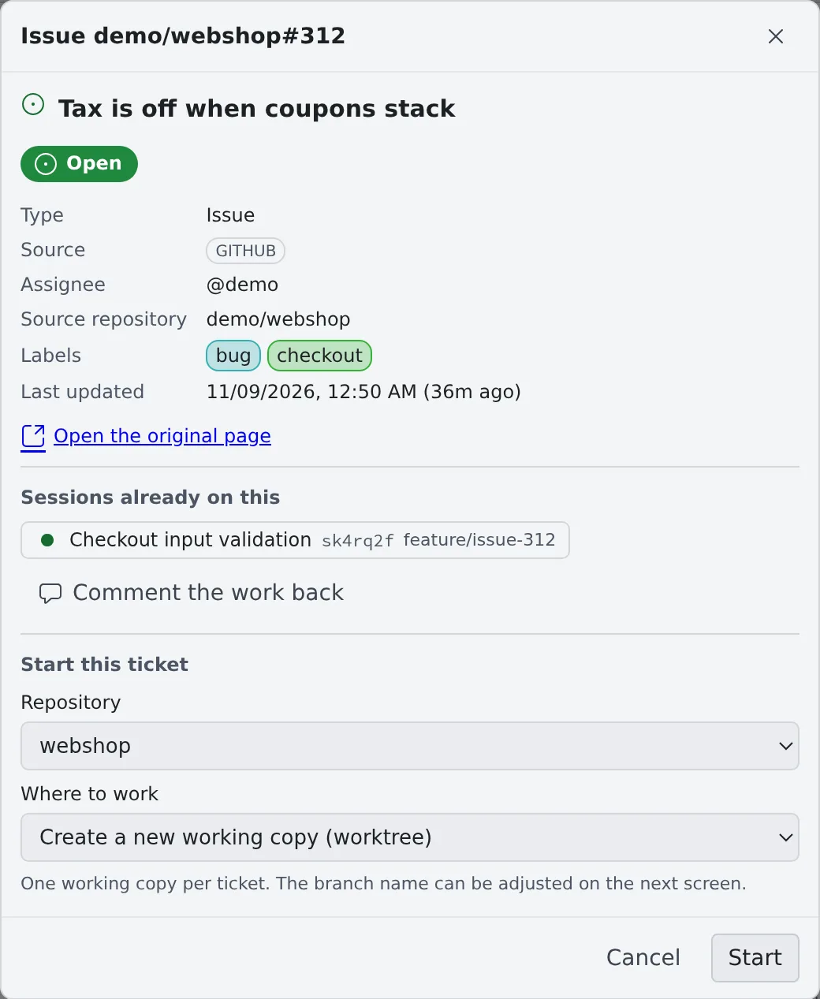

# Start from an issue or a ticket

English | [日本語](from-issues.ja.md)

Start a session from an issue or a pull request listed under **Issue tracker** in the left pane, with the ticket's details
already filled in. The list and the detail also show who has already picked up which ticket.

## How it works

| What you do | What the agent does |
|---|---|
| Open a row in the list, and pick the repository and where to work | Reads the body and comments with `gh`, `jira` or `bkt`, from the key and URL in its first prompt |
| Check the branch name and the first prompt in the launch dialog, then launch | Looks into the situation and proposes an approach before implementing |
| When done, comment the work back on the ticket | Links the session to tickets through its branch and pull requests |

To have anything in the list, save a query first ([Connect an issue tracker](../integrations/issue-tracker.md#choose-what-the-list-shows)).
The list can be read while the workspace is stopped.

## Read the list

| What you see | Meaning |
|---|---|
| The number beside the heading | How many items are not done. The line under it says when the list was last fetched |
| A dot and a bold title | The row has an update or new comments since you last looked. "N updated" appears under the heading |
| CI and conflict marks | On an open GitHub pull request: CI (failed, running, passed) and a conflict with its base, as of the last fetch |
| Comment count | Shown on GitHub and Bitbucket rows |
| 🔗 | Opens the item in the original tracker |
| A round badge | Someone has already started a session on it. Press it to open that session; you notice before a second person picks it up |

- A row shows only what differs between rows. If every row of a query has the same assignee or repository, that field is left out
- The relative update time appears only on rows that have not moved for 24 hours or more
- What you have seen is remembered per browser. Opening the detail counts as seen; an item new to the list gets no mark
- A long list folds at 10 rows with **Show more (N left)**. While it is unfolded, **Show less** stays at the bottom of the left pane

### Search within the list

Past 10 rows a **Find in this list** box appears. It narrows the rows shown now by key, title, assignee, label and repository.

- Clear it with × or Escape
- When nothing matches, or the query fetched only part of its matches, **Search the tracker for "…"** sends the words to the tracker. It works only while the workspace is running

### When it refreshes

While the workspace is running, the list is fetched again about every 5 minutes; **Refresh** (⟳) on the heading fetches it now.
While the workspace is stopped, the list already fetched is shown as it is, and the line under the heading says so. The
workspace is never started just to draw the list.

## Start a session from a row

Press a row to open its detail: state, type, source, assignee, source repository, labels, last updated, and **Open the original page**.

1. Under **Start this ticket**, pick the **Repository** to work in. The query's default working copy, or the issue's source repository, is preselected. A Jira issue does not say which repository it is for, so check it here
2. Choose **Where to work**

   | Choice | What happens |
   |---|---|
   | Create a new working copy (worktree) | Creates one working copy for the ticket |
   | Work in (repository) directly | Works in the original working copy, on its current branch |
   | Existing working copy: (branch) | Works in that working copy on its current branch. No new branch is made |

3. Press **Start** to open the launch dialog, with the agent, the model and the first prompt filled in
4. Check the branch name and the first prompt, then launch

### What the first prompt contains

The first prompt carries the key, the title, the URL, and which command reads the body and comments. The body itself is not pasted.

| Source | Command the agent reads the body with |
|---|---|
| GitHub | `gh issue view` (`gh pr view` for a pull request) |
| Jira | `jira issue view` |
| Bitbucket | `bkt pr view` and `bkt pr comments` |

The detail screen does not show the body either. The agent in the session is the one that reads it.

### Branch names

Starting from an issue fills the launch dialog with a branch name built from the branch naming rules, and a base branch.

- By default the prefix comes from the issue's type or labels, followed by the number and the title (`feature/45-empty-list`, `fix/PROJ-123`)
- In a repository with git-flow or Bitbucket branch settings, those prefixes and that base are used, and the dialog says which rule chose the base
- In a repository whose `origin` has `develop` but no git-flow settings, the dialog suggests **Initialize Git Flow…** ([Initialize Git Flow](../code/git-flow.md))
- A name outside the rules only gets a warning and can still be used
- Change the template with "Branch name template" in Saved queries ([Choose the branch name](../integrations/issue-tracker.md#choose-the-branch-name)). A tenant administrator may have set a team default; the repository's rules and your template come before it

Agents ask for a name under the same rules with the af tool `branch_name`, so a skill that creates branches can use the
same name the dialog shows.

## Report the work back

Once the work has started, **Comment the work back** appears in the detail.

- The draft holds only the branch and the changed files. No summary is written, so describe what you did yourself
- **Post** posts it to the ticket as it is
- On a Bitbucket pull request it appears only when the connection is known to have the pull request write scope (`pullrequest:write`) ([Bitbucket scopes](../integrations/bitbucket-cli.md#scopes))

## How sessions and tickets are linked

Besides the ticket it was started from, a session is linked to tickets and pull requests like this:

| When | What it is linked to |
|---|---|
| A session started another session | The child session watches the parent's ticket |
| The agent named its branch after a ticket with `branch_name` | That ticket (working on) |
| A pull request was opened from the session's branch | That pull request |
| The branch name or a pull request title holds a Jira key (`PROJ-123`) | That issue. Only uppercase keys of projects in the connected Jira |
| A GitHub pull request closes an issue | That issue |
| The agent used the af tool `link_work_item` | The ticket or pull request it named |

- Linked items show on the session's row; press one to open its detail. They stay when the session moves to another branch
- An item's detail lists its sessions with how each is linked (started for, created, working on, reviewing, watching)
- An archived session can be restored from **Sessions already on this** in the detail, after a confirmation. One without its working folder can be read but not resumed. A deleted session is marked "Deleted"
- A pull request that was merged or closed when last seen shows faintly at the end of the row
- While the workspace is stopped, the links as of the last time it ran are shown

### Unlink

In the item's detail, press **Remove** beside the session. The session and its work stay as they are.

- The item a session was started from cannot be removed
- A pull request removed this way is not linked again from the session's branch

## Opening a pull request

A GitHub or Bitbucket pull request is fetched again when you open its detail: draft or not, conflicts, reviews, CI,
base ← head and the size of the diff.

- The first line always says whether you are looking at a fresh read or the content already fetched. While the workspace is stopped, nothing is fetched and the content already fetched is shown
- When the fetch fails, press **Try again**
- Read the diff and the review discussion on the original page with **Open in GitHub** or **Open in Bitbucket**

### Merge (GitHub only)

A pull request GitHub says can be merged gets a **Merge** button.

1. Press **Merge** to open a confirmation with the pull request, base ← head and the merge method
2. The methods are the ones the repository allows. The first available of merge commit, squash and rebase is preselected
3. Press **Merge** in the confirmation to merge it on GitHub at once

- Only the commit shown in the detail is merged. If the branch has moved since, nothing is merged and the latest content is shown again
- The branch is not deleted after the merge
- A Bitbucket pull request has no Merge button, and agents cannot merge it either

### Start a review

**Review this pull request** is folded on a pull request. Open it and press **Start review** to start a review session.

- The new working copy checks out the pull request's head branch instead of cutting a new branch
- The first prompt asks for a review, not a plan
- If a working copy of that branch already exists, it is preselected

## Open from an issue number in the conversation

In the mirror and in assistant chats, the issue references an agent writes become links. Pressing one opens the same detail.

| Written as | Becomes a link when |
|---|---|
| `#956` | Read as a number on the session's working copy `origin` (github.com, bitbucket.org), merged and closed ones included. In a range (`#573-#598`) both ends are links |
| `owner/name#956` | Even in a chat with no working copy, except for the name of a Bitbucket repository |
| `PROJ-123` | The list has an issue of the same project, or the key belongs to a project your Jira connection can see |
| A number or key in backquotes | Only when it is in the issue tracker list |

- In a Bitbucket working copy, `#N` is a link only for pull requests in the list
- Words shaped like a key, such as `UTF-8` or `SHA-256`, are not links unless a project with that key exists
- Ctrl / ⌘-click or a middle click opens the original tracker directly
- It opens even with the left pane folded. For someone reading a shared session, these are not links

An issue not in the list opens a detail with its key and a link to the original page, and you can start a session from there too.
While the workspace is running, GitHub, Bitbucket and Jira issues are read on the spot; while it is stopped, the detail says
"**The workspace is stopped, so … was not asked**".

How links inside an opened file work is in [View documents and diagrams](../files/view.md#links-in-documents).

## When it goes wrong

### No Merge button

The button appears only when the connection is known to be able to merge.

| Connection | When the button appears |
|---|---|
| Classic token (from GitHub's device-flow login) | It has the `repo` scope (`public_repo` is enough for a public repository) |
| GitHub App | The installation grants Contents: write on this repository and GitHub has shown that you can push. Not when that cannot be read (an error, a rate limit, a timeout) |
| Fine-grained token | Never: GitHub does not say what it can do. Merge on GitHub |

### The Merge button cannot be pressed

The reason is shown beside it.

| Reason | What to do |
|---|---|
| Start the workspace to merge | The GitHub credentials live in the workspace. Start it and try again |
| Blocked: required reviews or checks are not satisfied | Get the required reviews and checks done |
| The branch is behind its base | Update the branch first |
| Conflicts must be resolved first | Resolve the conflicts |
| Some checks are failing | Fix the checks |
| A draft cannot be merged | Mark the pull request ready for review |
| GitHub has not decided yet | Wait a moment and open it again |

### The body is nowhere to be seen

The body is shown neither in the list nor in the detail; the agent in the session reads it. To read it yourself, press **Open the original page**.

## Related

- [Connect an issue tracker](../integrations/issue-tracker.md): connecting Jira, and the queries that fill the list
- [Use Jira](../integrations/jira.md): having agents handle Jira issues
- [Use the GitHub CLI](../integrations/github-cli.md): having agents handle pull requests with `gh`
- [Work in parallel with worktrees](worktrees.md): working copies and branches
