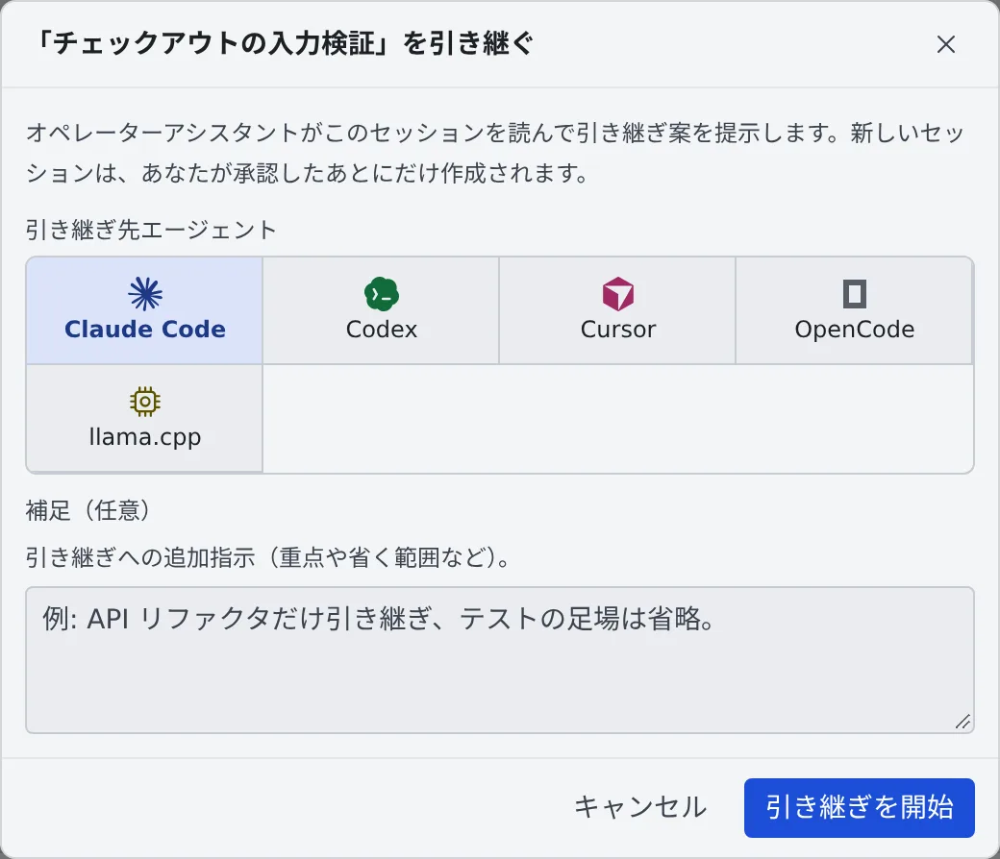
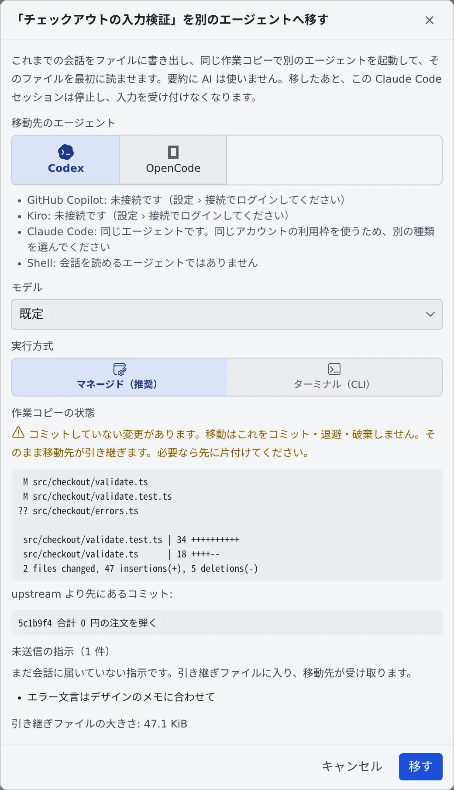

# 別のセッションやエージェントに引き継ぐ

[English](handoff.md) | 日本語

長くなった会話を新しいセッションで続けたり、利用上限に達したセッションを別のエージェントに移したりできます。

## 全体像

| あなたがやること | エージェントがやること |
|---|---|
| 「別のエージェントへ引き継ぐ…」で引き継ぎ先を選ぶ | フリート・オペレーターが会話を読み、引き継ぎ案を書く |
| 引き継ぎ案を確かめて承認する | 新しいセッションが、引き継ぎ案から始まる |
| 「別のエージェントへ移す…」で移動先を選ぶ | 会話をファイルに書き出し、同じ作業コピーで別のエージェントが続きを始める |

## どれを使うか

会話を新しいセッションへ持っていく方法は 3 つあります。

| | 引き継ぐ | ここから分岐 | 移す |
|---|---|---|---|
| 操作 | ⋯ メニューの「**別のエージェントへ引き継ぐ…**」 | 過去の自分の発言の「**ここから分岐**」 | ⋯ メニューの「**別のエージェントへ移す…**」 |
| 文脈を用意するのは | フリート・オペレーターが要約を書き、あなたが確かめる | 誰も書かない。会話をそのまま複製する | ワークスペースが会話をファイルに書き出す。AI は要約しない |
| 続けるエージェント | 接続しているどのエージェントでも | 同じエージェント | 別の種類のエージェントだけ |
| 元のセッション | そのまま残る | そのまま残る | 止まり、入力を受け付けなくなる |
| 引き継ぐもの | 要点・終わっていないタスク・変更したファイル・次の作業 | その発言より前の会話（一字一句そのまま） | 会話、止まったところ、作業コピーの状態、まだ送っていない指示 |

- 要約ではなく会話そのものを持っていきたいとき（「あの指示からやり直す」など）は、[ここから分岐](branch-message.ja.md)を使います
- 共有している相手に続きを頼むときは、⋯ メニューの「**メンバーへ引き継ぐ…**」を使います（[別のメンバーにセッションを引き継ぐ](../../member/12-collaboration.ja.md#別のメンバーにセッションを引き継ぐ)）

## 引き継ぐ

shell と ssm 以外の、会話のあるセッションで使えます。ワークスペースが起動している必要があります。セッション自体は停止中でもかまいません。

1. ⋯ メニューから「**別のエージェントへ引き継ぐ…**」を選びます
2. 「**引き継ぎ先エージェント**」を選びます。重点や省く範囲があれば「**補足（任意）**」に書きます

   

3. 「**引き継ぎを開始**」を押すと、フリート・オペレーターとのチャットに依頼文が入ります。確かめて送信します
4. フリート・オペレーターが元のセッションを読み、引き継ぎ案を出します
5. 引き継ぎ案、作業フォルダ、起動するエージェントを確かめて承認すると、新しいセッションが始まります

新しいセッションは、あなたが承認したときにだけ作られます。元のセッションはそのまま残ります。

## 別のエージェントへ移す

セッションがエージェントの利用上限に達したときや、別の種類のエージェントで続けたいときに使います。

1. ⋯ メニューから「**別のエージェントへ移す…**」を選びます
2. 「**移動先のエージェント**」と、新しいセッションの「**モデル**」「**実行方式**」を選びます
3. 画面に出る作業コピーの状態や、引き継ぎファイルの大きさを確かめて「**移す**」を押します

ワークスペースは会話を**引き継ぎファイル**に書き出し、選んだエージェントを**同じ作業コピー**で起動して、まずそのファイルを読ませます。
元のセッションはそのあと止まり、入力を受け付けなくなります。作業コピーに書き込むセッションは、いつも 1 つです。

### 移せるセッション

- ワークスペースが会話を読めるセッションだけです。shell と ssm は移せません
- 待機中、停止中、または利用上限・支出上限で止まっている必要があります
- 停止したマネージドの cursor セッションは移せません。会話が動いているエージェントの中にしかなく、止まると残らないためです
- ターンの実行中や、質問・計画・権限の確認があなたの返事を待っている間は移せません。ターンが終わるのを待つか止めて、先に答えてください
- 移動元・移動先になれる種類は [エージェント一覧](../../ref/agents.ja.md#別のエージェントへ移す) にあります。同じエージェントは移動先に出ません（同じアカウントの利用枠を使うためです）

### 画面で確かめること

| 項目 | 内容 |
|---|---|
| 移せるエージェント | 移せないエージェントや未接続のエージェントは、理由付きで並ぶ。claude・codex・muse・copilot・agy は、今の使用量も出る（copilot は月ごとの枠ひとつ） |
| 作業コピーの状態 | 未コミットの変更。移動はこれをコミット・退避・破棄しない。移動先がそのまま引き継ぐので、必要なら先に片付ける |
| 未送信の指示、届いていないセッション間メッセージ | 引き継ぎファイルに入り、移動先が受け取る |
| 引き継ぎファイルの大きさ | 目安を超えても、そのまま書き出す |
| 子セッションと引き継ぎ提案 | 元のセッションのものとして残る。子からの報告は元のセッションに届かなくなるので、Console で確かめる |

マネージドの cursor セッションは、止まると会話の表示が空になり、引き継ぎファイルが唯一の記録になります。

### 引き継ぎファイルに入るもの

- 会話、止まったところ、まだ届いていない指示、停止で取り下げられた入力
- 最後の 3 回分のあなたの発言からあとは、ツールの呼び出しを出力ごと残します。それより前は、読むだけのツール呼び出しを省き、ほかは出力なしの 1 行にします
- thinking は入りません
- 約 256 KiB を超えると、古いエージェントの返答を最初の段落だけに縮めます。あなたの発言と最後の 3 回分は縮めません
- 秘密情報らしき文字列は伏せます。見出しは Console の表示言語で書きます
- 元のエージェントが読んでいて、移動先が読まないプロジェクトの指示ファイルがあれば、その名前も書きます

ファイルは、移動先のセッションの作業用フォルダに置かれます。作業コピーの外なので、コミットされることはありません。
移動先のセッションと一緒にごみ箱へ入り、復元すると一緒に戻ります。

### 利用上限で止まったとき

利用上限（または支出上限）で止まったセッションは、チャットの上に帯が出て、「**別のエージェントへ移す**」ボタンから同じ画面が開きます。

- 利用枠の残っているエージェントが先頭に並び、「**枠に余裕あり**」の印が付きます。使用量の出ないエージェントも選べますが、印は付きません
- 移せるエージェントがないときや、候補がすべて上限に達しているときは、帯は出ません
- 移動が終わると、上限が解けたときの自動再開の予約は取り消されます。元のセッションがひとりでに動き出すことはありません
- セッションを停止しただけでは、予約は取り消されません。行に「**停止中・自動再開 …**」と出て、その時刻に再開します（ワークスペースが止まっていれば起動します）

### 移したあと

元の行には「**… へ移動済み**」と出ます。押すと移動先のセッションが開きます。

- 元のセッションで続けたいときは、メニューの「**それでもここで再開する…**」を選びます。移動先は止まらないので、以後はどちらか一方だけを使ってください

## 困ったとき

### 「… への移動が未完了」と出る

移動先が起動したか分からないまま止まりました。行を押して、画面で選びます。

| ボタン | すること |
|---|---|
| 「**やり直す**」 | 同じ引き継ぎファイルと同じ移動先の名前で、移動を終わらせる |
| 「**移動を取り消す**」 | ファイルを消して、元のセッションの入力を開き直す |

ワークスペースが起動している必要があります。

### 移動先が最初の指示を受け取ったか分からない

画面の「**最初の指示を送り直す**」で送り直せます。前の分が届いていた場合は、二重に届きます。

## 関連

- [セッションを止める・再開する](stop-resume.ja.md)
- [使いすぎたセッションを予算で止める](budget.ja.md)
- [エージェント一覧](../../ref/agents.ja.md)
