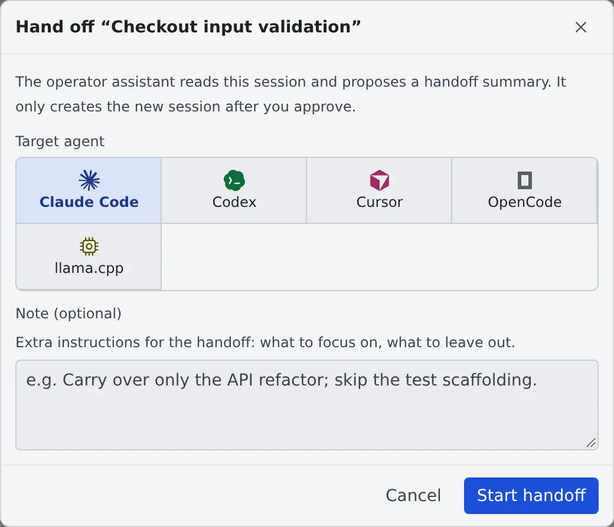
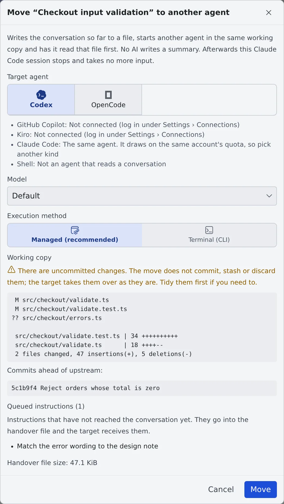

# Hand off to another session or agent

English | [日本語](handoff.ja.md)

You can continue a long conversation in a new session, or move a session that has hit its usage limit to another agent.

## How it works

| What you do | What the agent does |
|---|---|
| Choose the target in "Hand off to another agent…" | The Fleet Operator reads the conversation and drafts a handoff proposal |
| Review the proposal and agree to it | A new session starts from the proposal |
| Choose the target in "Move to another agent…" | The conversation is written to a file, and another agent carries on in the same working copy |

## Choose a way

There are three ways to carry a conversation into a new session.

| | Hand off | Branch here | Move |
|---|---|---|---|
| Where | **"Hand off to another agent…"** in the ⋯ menu | **"Branch here"** on one of your past messages | **"Move to another agent…"** in the ⋯ menu |
| Who prepares the context | The Fleet Operator writes a summary, and you review it | Nobody: the conversation is copied as it is | The Workspace writes the conversation to a file; no AI summarises it |
| Agent that carries on | Any connected agent | The same agent | Another kind of agent only |
| The original session | Stays as it is | Stays as it is | Stops and takes no more input |
| What carries over | Key points, unfinished tasks, changed files, next steps | The conversation before that message, word for word | The conversation, where it stopped, the working copy's state, instructions not yet sent |

- To carry the conversation itself rather than a summary ("redo it from that instruction"), use [Branch here](branch-message.md)
- To ask someone the session is shared with to carry on, use **"Hand off to a member…"** in the ⋯ menu ([Hand a session to a member](../team/hand-over.md))

## Hand off

Any session with a conversation can be handed off, except shell and ssm. The workspace has to be running; the session itself may be stopped.

1. Choose **"Hand off to another agent…"** in the ⋯ menu
2. Pick the **"Target agent"**. Write anything to focus on or leave out in **"Note (optional)"**

   

3. **"Start handoff"** puts the request into a chat with the Fleet Operator. Review it and send it
4. The Fleet Operator reads the original session and presents a handoff proposal
5. Check the proposal, the working folder and the agent to start, and agree: the new session starts

The new session is created only once you agree. The original session stays as it is.

## Move to another agent

Use it when a session has run out of its agent's usage limit, or you want to carry on with another kind of agent.

1. Choose **"Move to another agent…"** in the ⋯ menu
2. Pick the **"Target agent"**, and the new session's **"Model"** and **"Execution method"**
3. Check what the dialog shows about the working copy and the handover file's size, and press **"Move"**

The Workspace writes the conversation to a **handover file**, starts the agent you picked **in the same working copy**, and tells it to read that file first.
The original session then stops and takes no more input, so only one session writes to the working copy.

### Which sessions can be moved

- Only a session whose conversation the Workspace can read. shell and ssm cannot be moved
- It has to be idle, stopped, or stopped at a usage or spend limit
- A stopped Managed cursor session cannot be moved: its conversation lived only in the running agent, and nothing of it is left once it stops
- A move is refused while a turn is running, or while a question, a plan or a permission prompt is waiting for you. Let the turn end or stop it, and answer first
- Which kinds can be a source or a target is in the [Agents reference](../../ref/agents.md#moving-a-session-to-another-agent). The same agent is never offered as a target (it draws on the same account's quota)

### What to check in the dialog

| Item | What it says |
|---|---|
| The agents it can move to | Agents that cannot take it, or are not connected, are listed with the reason. For claude, codex, muse, copilot and agy, the current usage is shown too (copilot's as its one monthly pool) |
| The working copy's state | Uncommitted changes. The move never commits, stashes or discards them: the new session takes them over as they are, so tidy them first if you need to |
| Instructions not yet sent, messages from other sessions not yet delivered | They go into the handover file, and the new session receives them |
| The handover file's size | Past the guideline size it is still written in full |
| Child sessions and handoff proposals | They stay with the original session. Reports from children no longer reach it, so check them in the Console |

For a Managed cursor session, the conversation view is empty once it stops, and the handover file is then the only record.

### What goes into the handover file

- The conversation, where it stopped, instructions not yet delivered, and inputs a stop threw away
- From your last three messages on, every tool call is kept with its output. Before them, tool calls that only read are left out and the others keep one line without their output
- Thinking is left out
- Past about 256 KiB, the oldest agent replies are cut to their first paragraph. Your own messages and the last three exchanges are never cut
- Strings that look like secrets are masked. Its headings follow the Console's display language
- When the original agent followed project instruction files the new one does not load, the file names them

The file is saved in the new session's own scratch folder, outside the working copy, so it is never committed.
It goes to the trash with the new session and comes back when you restore it.

### When a session stopped at a usage limit

A session stopped at a usage limit (or a spend limit) shows a band above its chat, and its **"Move to another agent"** button opens the same dialog.

- Agents that still have quota left are listed first and marked **"quota left"**. Agents whose usage is not shown can be picked too, unmarked
- The band is not shown when no agent can take the session, or every candidate is at its own limit
- When the move completes, the automatic resume booked for the limit's reset is cancelled, so the original does not start again on its own
- Stopping the session does not cancel it. The row shows **"Stopped · auto-resume …"**, and at that time the session resumes (starting the workspace if it is stopped)

### After the move

The original row reads **"Moved to …"**. Pressing it opens the new session.

- To carry on in the original session, choose **"Resume here anyway…"** in its menu. The new session keeps running, so use only one of them from then on

## When it goes wrong

### The row reads "Move to … unfinished"

The move stopped without knowing whether the new session started. Press the row and choose in the dialog.

| Button | What it does |
|---|---|
| **"Retry"** | Finishes the move with the same handover file and the same target name |
| **"Cancel the move"** | Removes the file and opens the original session's input again |

The workspace has to be running.

### It is not known whether the new session received its first prompt

**"Resend the first prompt"** in the dialog sends it again. If the first one did arrive, it arrives twice.

## Related

- [Stop and resume a session](stop-resume.md)
- [Stop a session that spends too much with a budget](budget.md)
- [Agents reference](../../ref/agents.md)
