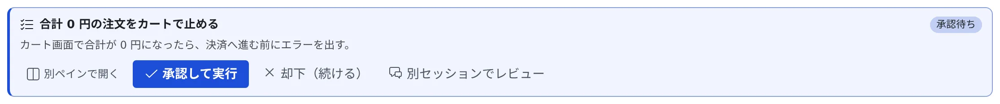

# プランにコメントする・レビューさせる

[English](plans.md) | 日本語

エージェントが出したプランの気になる箇所に、本文を選んでコメントを付けて返せます。
自分で読む代わりに、別のエージェントにレビューさせることもできます。

## 全体像

| あなたがやること | エージェントがやること |
|---|---|
| プランの本文を選んでコメントを書き、送る | コメントを踏まえて、改訂したプランを出し直す |
| **「別セッションでレビュー」** を押し、レビュー役のエージェントを選ぶ | レビュー役がプランを読み、判定と指摘を計画したセッションへ送る |
| 改訂版を同じレビュー役に送り返す（自動にもできる） | 計画したセッションがプランを直し、レビュー役が読み直す |

承認待ちのプランは、こういうカードで出ます。

## プランにコメントする

長いプランに「ここだけ直して」と返したいとき、本文を引用して打ち直す必要はありません。

1. プランカードの **「別ペインで開く」** を押します。本文がペインに開き、**「レビュー」** の印が付きます
2. 直してほしい箇所を選び、コメントを書きます
3. チャットのプランカードに戻り、**「コメントを送る（N）」** を押します

承認待ちのプランでは、このボタンが **「コメントを送って却下（N）」** になります。
コメントを届けるには承認のダイアログを閉じる必要があるので、送ることと却下が一体になっています。
エージェントは指摘を踏まえて、改訂したプランを出し直します。

## 別のセッションにレビューさせる

承認待ちのプランカードで **「別セッションでレビュー」** を押すと、いつもの起動画面が開きます。
レビューを頼むプロンプトが最初から入っていることだけが違います。

- エージェントとモデルは起動画面で選べます。プランを書いたのとは別のモデルに見せられます
- **プランはこの時点で却下されます。** レビュー結果はセッション間のメッセージで届きますが、承認待ちのセッションは文章を受け取れないためです
- 計画したセッションは Plan モードのままで、指摘を受け取ってからプランを直して出し直します
- レビュー役は、既定では**同じ作業コピー**で起動します。コミットしていない変更も読ませるためです。起動画面で新しい worktree も選べます
- 終わったレビュー役は、自分で終了します。会話はセッションとして残るので、なぜその指摘が出たのかを後で確かめられます

### 同じレビュー役に改訂版を送り返す

claude の改訂プランのカードには、**「‹レビュー役› で再レビュー」** が出ます。
そのプランのカードから起動したレビュー役のセッションが残っているときだけです。

- 新しいレビュー役を起動せず、改訂版を同じレビュー役にメッセージで送ります。前回の指摘を踏まえて読めます
- レビュー役が止まっていれば、先に再開します。ターンの途中なら、そのターンが終わってから届きます
- 最初のレビューと同じく、プランは却下されます。そのあと送れなかったときは、エラーの通知に **「もう一度送る」** が出ます
- プランとレビュー役の結び付きは計画したセッションの側に保存されるので、どのブラウザやデバイスでもこのボタンが出ます

### 再レビューを自動で回す

claude のプランのカードでは、「… で再レビュー」の隣に「最大 N 回まで自動で再レビュー」が出ます。
既定ではオフです。N は 1〜10 の範囲で選べます。既定は 3 です。

オンの間は、次の両方がそろったとき、改訂版がクリックなしで同じレビュー役へ送られます。

- 計画したセッションがプランを改訂した
- レビュー役の直前の返信の判定が `changes-requested` だった

| 項目 | 動き |
|---|---|
| 動く場所 | Agent。タブを閉じても続き、回数は Agent を再起動しても保たれます |
| 承認 | **決してしません。** 最後の改訂はふつうの承認カードに残り、判断はあなたがします |
| 読むところ | レビュー役の返信の **判定** の節だけ。指摘の本文は読みません |
| 動いている間の表示 | カードに「自動レビュー 2/3」 |
| 止まったときの表示 | カードに「自動レビューを停止（2/3）：‹理由›」 |
| 回数が 0 に戻るとき | そのプランのレビュー役を変えたとき、オフにしてからオンに戻したとき |

次のどれかで止まります。

- レビュー役が `approve` と判定した
- 自動で N 回送った
- 返信の **判定** の節が、ちょうど `approve` か `changes-requested` と読めなかった
- レビュー役に送れなかった、またはプランを却下できなかった
- 計画したセッションが Plan モードではない（止めたあとに再開した場合など）
- 承認のダイアログが表示されていなかった
- ラウンドの途中で Agent が再起動した（送り直しはしません）
- その間に、あなたがプランに答えたか、設定を変えた

最初のレビューを起動するのは、いつもあなたです。

### 止まったセッションに残ったプランをレビューさせる

止まったセッションに **「停止時に承認待ちだった計画」** のカードが残っていても、**「別セッションでレビュー」** を使えます。
動いているカードとの違いは次のとおりです。

- 何も却下せず、セッションも再開しません
- レビュー役のセッションができた時点で、カードが消えます。起動画面を閉じたときは残ります
- レビュー結果が届くと、セッションが再開します
- **「… で再レビュー」** では、プランを送れた時点でカードが消えます

## 困ったとき

### 「… で再レビュー」が出ない

次のどれかです。

- claude 以外のエージェントのプランです
- そのプランのカードから起動したレビュー役のセッションが、もうありません
- 結び付きを保存できない古い Agent です。レビュー役を起動したブラウザにだけ出て、ほかのブラウザでは「別セッションでレビュー」だけが出ます。自動の再レビューも出ません

### 「コメントを送る」を押せない

セッションが止まっています。再開してから送ってください。

## 関連

- [セッションに返事をする](reply.ja.md)：プランの承認と、止まったセッションに残ったカード
- [送る内容を保留する・ターンを止める](queue.ja.md)：却下やレビューが送る停止の扱い
