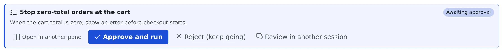

# Comment on a plan, have it reviewed

English | [日本語](plans.ja.md)

Select the parts of an agent's plan you want changed, attach comments and send them back.
Instead of reading it yourself, you can also have another agent review it.

## How it works

| What you do | What the agent does |
|---|---|
| Select text in the plan, write comments, send them | Comes back with a revised plan that takes them into account |
| Press **"Review in another session"** and pick the reviewing agent | The reviewer reads the plan and sends its verdict and findings to the planning session |
| Send the revision back to the same reviewer (or have it done automatically) | The planner revises the plan, and the reviewer reads it again |

A plan awaiting approval shows as a card like this.

## Comment on a plan

To say "change just this part" about a long plan, you do not have to quote it and retype.

1. Press **"Open in another pane"** on the plan card. The body opens in a pane marked **"Review"**
2. Select the passage you want changed and write a comment
3. Back on the plan card in the chat, press **"Send comments (N)"**

On a plan awaiting approval the button reads **"Send feedback and keep planning (N)"**.
Your comments can only arrive once the approval dialog is closed, so sending them and rejecting the plan are one action.
The agent comes back with a revised plan that takes them into account.

## Have another session review it

**"Review in another session"** on a plan awaiting approval opens the usual launch dialog.
The only difference is that a prompt asking for a review is already filled in.

- You pick the agent and the model in the dialog, so you can show the plan to a different model than the one that wrote it
- **The plan is rejected at that point.** The findings come back as a session-to-session message, and a session awaiting plan approval cannot take text
- The planning session stays in Plan mode, takes the findings, and proposes a revised plan
- The reviewer starts in the **same working copy** by default, so it reads your uncommitted work too. You can pick a new worktree in the dialog instead
- The reviewer folds itself away when it is done. Its conversation stays as a session, so you can see later why a point was raised

### Send the revision back to the same reviewer

**"Review again in ‹reviewer›"** appears on the card of a revised claude plan.
It does so only while a reviewer session launched from that plan's card is still there.

- It sends the revised plan to the same reviewer as a message, instead of starting a new one, so the second round sees its earlier findings
- A stopped reviewer is resumed first. One in the middle of a turn gets the message when the turn ends
- As with the first review, the plan is rejected. If the send fails after that, the error toast offers **"Send again"**
- The link between plan and reviewer is kept with the planning session, so any browser or device offers the button

### Have it review again automatically

On a claude plan's card, "Review automatically, up to N rounds" sits beside "Review again in …".
It is off by default. N can be anything from 1 to 10; the default is 3.

While it is on, the revised plan goes to the same reviewer without a click when both of these hold:

- The planning session has revised the plan
- The reviewer's last reply gave the verdict `changes-requested`

| Item | Behaviour |
|---|---|
| Where it runs | On the Agent. It carries on with the tab closed, and its count survives an Agent restart |
| Approval | **It never approves.** The last revision stays on an ordinary approval card, and the decision is yours |
| What it reads | Only the **Verdict** section of the reviewer's reply, never the findings |
| While it runs | The card shows "auto-review 2/3" |
| When it stops | The card shows "auto-review stopped at 2/3: ‹reason›" |
| When the count goes back to 0 | When you choose a different reviewer for the plan, or switch it off and on again |

It stops on any of these:

- The reviewer's verdict is `approve`
- It has sent N rounds automatically
- The **Verdict** section of a reply does not read as exactly `approve` or `changes-requested`
- The reviewer could not be reached, or the plan could not be rejected
- The planning session is not in Plan mode (for instance one resumed after a stop)
- The approval dialog was not on screen
- The Agent restarted in the middle of a round (nothing is resent)
- You answered the plan yourself, or changed the setting, in the meantime

The first review is still started by you.

### Have a plan left by a stopped session reviewed

When a stopped session left a **"Plan awaiting approval at stop"** card, **"Review in another session"** works there too.
It differs from a live card in these ways:

- Nothing is rejected and the session is not resumed
- The card is removed once the reviewer session has been created. Cancelling the launch dialog keeps it
- The reviewer's findings resume the session
- With **"Review again in …"**, the card is removed once the plan has been sent

## When it goes wrong

### "Review again in …" is not offered

One of these applies.

- The plan is not from claude
- The reviewer session launched from that plan's card is gone
- The Agent is too old to store the link. The button then appears only in the browser that launched the reviewer, and other browsers show only "Review in another session". Automatic review is not offered either

### "Send comments" cannot be pressed

The session is stopped. Resume it before sending.

## Related

- [Reply to a session](reply.md): approving a plan, and the cards a stopped session leaves
- [Hold what you send, stop a turn](queue.md): how the stop that rejecting and reviewing send is handled
