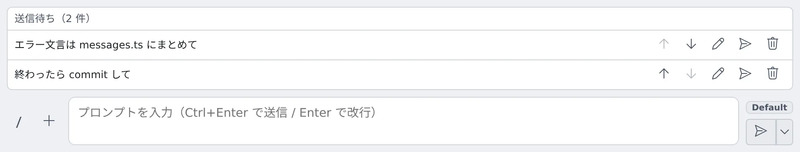

# 送る内容を待たせる・ターンを止める

[English](queue.md) | 日本語

ターンの実行中に、続きの指示を「送信待ち」に溜めておき、ターンが終わってから順に送れます。
キューに積まれた指示があるときに「停止」が何を止め、何を残すかも、このページで扱います。

## 全体像

| あなたがやること | エージェントがやること |
|---|---|
| 続きの指示を「送信待ち」に溜める | 何も受け取らない。ターンが終わると、1 件ずつ受け取る |
| ターン中にふつうに送る | すぐに受け取る。種別によって、実行中のターンに取り込むか、キューに積む |
| **停止** を押す | 実行中のターンを止める。キューの扱いは実行方式で変わる |

送信待ちとキューは別のものです。

| | 送信待ち | キュー |
|---|---|---|
| どこにある | ブラウザの中。まだ何も送っていない | Agent の中。すでに送った |
| 入るもの | 自分が溜めた指示だけ | 自分の指示と、ほかのセッションからのメッセージ |
| 出るところ | 入力欄の上の「送信待ち（N 件）」 | 会話の中の、操作付きの吹き出し |

## 送信待ちに溜める

1. ターンの実行中に、入力欄に指示を書きます
2. 送信ボタン右端の **▾** から **「送信待ちに追加」** を選びます（**Alt+Enter** でも同じです）。▾ はターンの実行中だけ出ます
3. 指示は入力欄の上の **「送信待ち（N 件）」** に並びます。エージェントにも会話にも、まだ何も届きません

ターンが終わると先頭の行が送られ、エージェントがそのターンを始めて終えると次の行、と 1 件ずつ送られます。
2 件が同時に出ることはありません。

| 操作 | 動き |
|---|---|
| **上へ** / **下へ** | 順番を入れ替える |
| **編集** | Enter で保存、Shift+Enter で改行、Esc で取り消し。日本語入力の変換中の Enter では保存しません。編集している間は何も送られません |
| **削除** | その行を消す |
| **今すぐ送る** | セッションの状態にかかわらず、その行をすぐ送る。扱いはターン中のふつうの送信と同じです |

- 添付付きで溜めた指示は、添付も残ります（「+N」と出ます）
- セッションが止まっている間は何も送られず、行はリストに残ります

### 送信待ちが止まるとき

次の操作のあとは、溜めた指示が勝手に走り出さないように一時停止します。
リストの上に **「停止したため自動送信を止めています。」** と出るので、続けるには **「再開」** を押します。

- **停止** を押した
- プランを却下した、または **「別セッションでレビュー」** や **「… で再レビュー」** に送った
- ターミナルのセッションで、質問を Esc で取り消した
- エージェントが送信を断った（その行は元の位置に残ります）

### 送信待ちが消えるとき

送信待ちはセッションごとの、一時的なものです。サーバーには保存しません。

- 同じページの中でペインやセッションを切り替えても残ります
- ページを再読み込みすると消えます
- 送られるのは、そのセッションのチャットを開いている間だけです

端末をまたいで残したいときは、[メモキュー](../chat/memos.ja.md)を使います。

## キューがあるときにターンを止める

**停止** がキューをどう扱うかは、実行方式で違います。

### マネージドのセッション

停止は 2 段階です。

| 操作 | 止まるもの | 残るもの |
|---|---|---|
| 1 回目の **停止** | 実行中のターンだけ | キューのもの。そのあと 1 件ずつ、1 ターンずつ実行されます |
| 2 回目の **停止** | 実行中のものと、キューに残っているものすべて | なし（ほかのセッションからのメッセージも捨てます） |
| 停止の横のメニューの **「停止してキューも捨てる」** | 1 回で両方 | なし |

- **1 回目は、訂正を今すぐ効かせるためのものです。** 「いや、X にして」と積んでからターンを止めると、その訂正が次に実行されます
- **2 回目に時間の制約はありません。** キューが尽きて、そこから始まった最後のターンが落ち着くまでは、1 分後に押しても 2 回目です
- **自分で新しいメッセージを送ると、数え直しです。** その次の停止は、また 1 回目になります
- 停止ボタンのダブルクリックは、停止 2 回として数えます
- **「停止してキューも捨てる」** のメニューは、セッションの実行中とキューに何かある間は出ています。質問や承認のカードが出ている間も出ます。チャットにキューが見えているときは、件数つきで強調されます

種別によっては、ターンの実行中に送ったメッセージをキューに積まず、実行中のターンにすぐ取り込みます。
その場合は、ふつう止める必要はありません。どの種別かは[エージェント一覧](../../ref/agents.ja.md#ターンの停止と実行中に送ったメッセージ)にあります。

### 止めずにキューから 1 件だけ外す

キューの吹き出しには、エージェントへの受け渡しが始まるまで **「入力欄へ戻す」** と **「取り除く」** が付きます。
受け渡しが始まると、操作の付かない表示になります。

### 捨てた入力を戻す

キューを捨てると、何件捨てたかを知らせる通知が出ます。

- **「戻す」** を押すと、捨てた自分のメッセージが 1 件ずつ入力欄に戻ります。送信はしません
- ほかのセッション・オペレーター・スケジュールからのメッセージは、一覧で見せるだけです
- 停止を押す直前に送って、まだエージェントに届いていなかったメッセージも、同じように戻せます
- 捨てた入力は、セッションごとに直近 5 回分を Agent が覚えています。セッションの停止・アーカイブ・実行方式の切り替えと、Agent の再起動で消えます

エージェントがすでに受け取った入力は、停止では取り戻せません。
受け渡しの途中で停止が届いたとき、すぐに止まるか、止まる前に最初の一歩が進むかは種別によります。

### ターミナル（CLI）のセッション

CLI 自身の動きのままです。

- **停止** は、その CLI がターンを止めるキーを送ります。どうするかは CLI が決めます
- 送っている間にもう一度 **停止** を押しても、無視されます
- キューは CLI の中にあるので、「停止してキューも捨てる」と捨てた件数の通知は出ません
- claude では、返答が始まる前に停止すると、止めたプロンプトをチャットの入力欄に戻します。入力欄に文字があるときはそれを残し、↑ で呼び出せると知らせます。取り出せなかったときは、端末で消すまで次の送信が断られます

CLI ごとに送るキーと、実行中に打ったプロンプトの扱いは、[エージェント一覧](../../ref/agents.ja.md#ターンの停止と実行中に送ったメッセージ)にあります。

### 停止と同じ扱いになる操作

- **プランの却下**、**「別セッションでレビュー」**、**「… で再レビュー」** は、同じ停止を送り、同じ規則に従います
- **質問の取り消し** がこの規則に従うのは、取り消すとターンが止まる種別だけです。ほかの種別は質問に「断った」と答えるだけで、キューには触れません

## 困ったとき

### 溜めた指示が送られない

次のどれかです。

- リストの上に「停止したため自動送信を止めています。」と出ている：**「再開」** を押します
- 行を編集している：保存するか取り消すと、送り始めます
- セッションが止まっている：再開すると送られます
- そのセッションのチャットを開いていない：開いている間だけ送られます

### 停止したのに、キューの指示が始まった

マネージドのセッションの 1 回目の停止は、実行中のターンだけを止めます。残りも止めるには、もう一度 **停止** を押すか、**「停止してキューも捨てる」** を使います。

## 関連

- [セッションに返事をする](reply.ja.md)：入力欄とカードの使い方
- [エージェント一覧](../../ref/agents.ja.md#ターンの停止と実行中に送ったメッセージ)：種別ごとの停止と、実行中に送ったメッセージの扱い
