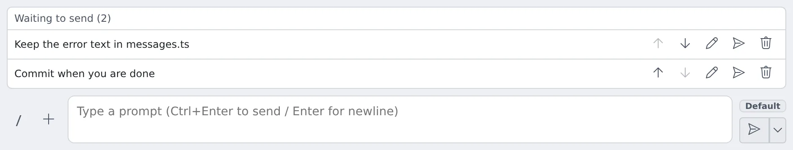

# Hold what you send, stop a turn

English | [日本語](queue.ja.md)

While a turn runs, you can hold follow-ups in a waiting list and send them in order once the turn ends.
This page also covers what Stop ends and what it keeps when something is queued.

## How it works

| What you do | What the agent does |
|---|---|
| Hold follow-ups in "Waiting to send" | Receives nothing. When the turn ends, it gets them one at a time |
| Send normally during a turn | Gets it at once. Depending on the kind, it takes it into the running turn or queues it |
| Press **Stop** | Stops the running turn. What happens to the queue depends on the execution method |

The waiting list and the queue are different things.

| | Waiting list | Queue |
|---|---|---|
| Where it lives | In your browser. Nothing has been sent | In the Agent. Already sent |
| What goes in | Only the follow-ups you held | Your messages and messages from other sessions |
| Where you see it | "Waiting to send (N)" above the input box | Bubbles with actions in the conversation |

## Hold follow-ups in the waiting list

1. While a turn runs, write the instruction in the input box
2. Choose **"Add to waiting list"** from the **▾** on the right edge of the Send button (or press **Alt+Enter**). The ▾ appears only while a turn runs
3. The instruction is listed in **"Waiting to send (N)"** above the input box. Nothing reaches the agent or the conversation yet

When the turn ends the first row is sent, then the next once the agent has started that turn and finished it, and so on.
Two rows never go out at once.

| Action | What it does |
|---|---|
| **Move up** / **Move down** | Changes the order |
| **Edit** | Enter saves, Shift+Enter adds a line, Esc cancels. Enter while an IME candidate is open does not save. Nothing is sent while you edit |
| **Delete** | Removes the row |
| **Send now** | Sends that row at once, whatever the session is doing. It is handled exactly like a plain send during a turn |

- A follow-up held with attachments keeps them (shown as "+N")
- While the session is stopped nothing is sent, and the rows stay in the list

### When the waiting list pauses

After the actions below the list pauses, so your held follow-ups do not start on their own.
The list header says **"Auto-send is paused because you stopped the turn."**; press **"Resume"** to go on.

- You pressed **Stop**
- You rejected a plan, or sent it to **"Review in another session"** or **"Review again in …"**
- You cancelled a question with Esc on a Terminal session
- The agent refused a send (that row stays where it was)

### When the waiting list is cleared

The waiting list belongs to one session and is temporary. It is never stored on the server.

- It stays when you switch panes or sessions in the same page
- Reloading the page clears it
- It sends only while that session's chat is open

To keep something across devices, use the [Memo queue](../../member/10-chat-memo.md#memo-queue).

## Stop a turn when something is queued

What **Stop** does with the queue depends on the execution method.

### Managed sessions

Stopping has two stages.

| Action | What stops | What is kept |
|---|---|---|
| First **Stop** | Only the running turn | What is queued. It then runs one message per turn, in order |
| Second **Stop** | What is running and everything still queued | Nothing (messages from other sessions are discarded too) |
| **"Stop and discard the queue"** in the menu next to Stop | Both, in one press | Nothing |

- **The first stop is for making a correction count now.** Queue "no, do X instead", stop the turn, and the correction runs next
- **The second stop needs no timing.** Until the queue has run out and the last turn it started has settled, a stop a minute later is still the second
- **Sending a new message of your own starts the count again.** The stop after that is a first stop again
- A double click on Stop counts as two stops
- The **"Stop and discard the queue"** menu is there while the session runs or has anything queued, also while a question or approval card is shown. It is highlighted, with a count, while the chat shows something queued

Some kinds do not queue a message sent during a turn but take it into the running turn at once.
There is usually no need to stop on those. Which kinds they are is in the [Agents reference](../../ref/agents.md#stopping-a-turn-and-messages-sent-while-one-runs).

### Take one message out of the queue without stopping

A queued bubble offers **"Back to input"** and **"Remove"** until it is being handed to the agent.
After that it shows without actions.

### Put back what was discarded

When the queue is discarded, a notice says how many messages went.

- **"Put back"** returns your own discarded messages to the input box one at a time, without sending them
- Messages from other sessions, the operator or a schedule are only listed
- A message you sent just before pressing Stop, which had not reached the agent yet, comes back the same way
- The Agent keeps the last five discards per session. They go when the session is stopped, archived or switched to another execution method, and when the Agent restarts

A stop cannot take back input the agent already holds.
When a stop arrives while a message is being handed over, whether it stops at once or the message takes a first step first depends on the kind.

### Terminal (CLI) sessions

The CLI's own behaviour applies.

- **Stop** sends the key that CLI stops a turn with, and the CLI decides what happens
- A second **Stop** while one is being sent is ignored
- The queue lives inside the CLI, so "Stop and discard the queue" and the discard notice are not offered
- On claude, a stop before the reply starts puts the stopped prompt back in the chat's input box. When the box already holds text, the text is kept and a note says to press ↑ to recall the prompt. When the prompt cannot be taken out, the next send is refused until it is cleared in the terminal

Which key each CLI gets, and what each does with a prompt typed during a turn, is in the [Agents reference](../../ref/agents.md#stopping-a-turn-and-messages-sent-while-one-runs).

### Actions that count as a stop

- **Rejecting a plan**, **"Review in another session"** and **"Review again in …"** send the same stop and follow the same rules
- **Cancelling a question** follows them only on kinds where cancelling stops the turn. The others answer the question as declined and leave the queue alone

## When it goes wrong

### Held follow-ups are not sent

One of these applies.

- The list header says "Auto-send is paused because you stopped the turn.": press **"Resume"**
- You are editing a row: save or cancel, and sending resumes
- The session is stopped: resume it and they are sent
- That session's chat is not open: they are sent only while it is

### You pressed Stop, and a queued message started

On a Managed session, the first stop ends only the running turn. To stop the rest, press **Stop** again or use **"Stop and discard the queue"**.

## Related

- [Reply to a session](reply.md): the input box and the cards
- [Agents reference](../../ref/agents.md#stopping-a-turn-and-messages-sent-while-one-runs): stopping by kind, and messages sent during a turn
