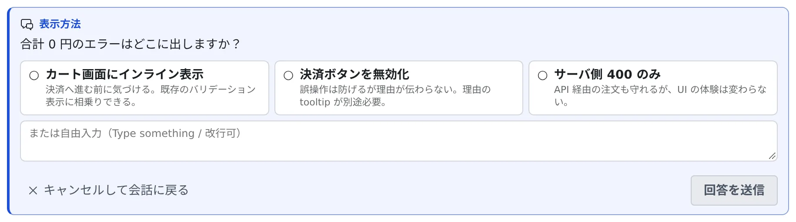

# セッションに返事をする

[English](reply.md) | 日本語

セッションのチャット表示で、エージェントの発言を読み、質問や承認の求めに答え、続きの指示を送れます。
スマホで進み具合を追いながら、短く返すこともできます。

## 全体像

| あなたがやること | エージェントがやること |
|---|---|
| チャット表示で会話を読む | ターンごとに、発言を Markdown で返す |
| 質問・プラン・許可のカードに答える | 答えを受け取って、作業を続ける |
| 入力欄からプロンプトを送る | 端末に打ち込まれたのと同じように受け取る |

## チャット表示で読む

会話を持つ種別のセッションは、すべてチャット表示で操作できます。

| 実行方式 | チャット表示の出し方 |
|---|---|
| ターミナル（CLI） | ペイン上部の **チャット ⇄ ターミナル** で切り替える |
| マネージド | 最初からチャット表示だけを使う |

- **作業過程**や**思考**のブロックは、見出しを押すと開閉します
- 長いブロックを開くと、最下部にも **「閉じる」** が出ます。読み終えた位置から畳めます
- 対応する種別は、[エージェント一覧](../../ref/agents.ja.md)の「実行中のチャットミラー」の行にあります

## カードに答える

エージェントがあなたの判断を待っているときは、カードが出ます。
出るカードと選択肢は、エージェントと状態によって違います。

| カード | できること |
|---|---|
| 質問中 | 選択肢を選ぶか自由に書いてから、**「回答を送信」** で送る |
| プラン承認待ち | **「承認して実行」** か **「却下（続ける）」** を選ぶ |
| 許可待ち | 編集やコマンドの実行を **「許可」** するか **「拒否」** する。**「常に許可」** など、以降は確認しない選択肢が出ることもあります |

- **質問は、選んだだけでは送られません。** 選び直したり、選択肢に付くプレビューを見比べたりしてから送れます
- **選んだ内容と書きかけの文は残ります。** 別のタブやターミナルを見に行って戻っても、そのままの状態でカードが出ます。回答を送るか、質問を取り消すと消えます
- 質問のカードには **「翻訳」** が出ることがあります。[回答を自分の言語で読む](translate.ja.md)を見てください
- プランへの指摘やレビューは、[プランにコメントする・レビューさせる](plans.ja.md)にあります

## プロンプトを送る

下の入力欄から送ると、端末に打ち込むのと同じように指示できます。画像も貼り付けられます。

- **モードの切り替え** で、Plan と実装を切り替えます
- 実行中は **停止**（Esc）で止められます
- 送った直後は送信済みと表示され、エージェントが処理を始めると会話に出ます
- ターンの実行中に送る内容を溜めておくこともできます。[送る内容を待たせる・ターンを止める](queue.ja.md)を見てください

停止中のセッションは、履歴を読むだけです。返事をするには **「再開して続ける」** で再開します。

## 止まったセッションに残ったカードに答える

質問・プラン・許可の求めがあなたを待っている間にセッションが止まっても、カードはチャットに残ります。
自分で止めた、待ちが続いて畳まれた、ワークスペースが止まった、のどれでも同じです。通知センターにも知らせが出ます。

| 見出し | できること |
|---|---|
| **停止時に未回答だった質問** | 動いているときと同じように選んだり書いたりして、**「回答して再開」** を押す |
| **停止時に承認待ちだった計画** | 任意の「補足や修正指示」欄のあと、**「承認して実行」** か **「承認しない」** を選ぶ。**「別セッションでレビュー」** もあります |
| **停止時に許可を求めていた操作** | **「続けて再開」** だけを選べる |

- **答えると、セッションが再開します。** 元のダイアログは停止で消えているので、答えはふつうのメッセージとして届きます
- **「承認して実行」は先に確認が出ます。** 再開してすぐにプランを実行し、取り消せないためです
- **「承認しない」** では、再開したセッションにプランの見直しを頼みます。補足を書いたときは、それが届きます
- **許可**を求めていたツールの呼び出しはもうありません。エージェントには何を求めていたかが伝わり、必要ならもう一度試します
- **「破棄」** はカードを消すだけで、セッションは再開しません
- 答えないままのカードは 14 日で消えます

## 前に送った文をもう一度使う

入力欄が空のとき **↑↓** で、この会話で自分が送った文をさかのぼれます。スマホでは入力欄の横の **∧∨** ボタンです。

ずっと前の文を探すときは **Ctrl+R** を押します。bash と同じ履歴の絞り込み検索が入力欄の上に開き、
打った文字を含む過去の文を新しい順に出します。

| キー | 動き |
|---|---|
| **Ctrl+R** / **Ctrl+S**（**↑↓** でも同じ） | さらに前へ / 後ろへ。右側の「3/12」は、何件中の何件目かです |
| **Enter**（または **Tab**） | 入力欄に入れるだけで、送信はしない。直してから送れます |
| **Esc**（または **Ctrl+G**） | 取り消して、検索の前に書いていた文に戻す |

- 一致がなくなると「一致なし」と出て、最後に見つかった文が入力欄に残ります
- スマホには Ctrl キーがないので、入力欄の左の虫めがねのボタンから開きます
- 探せるのは、この会話で自分が送った文だけです（`/コマンド` も含みます）。ほかのセッションの入力は対象外です

## 返信サジェストを使う

入力欄の上に、よく使う短い返信（OK・進めて・commit など）と、直近の回答に沿った候補がチップで並びます。

- クリックすると入力欄に入ります。**Ctrl・⌘・Alt のどれかを押しながらクリック**すると、すぐ送ります
- 候補は、あなたが送った短い文から覚えます
- 右クリック（タッチでは長押し）で **「常に表示（ピン留め）」** や **「この候補をもう出さない」** を選べます。同じ文を自分で送ると、また出るようになります

キーボードだけでも使えます。入力欄が空のとき **Tab** で候補へ移り、**←→** で選び、**Enter** で入力欄に入れ、
**Ctrl（⌘）+Enter** で送ります。**Esc** で入力欄に戻ります。Enter で送信する設定にしていると、Enter と Ctrl+Enter の役割は入れ替わります。

**✨ボタン**（「AI に返信候補を出してもらう（直近の会話から）」）を押すと、直近の会話から AI が候補をいくつか足します。

- 選ぶまで何も送られません
- トークンを使うのは、押したときだけです
- 会話がまだ短いときや使える AI がないときは、そう表示されます

チップの表示は **⚙設定 →「キー操作」**、✨ボタンは **⚙設定 →「AI 補助」** の「返信候補（セッション）」でオン・オフします。

## 会話の一文にマーカーを引く

会話の文字を選ぶと **「マーカーを引く」** が出ます。色（黄・緑・青・桃）を選ぶと、その一節に印が残ります。
長い会話で、大事な箇所が何画面も上にあるときに便利です。

- **印は会話に残ります。** そのセッションを共有している人にも、同じ位置に同じ印が見えます
- 会話ヘッダの下の **「マーカー」** の帯に一覧が出て、何人が引いたかもわかります
- **「マーカーを消す」** で消えるのは自分の印だけです
- 色に決まった意味はありません。チームで決めてください
- スマホやタブレットでは、色は画面の下端の帯に出ます。選択した箇所のすぐ上は、ブラウザの「コピー / 共有」のメニューが覆うためです

## 困ったとき

### 入力欄から送れない

セッションが止まっています。**「再開して続ける」** で再開してください。

### 質問のカードを選んだのに、エージェントが動かない

選んだだけでは送られません。**「回答を送信」** を押してください。

## 関連

- [送る内容を待たせる・ターンを止める](queue.ja.md)：ターン中の追加の指示と、停止の動き
- [プランにコメントする・レビューさせる](plans.ja.md)：プランへの指摘と、別のエージェントによるレビュー
- [スキルやコマンドを呼び出す](skills.ja.md)：入力欄からスキルを選ぶ
- [過去のメッセージから分岐する](branch-message.ja.md)：途中からやり直す
- [エージェント一覧](../../ref/agents.ja.md)：種別ごとに使える機能
