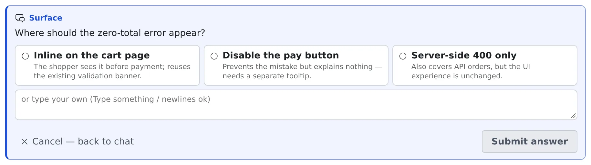

# Reply to a session

English | [日本語](reply.ja.md)

In a session's chat view you read what the agent says, answer its questions and approval requests, and send the next
instruction. It works on a phone too, for following progress and firing back a short reply.

## How it works

| What you do | What the agent does |
|---|---|
| Read the conversation in the chat view | Replies turn by turn, shown as Markdown |
| Answer a question, plan or permission card | Takes the answer and carries on |
| Send a prompt from the input box | Takes it as if you had typed it into the terminal |

## Read the chat view

Every session kind that has a conversation can be driven from the chat view.

| Execution method | How you get the chat view |
|---|---|
| Terminal (CLI) | Switch with **Chat ⇄ Terminal** at the top of the pane |
| Managed | The chat view is all there is, from the start |

- **Work-in-progress** and **thinking** blocks fold and unfold from their heading
- When a long block is open, **"Collapse"** also appears at its bottom, so you can fold it where you finished reading
- The kinds are in the "Live chat mirror" row of the [Agents reference](../../ref/agents.md)

## Answer a card

When the agent is waiting on your judgement, a card appears.
Which cards and choices you get depends on the agent and the state.

| Card | What you can do |
|---|---|
| Question pending | Pick a choice or type an answer, then send it with **"Submit answer"** |
| Plan awaiting approval | Choose **"Approve and run"** or **"Reject (keep going)"** |
| Awaiting permission | **"Allow"** or **"Deny"** the edit or command. A choice that stops asking for the rest of the session, such as **"Always allow"**, may be offered too |

- **Picking a choice does not send it.** You can change your mind, and compare the previews some choices come with, before anything goes out
- **What you picked and typed is kept.** Look at another tab or the terminal and come back: the card is as you left it. It is cleared once the answer is sent or the question is cancelled
- A question card may offer **"Translate"**; see [Read an answer in your own language](translate.md)
- Comments on a plan and reviews are in [Comment on a plan, have it reviewed](plans.md)

## Send a prompt

A prompt sent from the input box below works like typing into the terminal. You can paste images too.

- The **mode toggle** switches between Plan and Build
- While a turn runs, **Stop** (Esc) halts it
- Right after sending, the message shows as sent; it appears in the conversation once the agent starts on it
- You can also hold what you send while a turn runs; see [Hold what you send, stop a turn](queue.md)

A stopped session is read-only history. To reply, resume it with **"Resume and continue"**.

## Answer the cards a stopped session left

When a session stops while a question, a plan or a permission request is waiting for you, the card stays in its chat.
That holds whether you stopped it, it was folded away after waiting, or the workspace stopped. The notification center tells you too.

| Heading | What you can do |
|---|---|
| **Question left unanswered at stop** | Pick and type as on a live card, then press **"Answer and resume"** |
| **Plan awaiting approval at stop** | After an optional "Notes or changes" box, choose **"Approve and run"** or **"Do not approve"**. **"Review in another session"** is offered too |
| **Permission requested at stop** | The only choice is **"Resume and continue"** |

- **Answering resumes the session.** The original dialog did not survive the stop, so your answer arrives as an ordinary message
- **"Approve and run" asks first.** The session resumes and runs the plan straight away, and that cannot be undone
- **"Do not approve"** resumes the session and asks it to revise the plan. Notes you wrote are what it gets
- The tool call a **permission** card asked about is gone. The agent is told what it had asked and tries again if it still needs to
- **"Discard"** removes the card without resuming the session
- A card nobody answers is dropped after 14 days

## Reuse something you sent earlier

With the input box empty, **↑↓** walk back through what you sent in this conversation. On a phone, use the **∧∨** buttons beside the box.

To find something far back, press **Ctrl+R**. The same incremental history search bash has opens above the input box and
offers your past prompts containing what you type, newest first.

| Key | What it does |
|---|---|
| **Ctrl+R** / **Ctrl+S** (**↑↓** do the same) | Further back / forward. The "3/12" on the right is where you are in the matches |
| **Enter** (or **Tab**) | Only puts it in the input box; nothing is sent, so you can edit it first |
| **Esc** (or **Ctrl+G**) | Cancels and gives you back what you were typing before the search |

- When nothing matches any more it says "No match", and the last match stays in the input box
- Phones have no Ctrl key: open it from the magnifier button to the left of the input box
- Only what you sent in this conversation is searched (`/commands` included). Other sessions' inputs are not

## Use reply suggestions

Above the input box, chips offer short replies you use often (OK, go ahead, commit …) and suggestions that follow the latest reply.

- Clicking one puts it in the input box. **Hold Ctrl, ⌘ or Alt while clicking** to send it at once
- The suggestions learn from the short messages you send
- Right-click (long-press on touch) offers **"Always show (pin)"** and **"Stop suggesting this"**. Sending the same text yourself brings it back

It works from the keyboard alone. With the input box empty, **Tab** moves to the chips, **←→** picks one, **Enter** puts it in the
input box and **Ctrl (⌘)+Enter** sends it. **Esc** returns to the input box. If you set Enter to send, Enter and Ctrl+Enter swap roles.

The **✨ button** ("Suggest replies with AI (from the recent conversation)") has an AI add a few suggestions from the recent conversation.

- Nothing is sent until you choose one
- Tokens are spent only when you press it
- When the conversation is still short or no AI is available, it says so

Switch the chips in **⚙ Settings → "Keyboard"**, and the ✨ button with "Reply suggestions (session)" in **⚙ Settings → "AI assistance"**.

## Highlight a line in the conversation

Select text in the conversation and **"Highlight"** appears. Pick a colour (yellow, green, blue or pink) and the passage stays marked.
It helps when a conversation is long and the part that matters is several screens up.

- **The marks belong to the conversation.** Anyone the session is shared with sees the same passage marked in the same place
- The **"Highlights"** strip under the conversation header lists them, with the number of people who added them
- **"Remove highlight"** removes only your own marks
- Colours carry no fixed meaning. Agree one with your team
- On a phone or tablet the colours appear in a bar at the bottom of the screen, because the browser's own Copy / Share menu covers the space just above the selection

## When it goes wrong

### You cannot send from the input box

The session is stopped. Resume it with **"Resume and continue"**.

### You picked a choice on a question card, but the agent does not move

Picking does not send. Press **"Submit answer"**.

## Related

- [Hold what you send, stop a turn](queue.md): follow-ups during a turn, and what Stop does
- [Comment on a plan, have it reviewed](plans.md): comments on a plan, and a review by another agent
- [Call a skill or a command](skills.md): pick a skill from the input box
- [Branch from a past message](branch-message.md): start again from part-way through
- [Agents reference](../../ref/agents.md): what each kind supports
