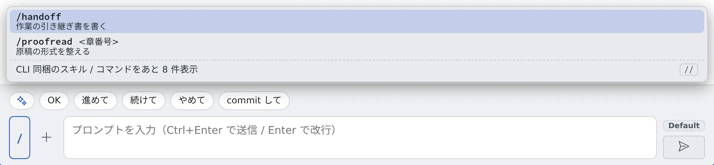

# スキルやコマンドを呼び出す

[English](skills.md) | 日本語

セッションの入力欄から、そのセッションで実際に呼べるスキルとコマンドを一覧で選べます。
名前を覚えていなくても、説明を見ながら入力欄に差し込めます。

## 全体像

| あなたがやること | エージェントがやること |
|---|---|
| 一覧からスキルやコマンドを選び、引数を書いて送る | ふつうのプロンプトと同じように受け取り、そのスキルやコマンドを実行する |
| 別のエージェント向けのスキルを選ぶ | 「そのファイルを読んで指示に従って」という文を受け取り、中身を読んで従う |

## 一覧を開く

入力欄の左のボタンを押すと、一覧が開きます。ボタンにはトリガー文字が出ています。

| エージェント | ボタン | 入力欄の先頭に打つ文字 |
|---|---|---|
| トリガー文字を持つもの | **`/`** または **`$`** | 同じ文字。日本語入力のままの全角「／」「＄」も受け付けます |
| トリガー文字を持たないもの | **✦** | なし（ボタンから開きます） |

- 各項目には、説明と引数のヒント、出所（**ユーザー** / **CLI** / **共有**）が付きます
- CLI に同梱のものは畳まれていて、「CLI 同梱のスキル / コマンドをあと N 件表示」で開きます
- どの種類がこの一覧を持つかは、[エージェント一覧](../../ref/agents.ja.md)の「スキル / コマンドのピッカー」の行にあります

## 選んで送る

選んでも、**入力欄に差し込まれるだけで、送信はされません。** 引数を書き足してから送ります。

| キー | 動き |
|---|---|
| **↑↓** | 選ぶ |
| **Enter**（または **Tab**） | 入力欄に差し込む |
| **Esc** | 一覧を閉じる |

## 別のエージェント向けのスキルを使う

リポジトリに置かれた、別のエージェント向けのスキルも一覧に混ざります。
選ぶと「‹ファイル› を読んで、そのスキルの指示に従って実行して。」という文が差し込まれます。
スキルの仕組みを持たないエージェントでも、中身を使えます。

## Agent Fleet が入れるスキル

claude・codex・opencode・muse のスキルフォルダには、`af-` で始まるスキルが入っています。これはワークスペースの方針の手順を、エージェントが必要な場面で読めるようにスキルにしたものです。エージェントが自分で判断して読むもので、あなたが一覧から呼び出すものではありません。

| スキル | エージェントが読む場面 |
|---|---|
| `af-environment` | ワークスペースの動き（停止や作り直しで残るもの、メモリの上限、入っていないツール）を確かめるとき |
| `af-worktrees` | ほかのセッションの作業コピーに触れるとき、依存関係を共有するとき |
| `af-build` | JVM や Node のビルドとテストを動かすとき、メモリ不足で止まったとき |
| `af-browser` | 画面を確かめる、スクリーンショットを撮る、ブラウザをあなたに渡すとき |
| `af-aws` | AWS のコマンドを、あなたのプロファイルで動かすとき |
| `af-gcp` | Google Cloud のコマンドを、あなたのプロファイルで動かすとき |
| `af-agent-fleet` | セッションの起動やメッセージ、引き継ぎ、MCP の追加などを扱うとき |

- 中身はワークスペースの方針と同じものです。方針は、⚙設定 →「エージェントへの指示」の「**方針を読む**」で読めます
- ワークスペースを起動したときと、エージェントへの指示を保存したときに書き直されます。編集しても元に戻るので、変えたい手順は[エージェントへの指示](../agents/instructions.ja.md)に書いてください
- あなたが書いたスキルには触れません。`af-` で始まる名前の自分のスキルも、そのまま残ります
- エージェントが自分で書くスキル（`afa-` で始まるもの）とは別のものです。下の節を見てください

## Agent がアーカイブしたスキルを戻す

エージェントが自分で書いたスキル（フォルダ名が `afa-` で始まるもの）は、30 日間だれも使わないと、Agent がアーカイブすることがあります。スキルの整理機能がオンのときだけ働き、あなたが書いたスキルには触れません。アーカイブしたスキルは、スキルフォルダの中の `.archive/` に移るだけで、消えはしません。

戻したいときは、どのセッションにでも「アーカイブされたスキルを一覧して」「afa-foo を戻して」と頼みます。セッションは `skill_restore` ツールを使います。

| 頼むこと | 起きること |
|---|---|
| 一覧 | アーカイブされたスキルごとに、名前・アーカイブされた日時・元のスキルフォルダが出ます |
| 戻す | 元の名前でスキルフォルダに戻り、「いま使われた」ことになります。次の整理ですぐにまたアーカイブされることはありません |

戻せるのはあなた自身のスキルフォルダだけです。同じ名前のスキルがすでにあると、何も変えずに断ります。先にそちらの名前を変えるか消してから、もう一度頼んでください。

## 困ったとき

### 一覧に何も出ない

「このセッションで使えるスキル / コマンドはありません」と出るときは、そのセッションから呼べるものがありません。
自分のスキルは **⚙設定 →「スキル」** で足せます。

### ボタンがない

その種類は一覧を持ちません。[エージェント一覧](../../ref/agents.ja.md)の「スキル / コマンドのピッカー」の行を確かめてください。

## 関連

- [セッションに返事をする](reply.ja.md)：入力欄の使い方
