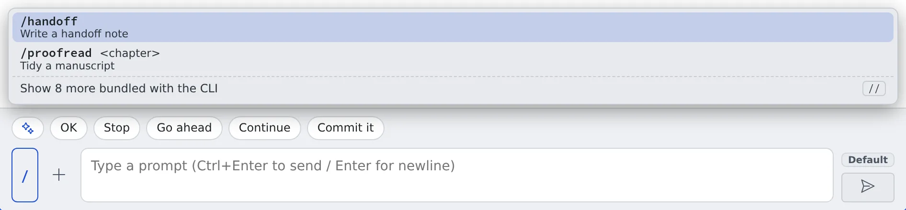

# Call a skill or a command

English | [日本語](skills.ja.md)

From a session's input box you can pick from the skills and commands that session can actually call.
You do not need to remember their names: insert one while reading its description.

## How it works

| What you do | What the agent does |
|---|---|
| Pick a skill or a command from the list, add arguments, send | Takes it like any prompt, and runs that skill or command |
| Pick a skill written for another agent | Gets "read that file and follow its instructions", reads it and follows it |

## Open the list

The button to the left of the input box opens the list. It shows the trigger character.

| Agent | Button | Typed at the head of the input box |
|---|---|---|
| One with a trigger character | **`/`** or **`$`** | The same character. The full-width `／` and `＄` a Japanese IME produces are accepted too |
| One without | **✦** | None (open it from the button) |

- Each entry carries its description, an argument hint, and where it came from: **user**, **CLI** or **shared**
- The ones bundled with the CLI are folded away; "Show N more bundled with the CLI" opens them
- Which kinds offer the list is in the "Skill / command picker" row of the [Agents reference](../../ref/agents.md)

## Pick one and send it

Picking one **only inserts it into the input box; nothing is sent.** Add the arguments, then send.

| Key | What it does |
|---|---|
| **↑↓** | Move |
| **Enter** (or **Tab**) | Insert into the input box |
| **Esc** | Close the list |

## Use a skill written for another agent

Skills written for another agent and left in the repository are listed too.
Picking one inserts "Read ‹file› and follow that skill's instructions.",
so even an agent with no skill mechanism of its own can use the content.

## Skills Agent Fleet puts in

The skills folders of claude, codex, opencode and muse hold skills whose names start with `af-`. They are the procedures of the workspace policy, turned into skills so that an agent can read the right one when it needs it. The agent reads them on its own judgement; they are not something you call from the list.

| Skill | When the agent reads it |
|---|---|
| `af-environment` | Checking how the workspace behaves (what survives a stop or a recreate, the memory limit, tools that are not installed) |
| `af-worktrees` | Touching another session's working copy, or sharing dependencies |
| `af-build` | Running a JVM or Node build or test suite, or after one ran out of memory |
| `af-browser` | Checking a screen, taking a screenshot, or handing a browser to you |
| `af-aws` | Running an AWS command as your profile |
| `af-gcp` | Running a Google Cloud command as your profile |
| `af-agent-fleet` | Starting sessions, sending messages, handing off, adding MCP servers and similar |

- Their content is the workspace policy itself. Read the policy under ⚙ Settings → "Agent instructions" → **"Read the policy"**
- They are rewritten when the workspace starts and when you save your agent instructions. An edit is undone, so put the way you want things done in [your agent instructions](../agents/instructions.md)
- Your own skills are left alone, including your own skills whose names start with `af-`
- They are not the skills an agent writes itself (names starting with `afa-`); see the next section

## Bring back a skill the Agent archived

Skills an agent wrote itself (folder names starting with `afa-`) can be archived by the Agent when nobody has used them for 30 days. This only happens when the skill curator is switched on, and it never touches skills you wrote. An archived skill is moved to `.archive/` inside the skills folder; nothing is deleted.

To get one back, ask any session: "list the archived skills" and then "restore afa-foo". The session uses the `skill_restore` tool:

| You ask | What happens |
|---|---|
| List | Each archived skill is shown with its name, when it was archived and the skills folder it came from |
| Restore | The skill moves back under its old name and counts as just used, so the next pass does not archive it again at once |

Restore only touches your own skills folders. It refuses, and changes nothing, when a skill with the same name already exists: rename or remove that one first, then ask again.

## When it goes wrong

### The list is empty

"No skills/commands for this session" means nothing can be called from that session.
Add your own skills in **⚙ Settings → "Skills"**.

### There is no button

That kind does not offer the list. Check the "Skill / command picker" row of the [Agents reference](../../ref/agents.md).

## Related

- [Reply to a session](reply.md): using the input box
